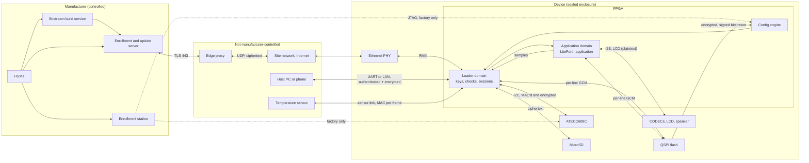

# FDA Security Architecture Views

This document presents `thriller` in the form of the security architecture views described in FDA's guidance
*Cybersecurity in Medical Devices: Quality Management System Considerations and Content of Premarket Submissions*
(Section V.B.2, with the level of detail from Appendix 2 and the control categories from Appendix 1).

## Scope

`thriller` is a root-of-trust platform for a recording device, not a finished medical device. A device manufacturer that builds on it submits the views for the whole device.
This document supplies the platform's part of each view so it can be carried into that submission. Where a view depends on the device (its clinical functions, its host software,
its network), this document marks what the integrator must add.

| View | Section here |
|---|---|
| Global System View | [1](#1-global-system-view) |
| Multi-Patient Harm View | [2](#2-multi-patient-harm-view) |
| Updateability/Patchability View | [3](#3-updateabilitypatchability-view) |
| Security Use Case Views | [4](#4-security-use-case-views) |

Section 5 maps the design to the guidance's security control categories, and section 6 lists the gaps a submission would have to close.
Terms are defined in the README and `doc/arch.md`. Risk IDs (R1–R46) refer to the Risk Assessment in `doc/arch.md`. Roles are defined in `doc/roles.md`.

## 1. Global System View

### Elements

| Element | Description | Trust |
|---|---|---|
| FPGA configuration engine | Vendor silicon (Pango Logos2). Checks the RSA-2048 signature and decrypts and authenticates the bitstream with its per-device AES-256-GCM eFuse key; refuses anything else; multi-boot fallback | Trusted, fixed; DPA-protected (R25) |
| Boot ROM | Block RAM in the bitstream. Pairs with the secure element, checks the loader image, UART recovery | Trusted; part of the signed bitstream |
| Loader core domain | LiteForth loader core and the security hardware: key registers, SHA-256 core, masked Ascon core, XIP engine, recording engine, I2C to the secure element, card, UART, sensor link, Ethernet transport | Trusted; holds every key path and security decision |
| Application core domain | LiteForth application core, I2S acquisition, LCD; runs from its flash slot | Signed by the application owner, or a device-bound developer build; no path to any key |
| ATECC608C secure element | Keys, counters, identity, host CheckMac, attestation signatures | Trusted; certified tamper-resistant; counters unauthenticated (R36) |
| QSPI flash | Bitstreams, loader and application images, boot record, records | Untrusted storage; everything authenticated |
| CODECs, LCD, speaker | Acquisition, display, alarms; plaintext inside the sealed enclosure | Physically protected only (R38) |
| MicroSD card | Recordings (encrypted to the host), user data, logs, offline packages | Untrusted storage |
| PSRAM stream buffer | Ring buffer of encrypted recording blocks between the recording engine and the card or network | Untrusted; ciphertext only (R48) |
| Ethernet PHY | 10/100 RMII PHY (LAN8742A class) and magnetics; held in reset unless the network policy enables it | Untrusted transport; the FPGA's hardware UDP transport sits behind it (R23) |
| Edge proxy (where needed) | Software or a small appliance on the site LAN that relays the device's UDP datagrams to the server over TLS 443 | Untrusted; carries only ciphertext (R29, R39) |
| Temperature sensor | Replaceable, outside the box; certificate from its manufacturer, paired to the device | Trusted for its readings once authenticated |
| Host PC | Data and CLI sessions over the UART or the LAN; decrypts recordings; relays to the server when the network is unavailable | Trusted by its user; authenticated by the secure element |
| Site network and Internet | Updates, recording uploads, server contact, sensor-pairing confirmation | Untrusted |
| Enrollment and update server | Records devices, sensors and pairings; detects unknown identities; serves updates built for each device's state | Manufacturer-controlled |
| Bitstream build service | Builds and encrypts each device's bitstream | Manufacturer-controlled; handles per-device keys (R42) |
| HSMs | Masters, LMS keys, the bitstream signing key, the device CA, sensor CA keys, the distribution key | Manufacturer-controlled, highest trust |
| Factory enrollment station | Provisions the secure element, programs the FPGA key and disables its JTAG, programs the flash, records the device | Manufacturer-controlled |

### Diagram

### Interfaces

| Interface | Between | What crosses it | Protection |
|---|---|---|---|
| QSPI (configuration) | Flash → configuration engine | The device's bitstream | Encrypted and authenticated under the FPGA's per-device eFuse key, RSA-signed; nothing else accepted; a bitstream without the current pairing key gets nothing from the secure element (R17, R31, R32, R44) |
| QSPI (XIP) | Flash ↔ both cores | Loader and application lines, headers, boot record, records | Per-line Ascon-AEAD128 under per-install keys; HMAC under the application key on headers and records (R2, R6, R34, R35) |
| I2C (secure element) | Loader domain ↔ ATECC608C | Nonces, MACs, encrypted key reads, counter reads, CheckMac, KDF output, signatures | Every read MAC'd or encrypted under the pairing key over a fresh nonce; counters unauthenticated; bus inside the seal (R36) |
| Mailbox and sample FIFO | Application domain → loader domain | Service requests, terminal bytes, samples | Fixed message set, fuzzed parser, one-way sample path (R45) |
| I2S, LCD | Application domain ↔ CODECs and LCD | Samples, waveforms | Inside the sealed enclosure only (R38, R40) |
| MicroSD | Loader domain ↔ card | Recordings, user data, logs, packages | All encrypted and authenticated (R1, R10, R26, R41) |
| QSPI (PSRAM) | Recording engine → PSRAM → card and network | Authenticated recording ciphertext in transit | Holds nothing else; damage is detected at the host (R48) |
| UART | Host ↔ loader domain | Status; sessions, packages, CLI | Status read-only (R30); sessions authenticated through the secure element, Ascon-AEAD128 frames (R9) |
| Ethernet (RMII) | Loader domain ↔ PHY ↔ site network | UDP datagrams carrying session frames: packages, recording ciphertext, server exchanges, DHCP | Hardware transport that drops everything but ARP, ICMP echo and UDP to one port; every payload is an authenticated, encrypted session frame; PHY reset driven by the network policy (R23, R28, R29, R39) |
| Sensor link | Sensor ↔ loader domain | Pairing, readings, commands | Certificates, ML-KEM pairing, per-frame MACs, maximum reading age (R11–R14) |
| JTAG | Factory ↔ FPGA | Key programming, boundary scan | Permanently disabled at enrollment on the Logos2 (R7, R43) |

**Integrator adds:** the host software and its environment, recording storage and review systems, the clinical interfaces and safe states, the edge proxy deployment, and any additional data flows.

## 2. Multi-Patient Harm View

Any compromise that scales from one unit or one sensor to the fleet.

### Fleet-wide assets

| Asset | If compromised | Protection |
|---|---|---|
| Bitstream signing key | Bitstreams that configure every FPGA | HSM; a forged bitstream still needs each device's encryption key and pairing key (R24) |
| Platform LMS keys | Platform packages accepted by every device | HSM; main and backup keys in the boot ROM; packages are per device anyway, so a stolen key alone installs nothing fleet-wide (R27) |
| Application LMS keys | Application packages accepted by every device | HSM; main and backup hashes in never-writable secure element slots (R27) |
| Device CA | Forged device certificates | HSM; the server relies on the symmetric identity, not the certificate |
| Sensor CA keys | Counterfeit sensors that pair everywhere | HSM; main and backup; server-side detection of unknown serials (R14) |
| Master keys | Any device's keys and any host's data secret | HSM, dual control, separate masters per purpose (R19) |
| Bitstream build service | Per-device keys of every device it builds for | Keys per job from the HSM, erased after; isolated and audited (R42) |
| Distribution key | Application package contents readable (not forgeable) | Accepted in the base model; Code Secrecy Profile (R18) |
| Configuration engine bug | Possible bypass on every FPGA of the family | Cannot be patched; followed through the vendor's advisories (R25) |

### Single-unit compromise stays single-unit

Every key on a device is unique to it, derived from its secure element's serial number, and its pairing key changes with every bitstream release. A lab attack on one FPGA (R5, R33),
one secure element (R46) or one sensor (R15) yields keys that work nowhere else. Past recordings cannot be decrypted on the device at all, and the host data secret is never stored on it.
Cloned sensors and cloned secure elements are detected by the server.

## 3. Updateability/Patchability View

| Component | How | Rollback protection |
|---|---|---|
| LiteForth application | Loader re-encrypts it per line into the inactive slot; confirmed after its header and lines check | Counter 1 |
| Loader | Platform package, A/B loader slots | Counter 0 |
| Bitstream, including the boot ROM | Platform package built for this device, A/B bitstream slots, the family's multi-boot | Counter 0 and the pairing-key ratchet |
| Secure element slot contents | Slot 0 by the ratchet; slots 11 and 13 by the loader; everything else fixed | — |
| Sensor denylist, CA keys | Inside update packages, and online | With the package |
| Sensor firmware | Integrator's choice (open question S6) | — |
| FPGA configuration engine, secure element firmware | Cannot be updated | — |

### End-to-end path

1. The manufacturer builds per-device platform packages from each device's reported state; the application owner signs application packages.
2. Packages reach the device over the network, through the host, or on a card.
3. The loader checks the LMS signature, the inclusion proof and the version before decrypting anything, then installs into the inactive slot.
4. The new component is confirmed after its checks, or the previous one stays in use. A new bitstream completes its ratchet only after its loader has booted.

Out-of-cycle patches use the same path. Devices that are rarely online still accept updates from cards or hosts, and the server reports which units are behind.

## 4. Security Use Case Views

### 4.1 Power-on and boot

Configuration engine checks and decrypts the bitstream → boot ROM pairs with the secure element and checks the loader against counter 0 → loader checks the application against counter 1
and releases the application core → every cache line is checked as fetched. Any failure falls back to another slot, or stops in a safe state with a boot record entry.

### 4.2 Recording

The loader draws a segment key, encapsulates it with ML-KEM to the host, and loads it into the recording engine; the application feeds samples; ciphertext goes to the card or over the network.
At the end of the segment the key is erased. The host decrypts and checks block and segment order (`doc/acquisition.md`).

### 4.3 Host session and user data

The host answers the secure element's challenge; the secure element releases the data key and derives the session key. User data needs the host's data secret, sent each session;
slot 11 detects a restored card (R10).

### 4.4 Updates

As section 3. A failed signature or version check refuses the package before any flash write and logs the attempt.

### 4.5 Sensor replacement and readings

A new sensor's certificate is checked, a pairing key is agreed with ML-KEM, and the pairing is logged and later confirmed by the server. Readings are requested by the loader,
authenticated per frame, aged, and passed to the application through the mailbox; late or invalid readings lead to the safe state (`doc/sensor.md`).

### 4.6 Manufacturing and enrollment

Provision the secure element, program the FPGA key and locks, build and program the device's bitstream and images, first boot and ratchet, attestation check, disable JTAG, record, close enrollment (`doc/enrollment.md`).

### 4.7 Attestation

A verifier sends a nonce; the loader builds a report of what it measured; the secure element signs it (ECDSA for hosts, MAC for the server). Only a bitstream holding the current pairing key can obtain a signature (`doc/se.md`).

### 4.8 Network exposure

The device presents no software to the network: a hardware UDP transport, one authenticated session protocol, outbound flows only, and an air-gap option.
A network attacker can deny service and see ciphertext, nothing else. The statement written for IT departments and this submission is `doc/network.md`.

### 4.9 Decommissioning

The server marks the device retired and the loader writes the retired state into slot 13; an authorized wipe erases the records region and the card. Recordings stay readable only by their host.

## 5. Security Control Categories (Appendix 1)

| Category | How `thriller` addresses it | Gaps |
|---|---|---|
| Authentication | Vendor bitstream authentication; LMS on every package; per-line tags on both images; the secure element releases keys only to the holder of the pairing key; the host authenticates to the secure element; sensor certificates and per-frame MACs; device identity proven to the server and attested to hosts | No device certificate for the sensor to check |
| Authorization | Loader services only, through the mailbox; keys with no CPU read path; user data only with the host's secret; developer builds bound to one device and epoch; network policy set by the application owner and enforced on the PHY's reset | Session timeouts to be set |
| Cryptography | NIST algorithms: Ascon-AEAD128 (SP 800-232) in a first-order masked core; SHA-256, HMAC and the SP 800-108 KDF in a masked SHA-256 core; LMS, ML-KEM, ML-DSA on the loader core; ECDSA only in the secure element; per-device keys | The SHA-256 core's side-channel resistance to be tested (R33); vendor bitstream signature not quantum-safe (R24) |
| Code, data and execution integrity | Bitstream authentication every power-up; headers and versions against secure element counters; per-line authentication on every fetch; two-core isolation; the ratchet | — |
| Confidentiality | Recordings encrypted to the host inside the FPGA; bitstream, flash, card, sessions encrypted | Plaintext on I2S and the LCD inside the sealed enclosure (R38) |
| Event detection and logging | HMAC-chained event log under the log key, written to the card, read by the host and uploaded to the server; lockdown records in the boot record | Event list to be completed |
| Resiliency and recovery | A/B slots for every image, multi-boot for the bitstream; UART recovery for the loader; safe state on sensor loss | Behavior under denial of service on the UART and the network port to be defined |
| Firmware and software updates | Signed, encrypted, interruption-safe updates for the platform and the application, online and offline | Per-device platform packages must be built from each device's reported state; sensor firmware updates not yet designed |

## 6. Gaps for a submission

1. **Event list** for the log, and how the host displays it.
2. **Clinical parameters:** maximum reading age, behavior during an unconfirmed pairing, the safe state.
3. **Fault-injection and side-channel evidence** on the FPGA and the sensor (`doc/test.md`).
4. **Sensor firmware update** path.
5. **Decommissioning procedure** in detail.
6. **SBOM:** LiteForth and the FPGA's RTL, the ML-KEM, ML-DSA and LMS code, cryptoauthlib's message formats, Pango Design Suite (Efinity for the Ti60 fallback), the edge proxy software,
   the sensor firmware, with support status and end-of-support dates. The FPGA vendor's and Microchip's advisories feed vulnerability monitoring.
7. **Testing evidence:** security requirements, threat mitigation and vulnerability testing as planned in `doc/test.md`; independent penetration testing to be arranged.
8. **Risk scoring:** the Risk Assessment rates likelihood; FDA asks for an exploitability-based, non-probabilistic approach with scores before and after mitigation.
9. **Network:** the clinical function must not depend on the network; a lost link affects uploads, updates and pairing confirmation only. The Ethernet port adds a mains-earth-referenced path,
   so the patient-applied parts' isolation must be shown on the acquisition side (IEC 60601-1), an electrical-safety item rather than a cybersecurity one.

## Source

U.S. Food and Drug Administration, *Cybersecurity in Medical Devices: Quality Management System Considerations and Content of Premarket Submissions*, guidance for industry and FDA staff,
https://www.fda.gov/media/119933/download. The views follow the version issued February 3, 2026. Appendix 1 and Appendix 2 content was taken from the September 27, 2023 version,
which has the same appendix structure; confirm against the current version before submission.
