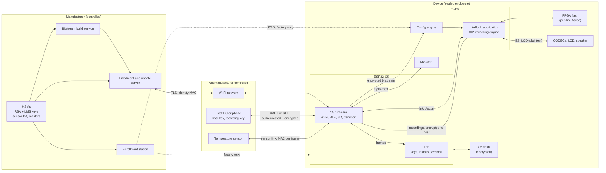

# FDA Security Architecture Views

This document presents `thriller` in the form of the security architecture views described in FDA's guidance
*Cybersecurity in Medical Devices: Quality Management System Considerations and Content of Premarket Submissions*
(Section V.B.2, with the level of detail from Appendix 2 and the control categories from Appendix 1).

## Scope

`thriller` is a root-of-trust platform for a recording device, not a finished medical device. A device manufacturer that builds on it
submits the views for the whole device. This document supplies the platform's part of each view so it can be
carried into that submission. Where a view depends on the device (its clinical functions, its host software,
its network), this document marks what the integrator must add.

The guidance asks for at least four views:

| View | Section here |
|---|---|
| Global System View | [1](#1-global-system-view) |
| Multi-Patient Harm View | [2](#2-multi-patient-harm-view) |
| Updateability/Patchability View | [3](#3-updateabilitypatchability-view) |
| Security Use Case Views | [4](#4-security-use-case-views) |

Section 5 maps the design to the guidance's security control categories, and section 6 lists the gaps a submission would have to close.

Terms are defined in the README and `doc/arch.md`. Risk IDs (R1–R43) refer to the Risk Assessment in `doc/arch.md`.
Roles (manufacturer, application owner, developer, user) are defined in `doc/roles.md`.

## 1. Global System View

### Elements

| Element | Description | Trust |
|---|---|---|
| ESP32-C5 boot ROM | Espressif silicon. Verifies the bootloader against eFuse key digests | Trusted, fixed, cannot be patched (R25) |
| C5 bootloader | Verifies the TEE and C5 firmware, enforces anti-rollback, falls back between slots; recovery bootloader as fallback | Trusted; signed |
| C5 TEE | ESP-TEE in machine mode. Holds the C5's keys; checks and installs every package; keeps version records; runs host, CLI, sensor and FPGA link sessions; issues recording segment keys | Trusted; signed |
| C5 firmware | User mode. Wi-Fi, BLE, UART, MicroSD, FPGA configuration and transport, sensor I/O. Handles only ciphertext and authenticated frames | Untrusted by the TEE; signed |
| ECP5 configuration engine | Lattice silicon. Decrypts the bitstream with its per-device eFuse key; decrypt-only, so no unencrypted configuration | Trusted, fixed; no bitstream authentication (R32) |
| ECP5 fabric (LFE5U-25F) | LiteForth CPU running the application; XIP engine; link and recording engines; I2S, LCD | Trusted for the application and recordings; keys with no CPU read path |
| LiteForth application | Device function, signal processing, display; runs from the FPGA's flash | Signed by the application owner, or a device-bound developer build |
| C5 QSPI flash, PSRAM | C5 images, bitstreams, TEE storage | Untrusted storage, encrypted by the C5 |
| FPGA QSPI flash | Application images, encrypted and authenticated per cache line | Untrusted storage |
| CODECs, LCD, speaker | Acquisition, display, alarms; plaintext inside the sealed enclosure | Physically protected only (R38) |
| MicroSD card | Recordings (encrypted to the host), user data, logs, offline packages | Untrusted storage |
| Temperature sensor | Replaceable, outside the box; certificate from its manufacturer, paired to the device | Trusted for its readings once authenticated |
| Host PC or phone | Data and CLI sessions over the UART or BLE; decrypts recordings; relays to the server | Trusted by its user; authenticated by the TEE |
| Wi-Fi network | Over-the-air updates, recording uploads, server contact, if the application owner enables Wi-Fi | Untrusted |
| Enrollment and update server | Records devices, sensors and pairings; detects unknown identities; serves updates | Manufacturer-controlled |
| Bitstream build service | Builds and encrypts each device's bitstream | Manufacturer-controlled; handles per-device keys (R42) |
| HSMs | Release RSA keys, LMS keys, sensor CA keys, master keys, distribution key | Manufacturer-controlled, highest trust |
| Factory enrollment station | Programs both chips, burns the device root key, programs the ECP5 key, records the device | Manufacturer-controlled |

### Diagram

### Interfaces

| Interface | Between | What crosses it | Protection |
|---|---|---|---|
| C5 QSPI | C5 ↔ its flash | C5 images, bitstreams, TEE storage | XTS-AES flash encryption with an on-chip key; RSA-signed images checked at boot; bitstreams also ECP5-encrypted (R2, R6) |
| ECP5 configuration (SPI2) | C5 firmware → ECP5 | The device's bitstream | Encrypted under the ECP5's per-device eFuse key; decrypt-only; a bitstream without this device's link key fails the handshake (R17, R31, R32) |
| C5–FPGA link (SPI2) | TEE ↔ FPGA fabric, through the C5 firmware | Boot image messages, install lines, segment keys, sensor readings, commands | Mutual authentication under the per-device link key with nonces from both sides; Ascon-AEAD128 frames (R36) |
| Recording stream (PARLIO) | FPGA → C5 firmware | Recording ciphertext | Encrypted to the host by the FPGA (R39, R41) |
| FPGA QSPI | FPGA ↔ its flash | Application lines | Per-line Ascon-AEAD128, per-install key, address in the nonce (R34, R35) |
| I2S, LCD | FPGA ↔ CODECs and LCD | Samples, waveforms | Inside the sealed enclosure only (R38, R40) |
| MicroSD (SPI2) | C5 firmware ↔ card | Recordings, user data, logs, packages | All encrypted and authenticated (R1, R26, R41) |
| UART | Host ↔ TEE, through the C5 firmware | Status; fallback sessions, packages, CLI | Status read-only (R30); sessions as for BLE |
| BLE serial service | Host or phone ↔ TEE, through the C5 firmware | CLI and host sessions, packages | Mutual authentication, Ascon-AEAD128, attempt limits; advertising only after a user action (R9, R28) |
| Wi-Fi | C5 firmware ↔ server | Packages, recording uploads, logs, pairing confirmations | Outbound TLS; server authenticated under the identity key; everything inside already protected (R23, R29) |
| Sensor link | Sensor ↔ TEE, through the C5 firmware | Pairing, readings, commands | Certificates, ML-KEM pairing, per-frame MACs, maximum reading age (R11–R14) |
| JTAG and download mode | Factory ↔ C5 and ECP5 | Initial programming, ECP5 key | C5: disabled by eFuse; ECP5: decrypt-only eFuse, key in eFuse, readback disabled, boundary scan still available, connector not populated (R7, R17, R43) |

**Integrator adds:** the host software and its environment, recording storage and review systems, the clinical interfaces and safe states, and any additional data flows.

## 2. Multi-Patient Harm View

The guidance asks how the system defends against attacks that could affect many patients at once.
For `thriller`, that means any compromise that scales from one unit or one sensor to the fleet.

### Fleet-wide assets

| Asset | If compromised | Protection |
|---|---|---|
| Release RSA keys | C5 images that boot on every device | HSM; main and backup digests in eFuse, each revocable (R27). A forgery also needs physical flash access, since updates need LMS too |
| LMS package keys | Packages accepted by every device | HSM; main and backup keys; replaceable by a TEE update signed with the other (R27) |
| Sensor CA keys | Counterfeit sensors that pair everywhere | HSM; main and backup; server-side detection of unknown serials (R14) |
| Master keys (device, ECP5, host data) | Any device's keys and any host's data secret | HSM, dual control, separate masters per purpose (R19) |
| Bitstream build service | Per-device keys of every device it builds for | Keys per job from the HSM, erased after; isolated and audited (R42) |
| Distribution key | Application package contents readable (not forgeable) | Accepted in the base model; Code Secrecy Profile (R18) |
| Boot ROM bug | Possible bypass on every C5 | Cannot be patched; followed through Espressif advisories (R25) |

### Single-unit compromise stays single-unit

Every key on a device is unique to it: the C5's flash and TEE storage keys are generated on chip, and the root key, ECP5 key and FPGA keys are derived per chip ID.
A lab attack on one C5 (R5), one ECP5 (R33) or one sensor (R15) yields keys that work nowhere else. Past recordings cannot be decrypted on the device at all,
and the host data secret is never stored on it. Cloned sensors are detected by the server and denylisted fleet-wide.

## 3. Updateability/Patchability View

### What can be updated

| Component | How | Rollback protection |
|---|---|---|
| LiteForth application | TEE re-encrypts it per line into the FPGA's flash, A/B slots; confirmed after the FPGA's self-test | TEE version record and install salt (R34) |
| FPGA bitstream | Per-device package into the C5's bitstream slots, A/B; the C5 falls back to the other slot if the link or self-test fails | TEE version record; the link handshake reports the version |
| C5 firmware | A/B slots; confirmed after a self-test | TEE version record; 6 eFuse steps for security releases |
| TEE | A/B slots (ESP-TEE OTA) | TEE version record; 3 eFuse steps |
| C5 bootloader | Rewritten in place, with the ROM's recovery bootloader as fallback | 4 eFuse steps |
| Sensor denylist, CA keys | Inside update packages, and online | With the package |
| Sensor firmware | Integrator's choice (open question) | — |
| C5 boot ROM, ECP5 configuration engine | Cannot be updated | — |

### End-to-end path

1. The manufacturer builds and signs C5 platform packages and per-device bitstream packages; the application owner signs application packages (`doc/roles.md`).
2. Application packages are encrypted under the distribution key; bitstreams are already encrypted under each device's ECP5 key.
3. Packages reach the device over Wi-Fi, through the host, or on a card.
4. The TEE checks the LMS signature and version before decrypting anything, then installs into the inactive slot.
5. The new component is confirmed after its self-test, or the previous one stays in use.

Out-of-cycle patches use the same path, including fixes to the radio stacks. Devices that are rarely online still accept updates from cards or hosts, and the server reports which units are behind.

## 4. Security Use Case Views

### 4.1 Power-on and boot

ROM checks the bootloader → bootloader checks the TEE and C5 firmware → C5 firmware configures the ECP5 with its encrypted bitstream → link handshake proves the per-device keys
and reports the bitstream version → TEE sends the boot image message → the FPGA runs the application, checking every cache line. Any failure falls back to another slot, or stops in a safe state with a log entry.

### 4.2 Recording

The TEE draws a segment key, encapsulates it with ML-KEM to the host, and sends it to the FPGA. The FPGA encrypts the stream
and passes ciphertext to the C5, which writes it to the card or uploads it. At the end of the segment both erase the key. The host decrypts and checks block and segment order (`doc/acquisition.md`).

### 4.3 Host session and user data

The host and TEE authenticate each other with the host key over fresh nonces and exchange encrypted, authenticated frames. User data other than recordings needs the host's data secret,
sent each session; an authenticated digest of the data state detects a restored card (R10).

### 4.4 Updates

As section 3. A failed signature or version check refuses the package before any flash write and logs the attempt.

### 4.5 Sensor replacement and readings

A new sensor's certificate is checked, a pairing key is agreed with ML-KEM, and the pairing is logged and later confirmed by the server. Readings are requested by the TEE,
authenticated per frame, aged, and passed to the application over the link; late or invalid readings lead to the safe state (`doc/sensor.md`).

### 4.6 Manufacturing and enrollment

Program the C5, lock its eFuses, burn the device root key, program the ECP5 key, build and install the device's bitstream, install the application, check the link handshake,
record, close enrollment (`doc/enrollment.md`).

### 4.7 Decommissioning

The server marks the device retired; an authorized wipe erases TEE storage and the card. Recordings stay readable only by their host; other user data stays unreadable without the host data secret.

## 5. Security Control Categories (Appendix 1)

| Category | How `thriller` addresses it | Gaps |
|---|---|---|
| Authentication | Secure boot (RSA-3072); LMS on every package; per-line tags on the application; mutual C5–FPGA link authentication; mutual host authentication; sensor certificates and per-frame MACs; device identity proven to the server | ECP5 bitstreams are not authenticated by the ECP5 (R32); no device certificate for the sensor to check |
| Authorization | TEE services only; keys with no CPU read path in the FPGA; user data only with the host's secret; developer builds bound to one device and epoch; radio policy set by the application owner | Session timeouts to be set |
| Cryptography | NIST algorithms: Ascon (SP 800-232) for all symmetric protocols; SHA-256 and HMAC for the C5's root derivation; LMS, ML-KEM, ML-DSA; per-device keys | C5 boot root is RSA-3072 (R24); the FPGA vendor's bitstream encryption (AES-128 without a MAC on the ECP5); 128-bit symmetric keys (post-quantum category 1) |
| Code, data and execution integrity | Secure boot every boot; per-line authentication of the application on every fetch; TEE isolation; anti-rollback | No integrity check of C5 flash reads after boot (R6) |
| Confidentiality | Recordings encrypted to the host inside the FPGA; flash, PSRAM, card, link and sessions encrypted | Plaintext on I2S and the LCD inside the sealed enclosure (R38) |
| Event detection and logging | MAC-chained (Ascon) event log in the TEE, copied to the card, read by the host and uploaded to the server | Event list to be completed |
| Resiliency and recovery | A/B slots for every component; recovery bootloader; safe state on sensor loss; UART fallback | Behavior under denial of service on the UART, BLE and Wi-Fi to be defined |
| Firmware and software updates | Signed, encrypted, interruption-safe updates for the C5, the bitstream and the application, online and offline | Per-device bitstream packages must be prepared for each device; sensor firmware updates not yet designed |

## 6. Gaps for a submission

1. **Event list** for the log, and how the host displays it.
2. **Clinical parameters:** maximum reading age, behavior during an unconfirmed pairing, the safe state.
3. **Fault-injection and side-channel evidence** on the C5, the ECP5 and the sensor (`doc/test.md`).
4. **Sensor firmware update** path.
5. **Decommissioning procedure** in detail.
6. **SBOM:** ESP-IDF and ESP-TEE versions, Mbed TLS, the ML-KEM, ML-DSA and Ascon libraries, LiteForth and the FPGA's RTL, Lattice Diamond (production bitstreams), Yosys and nextpnr (development),
   the sensor firmware, with support status and end-of-support dates. Espressif's and Lattice's advisories feed vulnerability monitoring.
7. **Testing evidence:** security requirements, threat mitigation and vulnerability testing as planned in `doc/test.md`; independent penetration testing to be arranged.
8. **Risk scoring:** the Risk Assessment rates likelihood; FDA asks for an exploitability-based, non-probabilistic approach with scores before and after mitigation.
9. **Wireless:** FDA's guidance on radio frequency wireless technology in medical devices also applies: coexistence testing, wireless quality of service, and the risk of a lost link.
    The clinical function must not depend on Wi-Fi or BLE.

## Source

U.S. Food and Drug Administration, *Cybersecurity in Medical Devices: Quality Management System Considerations
and Content of Premarket Submissions*, guidance for industry and FDA staff, https://www.fda.gov/media/119933/download.
The views follow the version issued February 3, 2026. Appendix 1 and Appendix 2 content was taken from the
September 27, 2023 version, which has the same appendix structure; confirm against the current version before submission.
