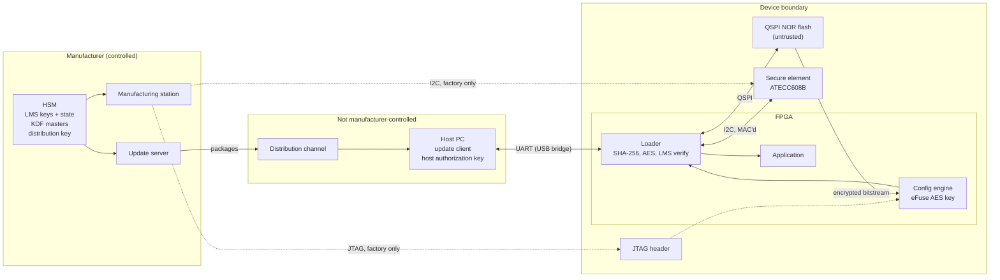
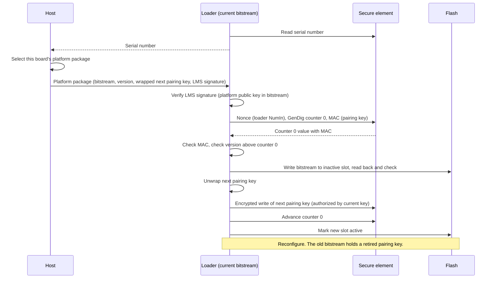
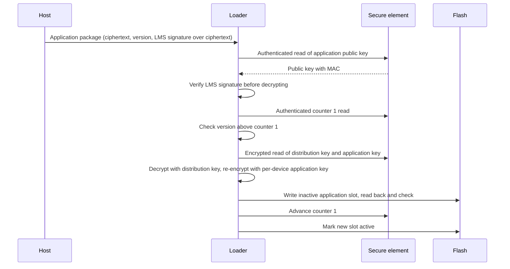
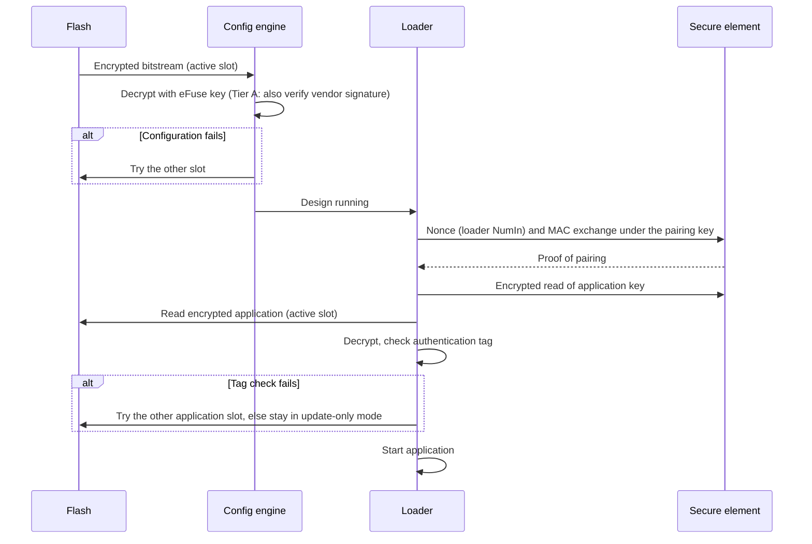
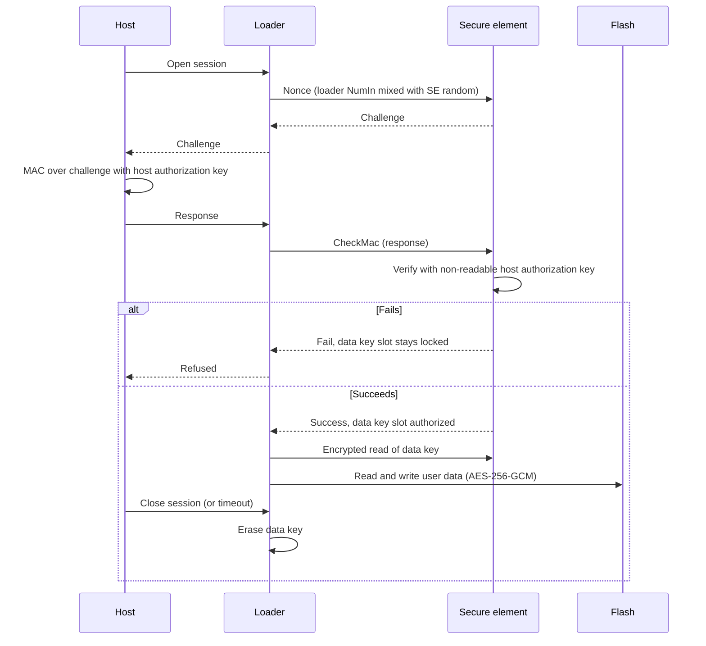
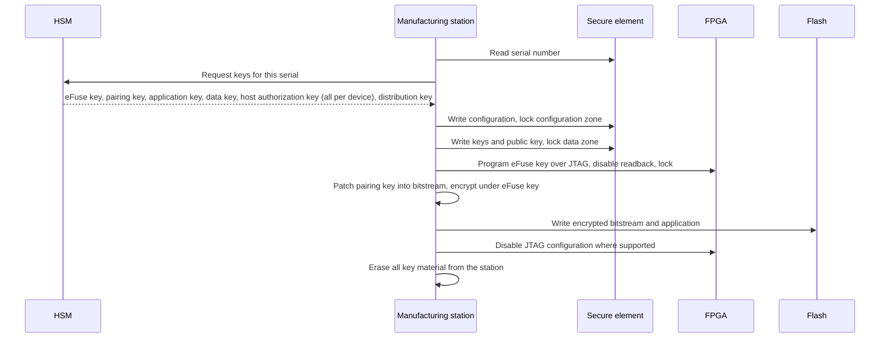

# FDA Security Architecture Views

This document presents `thriller` in the form of the security architecture views described in FDA's guidance
*Cybersecurity in Medical Devices: Quality Management System Considerations and Content of Premarket Submissions*
(Section V.B.2, with the level of detail from Appendix 2 and the control categories from Appendix 1).

## Scope

`thriller` is a root-of-trust platform, not a finished medical device. A device manufacturer that builds on it
submits the views for the whole device. This document supplies the platform's part of each view so it can be
carried into that submission. Where a view depends on the device (its clinical functions, its host software,
its network), this document marks what the integrator must add.

The guidance asks for at least four views:

| View | Section here |
|---|---|
| Global System View | [1](#1-global-system-view) |
| Multi-Patient Harm View | [2](#2-multi-patient-harm-view) |
| Updateability/Patchability View | [3](#3-updateabilitypatchability-view) |
| Security Use Case Views | [4](#4-security-use-case-views) |

Section 5 maps the design to the guidance's security control categories, and section 6 lists the gaps a submission would have to close.

Terms (loader, Tier A/B, pairing key, data key, distribution key) are defined in the README and `doc/arch.md`.
Risk IDs (R1–R22) refer to the Risk Assessment in `doc/arch.md`.

## 1. Global System View

### Elements

| Element | Description | Trust |
|---|---|---|
| FPGA configuration engine | Vendor silicon. Decrypts (and on Tier A, authenticates) the bitstream using eFuse keys | Trusted, fixed |
| Loader | `thriller` logic in the bitstream: soft CPU or state machine, SHA-256 and AES cores, I2C, QSPI and UART interfaces | Trusted while the bitstream is genuine |
| Application | Device-specific code, run by the loader after decryption and tag check | Trusted after LMS verification at install and tag check at boot |
| Secure element (ATECC608B) | Monotonic counters, key storage, host authorization (CheckMac), TRNG | Trusted, fixed |
| QSPI NOR flash | Encrypted bitstreams (A/B), encrypted application (A/B), encrypted user data | Untrusted storage |
| Host PC | Runs the update client and opens data sessions. Holds the host authorization key | Trusted by the user; authenticated by the secure element |
| Update server | Builds per-board platform packages and fleet-wide application packages | Manufacturer-controlled |
| HSM | Holds LMS signing keys (with state), KDF master keys, the distribution key | Manufacturer-controlled, highest trust |
| Manufacturing station | Programs eFuse keys, provisions and locks the secure element, writes flash | Manufacturer-controlled |
| Distribution channel | Delivers update files to the host (download, email, removable media) | Not manufacturer-controlled |

### Diagram

### Interfaces

| Interface | Between | Protocol | What crosses it | Protection |
|---|---|---|---|---|
| Configuration | Flash → config engine | Vendor SPI configuration | Bitstream | AES under a per-board eFuse key; Tier A adds the vendor signature |
| I2C | Loader ↔ secure element | ATECC command packets, CRC-16 | Counters, key reads, host authorization | Responses MAC'd under the pairing key over a loader nonce; keys read encrypted (EncRead). CRC is for transport only |
| QSPI | Loader ↔ flash | SPI NOR commands | Bitstreams, application, user data | Everything at rest is encrypted and authenticated (AES-256-GCM or vendor format) |
| UART | Host ↔ loader | Framed messages, CRC-32 | Update packages, session challenges, user data | LMS signatures on packages; CheckMac host authorization in the secure element. CRC is for transport only |
| JTAG | Factory station ↔ FPGA | IEEE 1149.1 | eFuse programming, initial configuration | Fused off, or limited to non-configuration instructions, after manufacturing where the FPGA supports it; readback disabled |

The device has no network interface of its own. Any network exposure comes through the host PC and is the integrator's to document.

**Integrator adds:** the host software and its environment (operating system, network, cloud services),
the device's clinical interfaces, and any additional data flows.

## 2. Multi-Patient Harm View

The guidance asks how the system defends against attacks that could affect many patients at once.
For `thriller`, that means any compromise that scales from one unit to the fleet.

### Fleet-wide assets

| Asset | If compromised | Defense | Risk |
|---|---|---|---|
| LMS application signing key | Malicious application installs on every unit | Key and state kept in an HSM; one-time leaf use enforced (SP 800-208) | R20 |
| LMS platform signing key | Malicious loader on every unit, at the next platform update | As above, and the attacker also needs each board's eFuse key to produce a bitstream that configures | R20 |
| KDF master keys | Every unit's per-device keys derivable | Held only in the HSM; never placed on a device, so compromising a unit cannot reveal them | — |
| Distribution key | Every application package readable | Accepted: obfuscation only, not relied on for safety. The Code Secrecy Profile replaces it with per-device keys | R6 |
| Update server | Could withhold updates or serve stale ones | Cannot forge packages (no signing keys on the server); counters reject old versions | R3, R4 |

### Single-unit compromise stays single-unit

| Compromised on one unit | Exposes on other units |
|---|---|
| FPGA eFuse key (R14) | Nothing: eFuse keys are per board (or per batch, which bounds it to the batch) |
| Pairing key | Nothing: each board's pairing key is patched into that board's bitstream only |
| Secure element keys (R18) | Nothing: all secure element keys are per device |
| Running bitstream (R11, R12) | Nothing, except the distribution key (R6) |

### Per-device key derivation and the guidance

Appendix 1 cautions against keys derived from serial numbers or other discoverable identifiers.
`thriller` derives per-device keys as KDF(master key, secure element serial number). The serial number is
discoverable, but it is not the secret: the master key is, and it never leaves the HSM. Knowing a serial number
without the master key gives nothing, and compromising a device cannot reveal the master key. This meets the
guidance's stated goal that compromising one device cannot reveal keys for others. A submission should state this
reasoning explicitly, along with the HSM controls protecting the master keys.

**Integrator adds:** fleet-wide paths through the host software or any shared server (for example, one host
managing many devices, or a cloud service), and the clinical consequence of each fleet-wide failure.

## 3. Updateability/Patchability View

There are two independent update chains. Each has its own signing key, anti-rollback counter and package format.

| | Platform update | Application update |
|---|---|---|
| Content | Bitstream (loader) | Application image |
| Signing | LMS, platform key (HSM) | LMS, application key (HSM) |
| Encryption in transit | Per-board eFuse key (bitstream) | Fleet-wide distribution key (per-device keys under the Code Secrecy Profile) |
| Packages built | One per board (or batch), selected by secure element serial | One per release |
| Anti-rollback | Secure element counter 0, plus pairing key rotation | Secure element counter 1 |
| Interruption safety | A/B bitstream slots | A/B application slots |
| After an ASIC conversion | Removed | Unchanged |

### End-to-end path

```mermaid
flowchart LR
  B["Build<br/>(preserved toolchain)"] --> S["Sign in HSM<br/>LMS, stateful"]
  S --> E["Encrypt<br/>per board or<br/>distribution key"]
  E --> P["Publish on<br/>update server"]
  P -->|"not manufacturer-controlled"| D["Distribution<br/>channel"]
  D --> H["Host update<br/>client"]
  H -->|UART| V["Loader: verify LMS<br/>before decrypting"]
  V --> C["Check version<br/>against counter"]
  C --> W["Write inactive<br/>flash slot"]
  W --> A["Advance counter,<br/>switch slot"]
```

Every segment after publication can be hostile. The design does not trust the distribution channel, the host,
or the UART for integrity: the loader rejects anything without a valid LMS signature and a version above the counter.
The channel only carries ciphertext.

### Platform update sequence

The order of the last four steps must survive a power failure at any point (`doc/arch.md`, Open Question 1).

### Application update sequence

### Supporting practices

- Security patches can ship as either chain at any time, independent of feature releases.
- Build environments, test suites and signing tools are preserved for the support life of the device.
- LMS keys are sized (2^10 to 2^15 signatures) well beyond the expected number of releases.
- The update metrics FDA asks for (time to patch, time for fielded devices to receive patches) are the integrator's to track.

**Integrator adds:** how update files reach users, whether updates are pushed or user-initiated, and labeling for the update procedure.

## 4. Security Use Case Views

Each view covers an operational state or function where a compromise could affect safety or effectiveness.
Clinical functions are the integrator's; these are the platform's.

### 4.1 Power-on and boot

Failure behavior: the device never runs an application whose tag fails, and falls back to an update-only
mode in which it accepts only signed packages.

### 4.2 Host session and user data access

The loader relays the host's response but never sees the host authorization key, so a compromised bitstream
cannot learn it.

### 4.3 Application update and 4.4 Platform update

See the sequences in section 3.

### 4.5 Manufacturing and provisioning

The manufacturing station handles device keys in clear for each board, so it is a high-value target:
it should hold keys only for the board being programmed and erase them afterward.

### 4.6 Standby, sessions ending, and decommissioning

- **Session end or timeout:** the loader erases the data key; the secure element authorization does not persist.
- **Decommissioning:** locked secure element slots cannot be rewritten, so decommissioning is done by destroying the secure element,
  or by having the HSM retire the unit's serial number so it receives no further updates. To be defined (section 6).

## 5. Security Control Categories (Appendix 1)

| Category | How `thriller` addresses it | Gaps |
|---|---|---|
| Authentication | LMS signatures on all updates and metadata, verified before decryption; host authenticated to the secure element (CheckMac); every secure element response MAC'd over a fresh nonce; CRCs used for transport only | The device does not authenticate itself to the host (no mutual authentication) |
| Authorization | Data key released only after host authorization; secure element slot policies deny by default | Roles beyond "authorized host" are the integrator's; session timeout length to be set |
| Cryptography | NIST algorithms: AES-256, SHA-256, HMAC, LMS (SP 800-208). Post-quantum for all signatures we control. Per-device keys from an HSM-held master | Vendor bitstream signature (Tier A) is ECDSA or RSA; mitigated by encrypted-only configuration (R21) |
| Code, data and execution integrity | Signed updates only; anti-rollback counters; authentication tag checked before execution; debug ports and readback locked in production | No runtime monitoring; fault-injection hardening not yet designed (R16) |
| Confidentiality | User data encrypted per device, unlocked only with the host; keys never cross the I2C bus in clear | Application code is obfuscated, not secret, unless the Code Secrecy Profile is enabled |
| Event detection and logging | None yet | Security event log (failed signatures, failed host authorization, rollback attempts, tag failures) to be designed |
| Resiliency and recovery | A/B slots for bitstream and application; update-only fallback mode | Recovery of a trusted default configuration, and behavior under denial of service on the UART, to be defined |
| Firmware and software updates | Two independent signed update chains; out-of-cycle patches possible; interruption-safe A/B slots; preserved toolchains | Pairing key rotation sequencing (Open Question 1) |

## 6. Gaps for a submission

Items a premarket submission would need that the platform does not yet provide:

1. **Security event logging.** Detect and record failed signatures, failed host authorizations, rollback attempts and tag failures, and make the log available to the host.
2. **Device-to-host authentication.** A non-readable identity key in the secure element, used in place (MAC), so the host can confirm it is talking to a genuine unit. This does not detect a compromised bitstream (R22).
3. **Fault-injection hardening** of the loader's security checks (R16).
4. **Pairing key rotation sequencing** under power failure (`doc/arch.md`, Open Question 1).
5. **Decommissioning procedure.**
6. **Trusted default configuration recovery** by an authorized user.
7. **SBOM** for the loader, its RTL cores, the soft CPU, toolchains and the secure element, with support status and end-of-support dates.
8. **Testing evidence:** security requirements testing, threat mitigation testing, vulnerability testing and independent penetration testing.
9. **Threat model and risk assessment format.** The Risk Assessment in `doc/arch.md` rates likelihood; FDA asks for an exploitability-based, non-probabilistic approach with scores before and after mitigation. The table needs to be re-scored in that form.

## Source

U.S. Food and Drug Administration, *Cybersecurity in Medical Devices: Quality Management System Considerations
and Content of Premarket Submissions*, guidance for industry and FDA staff, https://www.fda.gov/media/119933/download.
The views follow the version issued February 3, 2026. Appendix 1 and Appendix 2 content was taken from the
September 27, 2023 version, which has the same appendix structure; confirm against the current version before submission.
