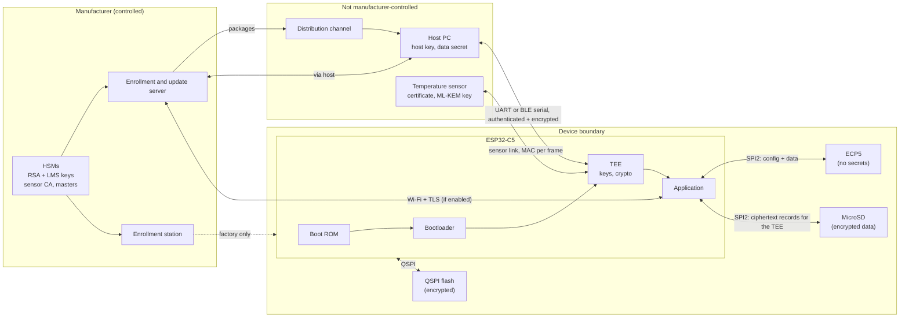

# FDA Security Architecture Views

This document presents `thriller` in the form of the security architecture views described in FDA's guidance
*Cybersecurity in Medical Devices: Quality Management System Considerations and Content of Premarket Submissions*
(Section V.B.2, with the level of detail from Appendix 2 and the control categories from Appendix 1).

## Scope

`thriller` is a root-of-trust platform, not a finished medical device. A device manufacturer that builds on it
submits the views for the whole device. This document supplies the platform's part of each view so it can be
carried into that submission. Where a view depends on the device (its clinical functions, its host software,
its network), this document marks what the integrator must add.

The guidance asks for at least four views:

| View | Section here |
|---|---|
| Global System View | [1](#1-global-system-view) |
| Multi-Patient Harm View | [2](#2-multi-patient-harm-view) |
| Updateability/Patchability View | [3](#3-updateabilitypatchability-view) |
| Security Use Case Views | [4](#4-security-use-case-views) |

Section 5 maps the design to the guidance's security control categories, and section 6 lists the gaps a submission would have to close.

Terms are defined in the README and `doc/arch.md`. Risk IDs (R1–R30) refer to the Risk Assessment in `doc/arch.md`.
Roles (manufacturer, application owner, developer, user) are defined in `doc/roles.md`.

## 1. Global System View

### Elements

| Element | Description | Trust |
|---|---|---|
| ESP32-C5 boot ROM | Espressif silicon. Verifies the bootloader against eFuse key digests | Trusted, fixed, cannot be patched (R25) |
| Bootloader | Verifies the TEE and application images, enforces anti-rollback, falls back between slots; a recovery bootloader covers a failed bootloader update | Trusted; signed |
| TEE | ESP-TEE in machine mode. Holds and uses every key; runs updates, host sessions, user data, sensor pairing and sessions, the event log | Trusted; signed |
| Application | Device function, in user mode, isolated from the TEE's memory and peripherals | Untrusted by the TEE; signed |
| External QSPI flash | Bootloader, TEE and application images (A/B), TEE secure storage | Untrusted storage, encrypted by the C5 |
| PSRAM (in package) | Application working memory | Untrusted, encrypted by the C5 |
| ECP5 FPGA | Peripheral configured by the application at power-up; holds no secrets | Untrusted (R17) |
| MicroSD card | Encrypted user data, event log copies, offline update packages | Untrusted storage |
| Temperature sensor | Replaceable, outside the box; certificate from its manufacturer, paired to the device | Trusted for its readings once authenticated |
| Host PC or phone | Opens data and CLI sessions over the UART or BLE, relays to the server, delivers updates. Holds the host key and host data secret | Trusted by its user; authenticated by the TEE |
| Wi-Fi network | Carries over-the-air updates and server contact, if the application owner enables Wi-Fi | Untrusted |
| Enrollment and update server | Records devices, sensors and pairings; detects unknown identities; serves updates | Manufacturer-controlled |
| HSMs | Release RSA keys, LMS keys, sensor CA keys, master keys, distribution key | Manufacturer-controlled, highest trust |
| Factory enrollment station | Programs images, burns the device root key, records the device | Manufacturer-controlled |
| Distribution channel | Delivers update files to hosts or cards | Not manufacturer-controlled |

### Diagram

### Interfaces

| Interface | Between | What crosses it | Protection |
|---|---|---|---|
| QSPI | C5 ↔ flash | Images, TEE storage | XTS-AES flash encryption, per-device key generated on chip; images RSA-signed and checked at boot (R2, R6) |
| UART | Host ↔ TEE (through the application) | Status reports; fallback sessions, packages and CLI | Status is read-only and holds nothing secret (R30); everything else as for BLE |
| BLE serial service (GATT) | Host or phone ↔ TEE (through the application) | CLI and host sessions, update packages | Mutual authentication under the host or developer key, AES-256-GCM frames with counters, attempt limits; BLE pairing not relied on; advertising only after a user action (R9, R28) |
| Wi-Fi | Application ↔ update and enrollment server | Over-the-air packages, log upload, pairing confirmation | Outbound TLS; server authenticated under the device identity key; packages LMS-signed and version-checked by the TEE (R23, R29) |
| Sensor link | Sensor ↔ TEE (through the application) | Pairing, readings, commands | Certificate and ML-KEM pairing; per-frame MAC under session keys with nonces from both ends; maximum reading age (R11–R14) |
| SPI2 to the ECP5 | Application ↔ FPGA | Plain bitstream at power-up, then data | None needed: no secrets cross it; build ID and self-test detect wrong logic (R17) |
| SPI2 to the MicroSD card | Application ↔ card, carrying the TEE's records | User data, logs, packages | AES-256-GCM records; MAC-chained logs; LMS-signed packages (R1, R26) |
| JTAG and download mode | Factory ↔ C5 | Initial programming | Disabled by eFuse after enrollment (R7) |
| Radio policy | Application owner → TEE | Which radios may run | Part of the signed build descriptor |

**Integrator adds:** the host software and its environment (operating system, network, cloud services),
the device's clinical interfaces and safe states, and any additional data flows.

## 2. Multi-Patient Harm View

The guidance asks how the system defends against attacks that could affect many patients at once.
For `thriller`, that means any compromise that scales from one unit or one sensor to the fleet.

### Fleet-wide assets

| Asset | If compromised | Protection |
|---|---|---|
| Release RSA keys | Images that boot on every device | HSM; main and backup digests in eFuse, each revocable (R27). An RSA forgery also needs physical flash access, since updates need LMS too |
| LMS package keys | Packages accepted by every device | HSM; main and backup keys; replaceable by a TEE update signed with the other (R27) |
| Sensor CA keys | Counterfeit sensors that pair everywhere | HSM; main and backup; server-side detection of unknown serials (R14) |
| Master keys | Any device's keys and any host's data secret | HSM, dual control, separate masters per purpose (R19) |
| Distribution key | Package contents readable (not forgeable) | Accepted in the base model; Code Secrecy Profile (R18) |
| Boot ROM bug | Possible bypass on every C5 | Cannot be patched; followed through Espressif advisories (R25) |

### Single-unit compromise stays single-unit

Every key on a device is unique to it: the flash and TEE storage keys are generated on chip, and the root key is derived per chip ID.
A lab attack on one C5 (R5) or one sensor (R15) yields keys that work nowhere else. The host data secret is not on the device at all,
so even a fully compromised device does not expose stored user data. Cloned sensors are detected by the server and denylisted fleet-wide.

## 3. Updateability/Patchability View

### What can be updated

| Component | How | Rollback protection |
|---|---|---|
| Application, including the FPGA bitstream | A/B slots; confirmed after a self-test, otherwise rolled back | TEE version record; 6 eFuse steps for security releases |
| TEE | A/B slots (ESP-TEE OTA) | TEE version record; 3 eFuse steps |
| Bootloader | Rewritten in place, with the ROM's recovery bootloader as fallback | 4 eFuse steps |
| Sensor denylist, CA keys | Inside update packages, and online | With the package |
| Sensor firmware | Integrator's choice (open question) | — |
| Boot ROM | Cannot be updated | — |

### End-to-end path

1. The manufacturer builds the images, signs them with the release RSA key, and the owner signs each package with LMS (`doc/roles.md`).
2. The package is encrypted under the distribution key and published.
3. It reaches the device online through the server, or offline on a card or through the host.
4. The TEE checks the LMS signature and version before decrypting, writes the inactive slot, and the bootloader tries it.
5. The new image confirms itself after its self-test, or the bootloader falls back.
6. If it is a security release, the eFuse secure version advances once the new image is confirmed.

Out-of-cycle patches use the same path. Devices that are rarely online still accept updates from cards or hosts, and the server reports which units are behind.

## 4. Security Use Case Views

### 4.1 Power-on and boot

ROM checks the bootloader → bootloader checks the TEE and application, versions and slot → TEE locks down peripherals and checks the build descriptor →
application configures and checks the FPGA → sensor session → wait for the host. Any failed check falls back to the other slot, or stops in a safe state with a log entry (`doc/c5.md`).

### 4.2 Host session and user data

The host and TEE authenticate each other with the host key over fresh nonces, derive a session key, and exchange encrypted, authenticated frames.
The host sends its data secret; the TEE combines it with the device's data key to read and write records on the card. At the end the TEE gives the host
an authenticated digest of the data state, which the host presents next time to detect a restored card (R10). Nothing is readable without the host.

### 4.3 Updates

As section 3. A failed signature or version check refuses the package before any flash write and logs the attempt.

### 4.4 Sensor replacement and readings

A new sensor's certificate is checked, a pairing key is agreed with ML-KEM, and the pairing is logged and later confirmed by the server.
Readings are requested by the device, authenticated per frame, and accepted only within the maximum reading age; otherwise the device goes to its safe state (`doc/sensor.md`).

### 4.5 Manufacturing and enrollment

Program, first boot (eFuse lockdown and on-chip key generation), burn the device root key, write the distribution key, verify, record, close enrollment (`doc/enrollment.md`).
The enrollment station is in a controlled area because the root key crosses its link once.

### 4.6 Decommissioning

The server marks the device retired; an authorized wipe erases TEE storage and the card. Old data stays unreadable without the host data secret.

## 5. Security Control Categories (Appendix 1)

| Category | How `thriller` addresses it | Gaps |
|---|---|---|
| Authentication | Secure boot (RSA-3072); LMS on update packages; mutual host authentication; sensor certificates (ML-DSA) and per-frame MACs; device identity proven to the server | No device certificate for the sensor to check (`doc/sensor.md`) |
| Authorization | User data only in a host session with the host's secret; TEE services only; developer builds bound to one device and epoch; roles (`doc/roles.md`) | Session timeouts to be set |
| Cryptography | NIST algorithms: AES, SHA-256, HMAC, HKDF, LMS, ML-KEM, ML-DSA, Ascon; per-device keys; keys generated on chip where the HSM does not need them | Boot root is RSA-3072, not quantum-safe (R24); flash encryption is XTS-AES-128 until the Key Manager is supported |
| Code, data and execution integrity | Secure boot every boot; TEE isolation; anti-rollback in three layers; FPGA build check | No integrity check of flash reads after boot (R6) |
| Confidentiality | Flash, PSRAM, card and host sessions encrypted; user data needs the host | Package contents fleet-readable without the Code Secrecy Profile (R18) |
| Event detection and logging | HMAC-chained event log in the TEE, copied to the card, read by the host and uploaded to the server | Event list to be completed |
| Resiliency and recovery | A/B slots with confirmation and fallback; recovery bootloader; safe state on sensor loss; UART fallback when radios are off or failing | Behavior under denial of service on the UART, BLE and Wi-Fi to be defined |
| Firmware and software updates | Signed, encrypted, interruption-safe updates over the air, through the host, or from a card; out-of-cycle patches, including fixes to the radio stacks | Sensor firmware updates not yet designed |

## 6. Gaps for a submission

1. **Event list** for the log, and how the host displays it.
2. **Clinical parameters:** maximum reading age, behavior during an unconfirmed pairing, the safe state.
3. **Fault-injection and side-channel evidence** on the C5 and the sensor (`doc/test.md` section 5).
4. **Sensor firmware update** path.
5. **Decommissioning procedure** in detail.
6. **SBOM:** ESP-IDF and ESP-TEE versions, Mbed TLS, the ML-KEM, ML-DSA and Ascon libraries, the sensor firmware, the FPGA toolchain, with support status and end-of-support dates.
   Espressif's PSIRT advisories feed vulnerability monitoring.
7. **Testing evidence:** security requirements, threat mitigation and vulnerability testing as planned in `doc/test.md`; independent penetration testing to be arranged.
8. **Risk scoring:** the Risk Assessment rates likelihood; FDA asks for an exploitability-based, non-probabilistic approach with scores before and after mitigation.
9. **Wireless:** FDA's guidance on radio frequency wireless technology in medical devices also applies: coexistence testing, wireless quality of service, and the risk analysis of a lost link. The clinical function must not depend on Wi-Fi or BLE.

## Source

U.S. Food and Drug Administration, *Cybersecurity in Medical Devices: Quality Management System Considerations
and Content of Premarket Submissions*, guidance for industry and FDA staff, https://www.fda.gov/media/119933/download.
The views follow the version issued February 3, 2026. Appendix 1 and Appendix 2 content was taken from the
September 27, 2023 version, which has the same appendix structure; confirm against the current version before submission.
