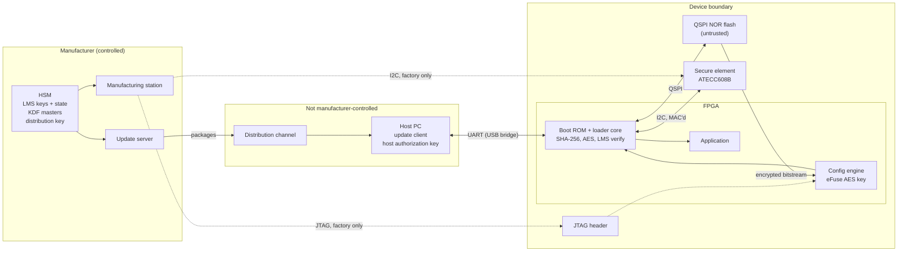
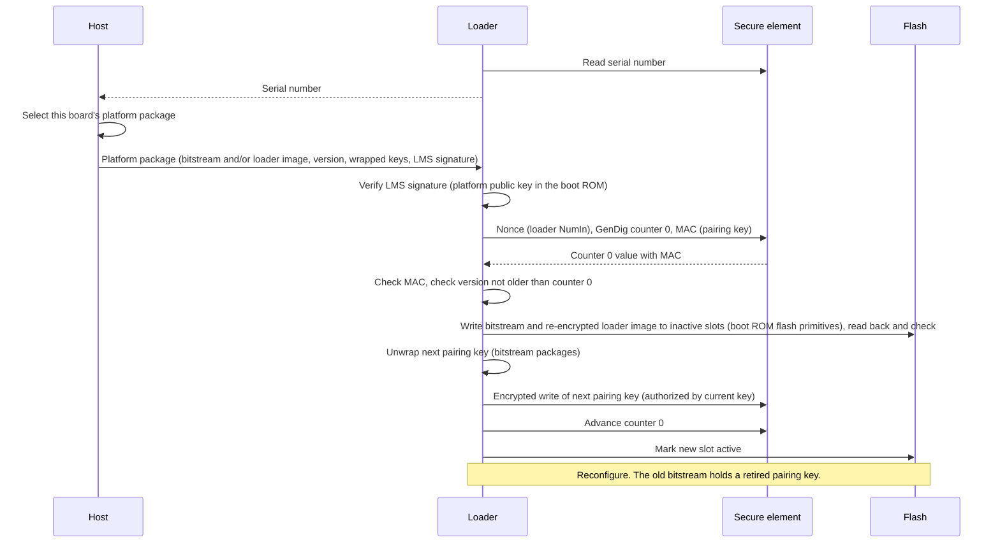
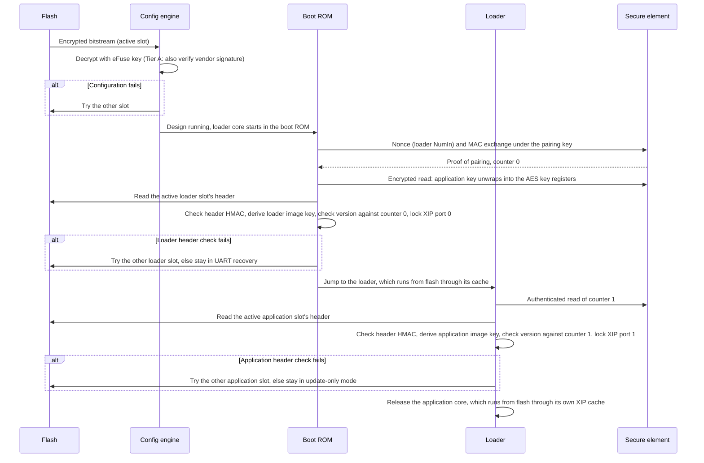
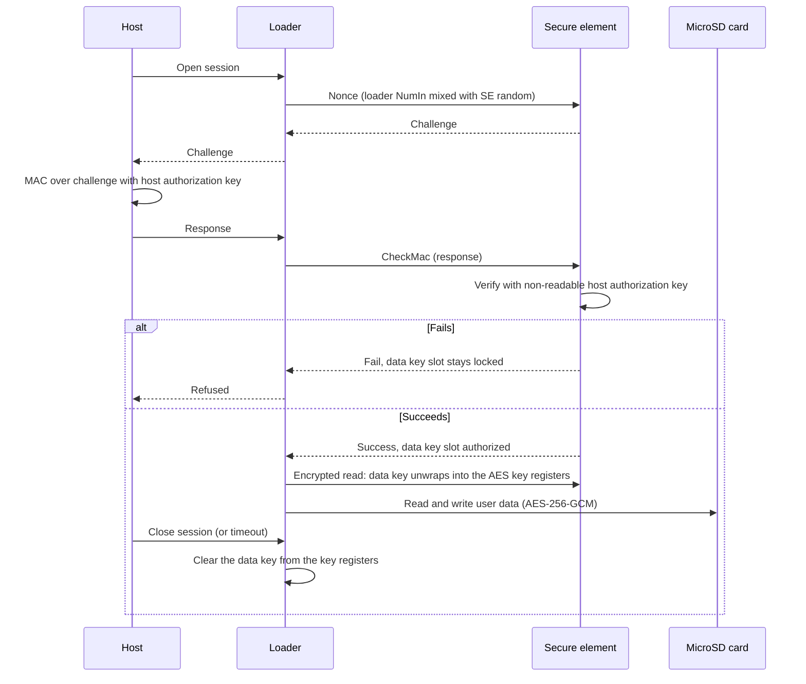
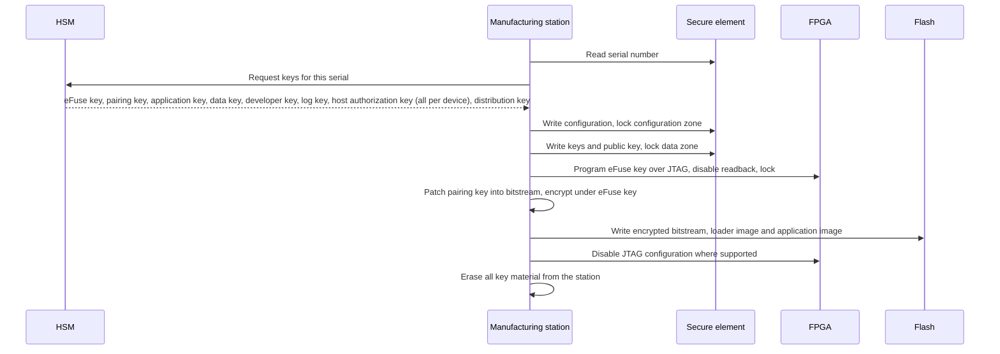

# FDA Security Architecture Views

This document presents `thriller` in the form of the security architecture views described in FDA's guidance
*Cybersecurity in Medical Devices: Quality Management System Considerations and Content of Premarket Submissions*
(Section V.B.2, with the level of detail from Appendix 2 and the control categories from Appendix 1).

## Scope

`thriller` is a root-of-trust platform, not a finished medical device. A device manufacturer that builds on it
submits the views for the whole device. This document supplies the platform's part of each view so it can be
carried into that submission. Where a view depends on the device (its clinical functions, its host software,
its network), this document marks what the integrator must add.

The guidance asks for at least four views:

| View | Section here |
|---|---|
| Global System View | [1](#1-global-system-view) |
| Multi-Patient Harm View | [2](#2-multi-patient-harm-view) |
| Updateability/Patchability View | [3](#3-updateabilitypatchability-view) |
| Security Use Case Views | [4](#4-security-use-case-views) |

Section 5 maps the design to the guidance's security control categories, and section 6 lists the gaps a submission would have to close.

Terms (loader, Tier A/B, pairing key, data key, distribution key) are defined in the README and `doc/arch.md`.
Risk IDs (R1–R31) refer to the Risk Assessment in `doc/arch.md`. Roles (manufacturer, application owner, developer, user) are defined in `doc/roles.md`.

## 1. Global System View

### Elements

| Element | Description | Trust |
|---|---|---|
| FPGA configuration engine | Vendor silicon. Decrypts (and on Tier A, authenticates) the bitstream using eFuse keys | Trusted, fixed |
| Loader core | A LiteForth CPU in the bitstream with the SHA-256 and AES cores, the security block, and the I2C, QSPI, SD and UART interfaces. It starts in a boot ROM (block RAM in the bitstream; mask ROM on the ASIC) that verifies the loader image in flash, then runs the loader from flash through its own XIP cache (`doc/hw.md`) | Trusted while the bitstream is genuine |
| Application core | A second LiteForth CPU running the device-specific code from the XIP cache. No wiring to keys or security controls; reaches the loader only through the mailbox | Untrusted by the loader; its code is LMS-verified at install and tag-checked on every cache fill |
| Secure element (ATECC608B) | Monotonic counters, key storage, host authorization (CheckMac), TRNG | Trusted, fixed |
| QSPI NOR flash | Encrypted bitstreams (A/B), loader images (A/B) and application images (A/B); written only during updates and development | Untrusted storage |
| Host PC | Runs the update client and opens data sessions. Holds the host authorization key | Trusted by the user; authenticated by the secure element |
| Update server | Builds per-board platform packages and fleet-wide application packages | Manufacturer-controlled |
| HSM | Holds LMS signing keys (with state), KDF master keys (including the developer master key), the distribution key | Manufacturer-controlled, highest trust |
| Manufacturing station | Programs eFuse keys, provisions and locks the secure element, writes flash | Manufacturer-controlled |
| Distribution channel | Delivers update files to the host (download, email, removable media) | Not manufacturer-controlled |
| MicroSD card | Removable media for encrypted user data, security event logs and offline update packages | Untrusted storage |

### Diagram



### Interfaces

| Interface | Between | Protocol | What crosses it | Protection |
|---|---|---|---|---|
| Configuration | Flash → config engine | Vendor SPI configuration | Bitstream | AES under a per-board eFuse key; Tier A adds the vendor signature |
| I2C | Loader ↔ secure element | ATECC command packets, CRC-16 | Counters, key reads, host authorization | Counter and public key hash responses MAC'd under the pairing key over a loader nonce; keys read encrypted (EncRead, which carries no MAC) and checked after unwrapping. The bus and the secure element are physically protected, since counter increments are unauthenticated (R30). CRC is for transport only |
| QSPI | Loader core (direct mode, for installs) and XIP engine (loader and application fetches, two ports) ↔ flash | SPI NOR commands | Bitstreams, loader and application images | Everything at rest is encrypted and authenticated (AES-256-GCM per cache line, or vendor format); each line checked as it is fetched |
| UART | Host ↔ loader | Framed messages with a channel number, CRC-32 | Update packages, session challenges, user data, the application's terminal | LMS signatures on packages; CheckMac host authorization in the secure element. Session traffic is not yet encrypted or authenticated (R29, gap 10). CRC is for transport only |
| JTAG | Factory station ↔ FPGA | IEEE 1149.1 | eFuse programming, initial configuration | Fused off, or limited to non-configuration instructions, after manufacturing where the FPGA supports it; readback disabled |
| MicroSD | Loader ↔ removable card | SD (SPI mode) | User data in and out; security event logs out; update packages in | User data encrypted and authenticated under the data key (AES-256-GCM); update packages carry LMS signatures, exactly as over the UART; log records are MAC'd and chained under a per-device log key so removal, reordering or editing is detectable. The loader reads only fixed-format package and log files, never a general filesystem it must trust |

The device has no network interface of its own. Any network exposure comes through the host PC and is the integrator's to document.

**Integrator adds:** the host software and its environment (operating system, network, cloud services),
the device's clinical interfaces, and any additional data flows.

## 2. Multi-Patient Harm View

The guidance asks how the system defends against attacks that could affect many patients at once.
For `thriller`, that means any compromise that scales from one unit to the fleet.

### Fleet-wide assets

| Asset | If compromised | Defense | Risk |
|---|---|---|---|
| LMS application signing key | Malicious application installs on every unit | Key and state kept in an HSM; one-time leaf use enforced (SP 800-208) | R20 |
| LMS platform signing key | Malicious loader on every unit, at the next platform update | As above, and every platform package is per board: a bitstream needs the board's eFuse key, and a loader image's content key is wrapped under the board's pairing key, both derived from HSM-held masters | R20 |
| KDF master keys | Every unit's per-device keys derivable | Held only in the HSM; never placed on a device, so compromising a unit cannot reveal them | — |
| Distribution key | Every application package readable | Accepted: obfuscation only, not relied on for safety. The Code Secrecy Profile replaces it with per-device keys | R6 |
| Update server | Could withhold updates or serve stale ones | Cannot forge packages (no signing keys on the server); counters reject old versions | R3, R4 |

### Single-unit compromise stays single-unit

| Compromised on one unit | Exposes on other units |
|---|---|
| FPGA eFuse key (R14) | Nothing: eFuse keys are per board (or per batch, which bounds it to the batch) |
| Pairing key | Nothing: each board's pairing key is patched into that board's bitstream only |
| Secure element keys (R18) | Nothing: all secure element keys are per device |
| Running bitstream (R11, R12) | Nothing, except the distribution key (R6) |

### Per-device key derivation and the guidance

Appendix 1 cautions against keys derived from serial numbers or other discoverable identifiers.
`thriller` derives per-device keys as KDF(master key, secure element serial number). The serial number is
discoverable, but it is not the secret: the master key is, and it never leaves the HSM. Knowing a serial number
without the master key gives nothing, and compromising a device cannot reveal the master key. This meets the
guidance's stated goal that compromising one device cannot reveal keys for others. A submission should state this
reasoning explicitly, along with the HSM controls protecting the master keys.

**Integrator adds:** fleet-wide paths through the host software or any shared server (for example, one host
managing many devices, or a cloud service), and the clinical consequence of each fleet-wide failure.

## 3. Updateability/Patchability View

There are two independent update chains. Each has its own signing key, anti-rollback counter and package format.

| | Platform update | Application update |
|---|---|---|
| Content | Bitstream (hardware and boot ROM) and/or loader image | Application image |
| Signing | LMS, platform key (HSM) | LMS, application key (HSM) |
| Encryption in transit | Per-board eFuse key (bitstream); content key wrapped under the board's pairing key (loader image) | Fleet-wide distribution key (per-device keys under the Code Secrecy Profile) |
| Packages built | One per board (or batch), selected by secure element serial | One per release |
| Anti-rollback | Secure element counter 0, plus pairing key rotation | Secure element counter 1 |
| Interruption safety | A/B bitstream and loader slots | A/B application slots |
| After an ASIC conversion | Replaced by an updatable-loader chain on counter 0 (`doc/ics55.md`) | Unchanged |

### End-to-end path

```mermaid
flowchart LR
  B["Build<br/>(preserved toolchain)"] --> S["Sign in HSM<br/>LMS, stateful"]
  S --> E["Encrypt<br/>per board or<br/>distribution key"]
  E --> P["Publish on<br/>update server"]
  P -->|"not manufacturer-controlled"| D["Distribution<br/>channel"]
  D --> H["Host update<br/>client"]
  H -->|UART| V["Loader: verify LMS<br/>before decrypting"]
  V --> C["Check version<br/>against counter"]
  C --> W["Write inactive<br/>flash slot"]
  W --> A["Advance counter,<br/>switch slot"]
```



Every segment after publication can be hostile. The design does not trust the distribution channel, the host,
or the UART for integrity: the loader rejects anything without a valid LMS signature and a version not older than the counter
(or, for a developer build on its own device, a valid developer HMAC and the current epoch).
The channel only carries ciphertext.

### Platform update sequence



The order of the last four steps must survive a power failure at any point (`doc/arch.md`, Open Question 1).

### Application update sequence

```mermaid
sequenceDiagram
  participant H as Host
  participant L as Loader
  participant SE as Secure element
  participant F as Flash
  H->>L: Application package (ciphertext, version, LMS signature over ciphertext)
  L->>SE: Authenticated read of the application public key's hash
  SE-->>L: Hash with MAC
  L->>L: Check the package's public key against the hash; verify LMS signature before decrypting, keeping the ciphertext digest
  L->>SE: Authenticated counter 1 read
  L->>L: Check version not older than counter 1
  L->>SE: Encrypted reads: distribution key and application key unwrap into the AES key registers (private path)
  L->>L: Decrypt with distribution key, re-hashing the ciphertext (must match); re-encrypt per cache line under a new image key from a fresh install salt
  L->>F: Write inactive application slot, read back and check
  L->>SE: Advance counter 1
  L->>F: Mark new slot active
```

### Supporting practices

- Security patches can ship as either chain at any time, independent of feature releases.
- Build environments, test suites and signing tools are preserved for the support life of the device.
- LMS keys are sized (2^10 to 2^15 signatures) well beyond the expected number of releases, since each release takes one signature, on its release manifest.
- A backup application signing key, held offline, keeps updates possible if the main key or its HSM is lost (R31).
- The update metrics FDA asks for (time to patch, time for fielded devices to receive patches) are the integrator's to track.

**Integrator adds:** how update files reach users, whether updates are pushed or user-initiated, and labeling for the update procedure.

## 4. Security Use Case Views

Each view covers an operational state or function where a compromise could affect safety or effectiveness.
Clinical functions are the integrator's; these are the platform's.

### 4.1 Power-on and boot



Failure behavior: if neither loader slot checks, the boot ROM stays in UART recovery, which accepts only signed loader packages;
if neither application slot checks, the loader stays in an update-only mode in which it accepts only signed packages.
While the application runs, every cache line's tag is checked as it is fetched. A failing tag locks the device down and marks the slot bad,
so the next boot falls back to the other slot (`doc/xip.md`).

### 4.2 Host session and user data access



The loader relays the host's response but never sees the host authorization key, so a compromised bitstream
cannot learn it.

### 4.3 Application update and 4.4 Platform update

See the sequences in section 3.

### 4.5 Manufacturing and provisioning



The manufacturing station handles device keys in clear for each board, so it is a high-value target:
it should hold keys only for the board being programmed and erase them afterward.

### 4.6 Standby, sessions ending, and decommissioning

- **Session end or timeout:** the loader clears the data key from the key registers; the secure element authorization does not persist.
- **Decommissioning:** after lock, only the pairing key slot and the reserved freshness slot can be rewritten, through authorized encrypted writes; the other key slots never can (`doc/se.md`). Decommissioning is therefore done by destroying the secure element,
  or by having the HSM retire the unit's serial number so it receives no further updates. To be defined (section 6).

## 5. Security Control Categories (Appendix 1)

| Category | How `thriller` addresses it | Gaps |
|---|---|---|
| Authentication | LMS signatures on all production and platform updates and their metadata, verified before decryption; per-device HMAC on developer builds; host authenticated to the secure element (CheckMac); every secure element response MAC'd over a fresh nonce; CRCs used for transport only | The device does not authenticate itself to the host (no mutual authentication) |
| Authorization | Data key released only after host authorization; secure element slot policies deny by default; roles and per-device developer keys (`doc/roles.md`); application isolated on its own core | Session timeout length to be set |
| Cryptography | NIST algorithms: AES-256, SHA-256, HMAC, LMS (SP 800-208). Post-quantum for all signatures we control. Per-device keys from an HSM-held master | Vendor bitstream signature (Tier A) is ECDSA or RSA; mitigated by encrypted-only configuration (R21) |
| Code, data and execution integrity | Signed updates only; anti-rollback counters; every cache line's tag checked before execution; debug ports and readback locked in production | No runtime monitoring; fault-injection hardening designed and planned for testing (`doc/test.md`), not yet implemented (R16) |
| Confidentiality | User data encrypted per device, unlocked only with the host; keys never cross the I2C bus in clear | Session traffic over the UART is not yet protected (R29); application code is obfuscated, not secret, unless the Code Secrecy Profile is enabled |
| Event detection and logging | Security event log on the MicroSD card, MAC'd and hash-chained under a per-device log key (R24) | The full list of logged events, and how the host reads the log, to be defined |
| Resiliency and recovery | A/B slots for bitstream, loader and application (`doc/flash.md`); update-only fallback mode | Recovery of a trusted default configuration, and behavior under denial of service on the UART, to be defined |
| Firmware and software updates | Two independent signed update chains; out-of-cycle patches possible; interruption-safe A/B slots; preserved toolchains | Pairing key rotation sequencing (Open Question 1) |

## 6. Gaps for a submission

Items a premarket submission would need that the platform does not yet provide:

1. **Security event logging.** The log's format and protection are designed (R24); the full list of events (failed signatures, failed host authorizations, rollback attempts, tag failures, developer installs) and how the host reads it remain to be defined.
2. **Device-to-host authentication.** A non-readable identity key in the secure element, used in place (MAC), so the host can confirm it is talking to a genuine unit. This does not detect a compromised bitstream (R22).
3. **Fault-injection hardening** of the loader's security checks (R16). Countermeasures and test campaigns are planned in `doc/test.md` section 6.
4. **Pairing key rotation sequencing** under power failure (`doc/arch.md`, Open Question 1).
5. **Decommissioning procedure.**
6. **Trusted default configuration recovery** by an authorized user.
7. **SBOM** for the loader, its RTL cores, the soft CPU, toolchains and the secure element, with support status and end-of-support dates.
8. **Testing evidence:** security requirements testing, threat mitigation testing, vulnerability testing and independent penetration testing. The plan for the first three is in `doc/test.md`; independent penetration testing is still to be arranged.
9. **Threat model and risk assessment format.** The Risk Assessment in `doc/arch.md` rates likelihood; FDA asks for an exploitability-based, non-probabilistic approach with scores before and after mitigation. The table needs to be re-scored in that form.
10. **Host session protection.** Encrypt and authenticate the session's traffic after CheckMac, under a session key derived in the secure element (R29; `doc/arch.md`, Open Question 13).

## Source

U.S. Food and Drug Administration, *Cybersecurity in Medical Devices: Quality Management System Considerations
and Content of Premarket Submissions*, guidance for industry and FDA staff, https://www.fda.gov/media/119933/download.
The views follow the version issued February 3, 2026. Appendix 1 and Appendix 2 content was taken from the
September 27, 2023 version, which has the same appendix structure; confirm against the current version before submission.
