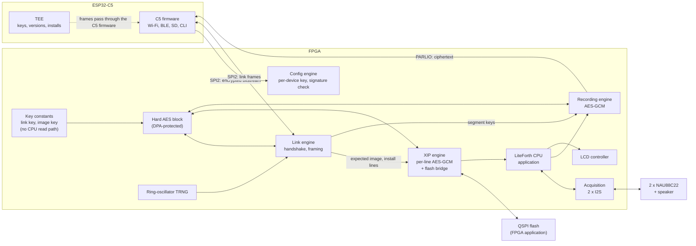

# FPGA

This document is family-neutral. What a family must provide, and how each candidate provides it, is in `fpga/` at the top of the repository:
`fpga/README.md` (the requirements), and one folder per family (`fpga/ecp5/`, `fpga/lifcl/`, `fpga/ti60/`, `fpga/logos/`, `fpga/logos2/`). The current choice is the
**Pango Logos2 PG2L50H-6IFBG484** (`fpga/logos2/`), with the **ECP5 LFE5U-25F** as fallback (`fpga/ecp5/`).

The FPGA runs the application: a LiteForth CPU executing in place from its own QSPI flash, with the acquisition front end (two NAU88C22 CODECs),
the LCD and the speaker. It is inside the trust boundary for the application and for recordings, so it holds two per-device keys, carried in its encrypted bitstream.
The C5 remains the root of trust: it stores and selects the bitstream, verifies and installs application images, holds the version records,
and does all networking and storage (`doc/c5.md`).

## Block diagram

## Bitstream

- **Per device.** Each device's bitstream carries its own link key and image key as constants in block RAM, written into one common routed design per device by the family's
  build flow. Both keys are derived in the HSM from the device root: HMAC(root, "fpga link") and HMAC(root, "fpga image"). The C5's TEE derives the same values.
- **Encrypted by the FPGA's own key.** The bitstream is encrypted under the FPGA's per-device configuration key, held in the FPGA's own key storage, so it stays encrypted
  in the C5's flash, on the configuration bus, and in transit. The C5 never holds the plaintext. The C5's flash encryption alone would not do: it decrypts as it reads,
  and the keys would cross the configuration bus in clear.
- **No fallback.** The FPGA must be set to refuse any unencrypted (or, where the family can authenticate bitstreams, unsigned) configuration. A bitstream without this device's
  link key would fail the handshake anyway (R17).
- **Authentication is family-dependent.** The Logos2 authenticates every bitstream twice (AES-256-GCM under the device's key, RSA-2048 over SHA-3), as would CrossLink-NX and Titanium;
  this closes blind modification of an encrypted bitstream (R32). The ECP5 fallback does not, so it relies on the configuration CRC and the link handshake.
- **Built by the bitstream build service** for each device and each FPGA release (`doc/enrollment.md`), with the family's tools (`fpga/<family>/`).
  The service sees per-device keys in plaintext, so it is a protected system with its keys released by the HSM per job (R42).

## Configuration

1. The C5's TEE chooses the bitstream slot (A or B in the C5's flash) from its version record; the C5 firmware sends that encrypted bitstream over SPI2 to the FPGA's slave configuration port
   (slave serial on the Logos2). Whether the same pins can then carry the link is family-dependent (yes on the ECP5; probably on the Logos2, otherwise the board gives the link its own pins).
2. The C5 checks that configuration completed, then opens the link (below). The handshake proves that the configured FPGA holds this device's link key, and reports the bitstream's version,
   which the TEE checks against its record. An old bitstream of the same device, loaded by an attacker through JTAG or the configuration pins, is refused there.
3. If the handshake or the FPGA's self-test fails on a newly installed bitstream, the C5 configures the other slot. The C5 controls configuration, so bitstream fallback is simple.
4. If the FPGA is reset or reconfigured while running, the link session ends; the C5 treats that as an event, logs it, and repeats steps 2 to 3.

## Key isolation in the fabric

| Key | Where it lives | Who can use it | Who can read it |
|---|---|---|---|
| Link key | Block RAM constant in the bitstream | Link engine | No one |
| Image key | Block RAM constant in the bitstream | XIP engine (to derive each install's key) | No one |
| Install key | XIP key register, loaded by the link engine at boot | XIP engine | No one |
| Segment key | Recording engine key register, written by the link engine | Recording engine | No one |

The LiteForth CPU has no read path to any of them, or to the hard AES block. It can ask the recording engine to encrypt a block and the link engine to send a message, and nothing else.
Keys pass from their registers straight into the hard AES block; that transfer is the one key-dependent path left in the fabric.
Key registers are cleared on reset, on reconfiguration, and on any tag or link failure. The CPU's debug port is not built into production bitstreams.

## The link to the C5

The link runs over SPI2, with the C5 as master. The C5 firmware moves the frames; only the TEE holds the C5's copy of the link key.

**Handshake (at every link start):**

1. The FPGA draws a nonce *Nf* from its TRNG; the TEE draws *Nc*.
2. Both derive session keys, one per direction, from the link key and both nonces, with the SP 800-108 counter-mode KDF using AES-256-CMAC
   (AES only, run in the hard AES block, so the FPGA needs no SHA-256).
3. Each side sends a confirmation tag over the whole transcript, including the FPGA's bitstream version and the C5's firmware version, with direction labels.
4. Frames then use AES-256-GCM (or CCM, F4) with a nonce made of the direction and a 64-bit counter; any failure ends the session and clears the FPGA's session keys.

The FPGA's own nonce is what stops a recorded session from being replayed to it: it keeps no state across boots, so without its TRNG it could not tell an old session from a new one.

**Messages:**

| From | Message | Purpose |
|---|---|---|
| C5 | Boot image: slot, version, install salt, length, mode | The XIP engine derives the install key and unlocks the CPU (`doc/xip.md`) |
| C5 | Install commands and encrypted lines | Flash bridge writes; the CPU is held in reset meanwhile |
| C5 | Segment key and segment number | Start a recording segment (`doc/acquisition.md`) |
| C5 | Sensor readings with age and status | The application acts only on readings the TEE has passed (`doc/sensor.md`) |
| C5 | Host commands, settings, alarms | From authenticated host and CLI sessions |
| FPGA | Status, faults, tag failures | Logged by the TEE |
| FPGA | Application messages | Displayed, logged, or sent to the host |

The recording stream itself goes to the C5 over its parallel input (PARLIO), already encrypted to the host by the recording engine, so it does not need the link's encryption
and does not compete with the SD card for SPI2.

## TRNG

A ring-oscillator TRNG with continuous health tests (repetition count and adaptive proportion, as in NIST SP 800-90B), conditioned with AES-256-CMAC.
It supplies the link nonce. A health-test failure stops the link, so the CPU never starts.

## XIP engine and flash bridge

The application runs from the FPGA's QSPI flash through a decrypting, authenticating cache (`doc/xip.md`). The C5 does the installing: it verifies each package and
writes the encrypted lines through the FPGA's flash bridge, a hardware block driven by link commands, not by the CPU. A broken application cannot stop an update.

## Acquisition, recordings, LCD and speaker

The FPGA masters both CODECs' I2S buses, generates their master clock, and drives the LCD and the speaker (`doc/acquisition.md`).

## Resource estimate

Rough figures in 4-input-LUT equivalents, to be replaced by synthesis results:

| Block | LUTs | Block RAM |
|---|---|---|
| LiteForth CPU | 1.5K to 3K | Stacks, data RAM |
| XIP engine: fill controller, GHASH if needed, 4 KB cache, flash bridge | 1.5K to 3K | 4 KB cache |
| Link and recording engine: framing, scheduling of the shared hard AES block | 1K to 2K | Buffers |
| TRNG | Under 0.2K | |
| Two I2S masters, CODEC control | 0.5K to 1K | |
| LCD controller, PARLIO output | 0.5K to 1K | Line buffer |
| **Total** | **About 5K to 10K, plus the hard AES block** | |

The PG2L50H leaves ample room for the application. On the ECP5 fallback, which has no hard AES block, two soft AES-256 cores and GHASH add about 6K LUTs, leaving roughly 6K to 13K of
the LFE5U-25F's 24K for the application (`fpga/ecp5/`).

## Open questions

See `doc/questions.md` (FPGA rows).
