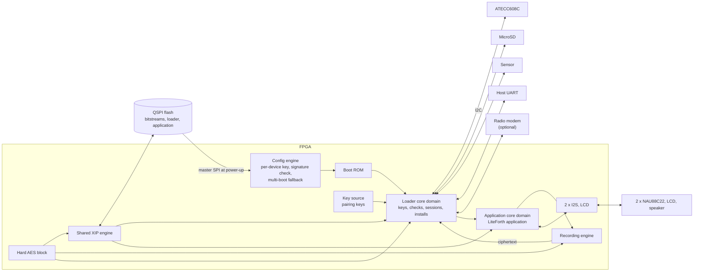

# FPGA

This document is family-neutral. What a family must provide, and how each candidate provides it, is in `fpga/` at the top of the repository:
`fpga/README.md` (the requirements), and one folder per family. The current choice is the **Pango Logos2 PG2L50H-6IFBG484** (`fpga/logos2/`), with the **ECP5 LFE5U-25F** as fallback
for a limited number of units (`fpga/ecp5/`).

The FPGA is the root of trust and runs the application. Its configuration engine is the immutable anchor; its bitstream carries the boot ROM, the two cores and the pairing keys;
everything else it needs (keys, counters, identity) is in the secure element, and everything it executes is in the flash, authenticated line by line (`doc/hw.md`, `doc/se.md`, `doc/xip.md`).

## Block diagram

## Bitstream

- **Per device.** Each device's bitstream carries its two pairing keys and their version as constants in the key-source block RAM, written into one common routed design per device by the
  family's build flow (`doc/enrollment.md`, Bitstream build service). Both keys are derived in the HSM: KDF(pairing master, serial number, version).
- **Encrypted by the FPGA's own key.** The bitstream is encrypted under the FPGA's per-device configuration key, held in its eFuses, so it stays encrypted in flash and on the configuration bus.
  The pairing keys exist in plaintext only inside the FPGA and the HSM (R31).
- **No fallback.** The FPGA must be set to refuse any unencrypted or unsigned configuration. A bitstream without the current pairing key gets nothing from the secure element anyway (R17).
- **Authentication is family-dependent.** The Logos2 authenticates every bitstream twice (AES-256-GCM under the device's key, RSA-2048 over SHA-3), which closes blind modification of an
  encrypted bitstream (R32). The ECP5 fallback does not, so it relies on the configuration CRC and on the secure element refusing a damaged pairing key.
- **Superseded bitstreams are dead, not refused.** The configuration engine will load any correctly encrypted and signed bitstream of this device, old or new; the pairing-key ratchet in the secure
  element makes an old one useless (`doc/se.md`).

## Configuration

1. At power-up the configuration engine reads the active bitstream from the flash in master SPI mode, checks it and decrypts it inside the FPGA. If it fails, the family's multi-boot
   loads the other bitstream slot (`doc/flash.md`).
2. The boot ROM pairs with the secure element and starts the boot chain (`doc/hw.md`, Boot and lockdown). Which bitstream is running is known from the pairing key that worked and the version in the key source.
3. A reconfiguration while running (a glitch, a pulse on the program pin) restarts the chain from the configuration engine; all key registers are in the fabric and are lost with it.
   The boot record's lockdown count records that the device restarted without a clean shutdown.

The FPGA keeps no state across power cycles except its eFuses. Everything else it needs at boot it reads from the secure element (authenticated) or the flash (authenticated under keys the
secure element released).

## Key isolation in the fabric

| Key | Where it lives | Who can use it | Who can read it |
|---|---|---|---|
| Pairing keys | Key-source block RAM in the bitstream | SHA-256 core | No one |
| Application, data, distribution, developer, log keys | Key registers, unwrapped from the secure element | Their engines | No one |
| Image keys, install keys | XIP engine and install port registers, derived in hardware | XIP engine, install port | No one |
| Session, sensor and segment keys | Key registers | Install port, recording engine | No one (the segment key's one wrapped exposure to the loader's ML-KEM code is noted in `doc/hw.md`) |

Neither core has a read path to any of them, or to the hard AES block. Key registers are cleared on reset, on reconfiguration, and on any tag or protocol failure. No CPU debug port is built into production bitstreams.

## TRNG

A ring-oscillator TRNG with continuous health tests (repetition count and adaptive proportion, as in NIST SP 800-90B), conditioned with AES-256-CMAC in the hard AES block, and mixed with the
secure element's certified random output, so every nonce has a certified source behind it even if the ring oscillators degrade. It supplies every nonce, segment key and install salt. A health-test failure stops the boot chain before any key is unwrapped.

## Resource estimate

See `doc/hw.md`, Resource estimate: about 8K to 16K LUT4 equivalents for the two cores and the security blocks, plus the hard AES block, plus the application.

## Open questions

See `doc/questions.md` (FPGA rows).
