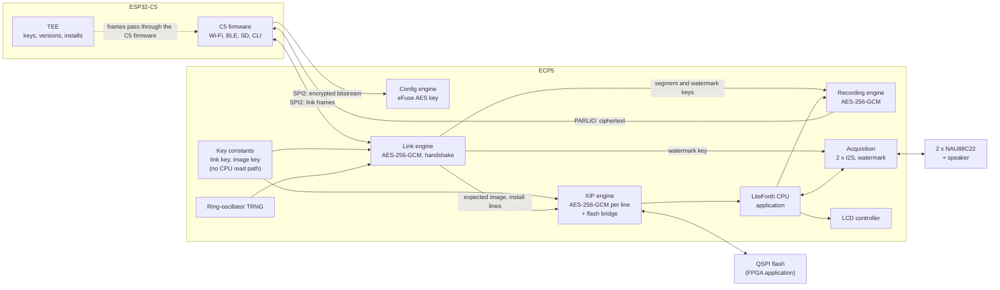

# FPGA

The ECP5 runs the application: a LiteForth CPU executing in place from its own QSPI flash, with the acquisition front end (two NAU88C22 CODECs),
the LCD and the speaker. It is inside the trust boundary for the application and for recordings, so it holds two per-device keys, carried in its encrypted bitstream.
The C5 remains the root of trust: it stores and selects the bitstream, verifies and installs application images, holds the version records,
and does all networking and storage (`doc/c5.md`).

## Block diagram

## Bitstream

- **Per device.** Each device's bitstream carries its own link key and image key as constants in block RAM, patched into a common build with prjtrellis's `ecpbram`
  (no re-place-and-route). Both keys are derived in the HSM from the device root: HMAC(root, "fpga link") and HMAC(root, "fpga image"). The C5's TEE derives the same values.
- **Encrypted by the ECP5's own key.** The bitstream is encrypted with Lattice's `bitgen` under the ECP5's per-device eFuse AES key, so it stays encrypted
  in the C5's flash, on the SPI configuration bus, and in transit. The C5 never holds the plaintext. The C5's flash encryption alone would not do: it decrypts as it reads,
  and the keys would cross the configuration bus in clear.
- **Locked ECP5.** At enrollment the ECP5's AES key is programmed, the "encrypted bitstreams only" setting is fused so it refuses any plaintext or foreign bitstream,
  readback is disabled, and the key fuses are locked (`doc/enrollment.md`).
- **Built by the bitstream build service** for each device and each FPGA release, from one Yosys and nextpnr build: patch the keys, encrypt with `bitgen`, sign the package with the
  manufacturer's LMS key. The service sees per-device keys in plaintext, so it is a protected system with its keys released by the HSM per job (R42).
- **Not authenticated by the ECP5.** ECP5 bitstream encryption has no MAC. A foreign bitstream is refused, but a genuine encrypted one could be modified blindly; each edit scrambles
  whole cipher blocks and must still pass the configuration CRC (R32). The link handshake then catches any bitstream whose keys or version do not check out.

## Configuration

1. The C5's TEE chooses the bitstream slot (A or B in the C5's flash) from its version record; the C5 firmware sends that encrypted bitstream over SPI2 in slave SPI mode.
2. The C5 checks DONE, then opens the link (below). The handshake proves that the configured FPGA holds this device's link key, and reports the bitstream's version,
   which the TEE checks against its record. An old bitstream of the same device, loaded by an attacker through JTAG or the configuration pins, is refused there.
3. If the handshake or the FPGA's self-test fails on a newly installed bitstream, the C5 configures the other slot. The C5 controls configuration, so bitstream fallback is simple.
4. If the FPGA is reset or reconfigured while running, the link session ends; the C5 treats that as an event, logs it, and repeats steps 2 to 3.

## Key isolation in the fabric

| Key | Where it lives | Who can use it | Who can read it |
|---|---|---|---|
| Link key | Block RAM constant in the bitstream | Link engine | No one |
| Image key | Block RAM constant in the bitstream | XIP engine (to derive each install's key) | No one |
| Install key | XIP key register, loaded by the link engine at boot | XIP engine | No one |
| Segment key | Recording engine key register, written by the link engine | Recording engine | No one |
| Watermark key | Watermark generator register, written by the link engine | Watermark generator and correlator | No one |

The LiteForth CPU has no read path to any of them. It can ask the recording engine to encrypt a block and the link engine to send a message, and nothing else.
Key registers are cleared on reset, on reconfiguration, and on any tag or link failure. The CPU's debug port is not built into production bitstreams.

## The link to the C5

The link runs over SPI2, with the C5 as master. The C5 firmware moves the frames; only the TEE holds the C5's copy of the link key.

**Handshake (at every link start):**

1. The FPGA draws a nonce *Nf* from its TRNG; the TEE draws *Nc*.
2. Both derive session keys, one per direction, from the link key and both nonces, with the SP 800-108 counter-mode KDF using AES-256-CMAC
   (AES only, so the FPGA needs no SHA-256).
3. Each side sends a confirmation tag over the whole transcript, including the FPGA's bitstream version and the C5's firmware version, with direction labels.
4. Frames then use AES-256-GCM with a 64-bit counter per direction as the nonce; any failure ends the session and clears the FPGA's session keys.

The FPGA's own nonce is what stops a recorded session from being replayed to it: it keeps no state across boots, so without its TRNG it could not tell an old session from a new one.

**Messages:**

| From | Message | Purpose |
|---|---|---|
| C5 | Boot image: slot, version, install salt, length, mode | The XIP engine derives the install key and unlocks the CPU (`doc/xip.md`) |
| C5 | Install commands and encrypted lines | Flash bridge writes; the CPU is held in reset meanwhile |
| C5 | Segment key, watermark key, segment number | Start a recording segment (`doc/acquisition.md`) |
| C5 | Sensor readings with age and status | The application acts only on readings the TEE has passed (`doc/sensor.md`) |
| C5 | Host commands, settings, alarms | From authenticated host and CLI sessions |
| FPGA | Status, faults, tag failures | Logged by the TEE |
| FPGA | Application messages | Displayed, logged, or sent to the host |

The recording stream itself goes to the C5 over its parallel input (PARLIO), already encrypted to the host by the recording engine, so it does not need the link's encryption
and does not compete with the SD card for SPI2.

## TRNG

A ring-oscillator TRNG with continuous health tests (repetition count and adaptive proportion, as in NIST SP 800-90B), conditioned with AES-CMAC.
It supplies the link nonce. A health-test failure stops the link, so the CPU never starts.

## XIP engine and flash bridge

The application runs from the FPGA's QSPI flash through a decrypting, authenticating cache (`doc/xip.md`). The C5 does the installing: it verifies each package and
writes the encrypted lines through the FPGA's flash bridge, a hardware block driven by link commands, not by the CPU. A broken application cannot stop an update.

## Acquisition, recordings, LCD and speaker

The FPGA masters both CODECs' I2S buses, generates their master clock, runs the watermark generators, and drives the LCD and the speaker (`doc/acquisition.md`).

## Resource estimate

Rough figures, to be replaced by synthesis results:

| Block | LUTs | Block RAM |
|---|---|---|
| LiteForth CPU | 1.5K to 3K | Stacks, data RAM |
| XIP engine: AES-256, GHASH, fill controller, 4 KB cache, flash bridge | 3K to 5K | 4 KB cache, S-boxes |
| Link and recording engine: one shared AES-256-GCM core, KDF, framing | 3K to 4.5K | S-boxes, buffers |
| TRNG | Under 0.2K | |
| Two I2S masters, watermark generators | 1K to 2K | Sine table |
| LCD controller, PARLIO output | 0.5K to 1K | Line buffer |
| **Total** | **About 9K to 16K** | |

An LFE5U-25 (24K LUTs) is the likely minimum; an LFE5U-45 leaves room for the application's own logic.

## Open questions

See `doc/questions.md` (FPGA rows).
