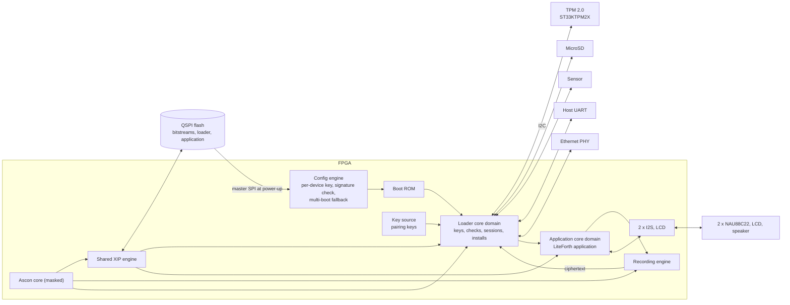

# FPGA

This document is family-neutral. What a family must provide, and how each candidate provides it, is in `fpga/` at the top of the repository:
`fpga/README.md` (the requirements), and one folder per family. The current choice is the **Pango Logos2 PG2L50H-6IFBG484** (`fpga/logos2/`), with the **Efinix Titanium Ti60** as fallback (`fpga/ti60/`).

The FPGA is the root of trust and runs the application. Its configuration engine is the immutable anchor; its bitstream carries the boot ROM, the three cores and the pairing keys;
everything else it needs (keys, counters, identity) is in the TPM, and everything it executes is in the flash, authenticated line by line (`doc/hw.md`, `doc/tpm.md`, `doc/xip.md`).

## Block diagram

## Bitstream

- **Per device, or common with wrapped keys.** In the per-device form, each device's bitstream carries its two pairing keys and their version as constants in the key-source block RAM, written into one common routed design per device by the
  family's build flow (`doc/enrollment.md`, Bitstream build service). Both keys are derived in the HSM: KDF(pairing master, serial number, version).
- **Encrypted by the FPGA's own key.** The bitstream is encrypted under the FPGA's per-device configuration key, held in its eFuses, so it stays encrypted in flash and on the configuration bus.
  The pairing keys exist in plaintext only inside the FPGA and the HSM (R31).
- **No fallback.** The FPGA must be set to refuse any unencrypted or unsigned configuration. A bitstream without the current pairing key gets nothing from the TPM anyway (R17).
- **Authentication is required.** The Logos2 authenticates every bitstream twice (AES-256-GCM under the device's key, RSA-2048 over SHA-3) and the Ti60 with RSA-4096, which closes blind modification
  of an encrypted bitstream (R32). Families that only encrypt (ECP5, GW5A) were dropped for this reason.
- **Superseded bitstreams are dead, not refused.** The configuration engine will load any correctly encrypted and signed bitstream of this device, old or new; the pairing-key ratchet in the TPM
  makes an old one useless (`doc/tpm.md`).

## Wrapped pairing keys: the alternative to per-device bitstreams

Per-device bitstreams need a tool that rewrites block RAM contents in a routed design and then encrypts and signs the result. Some families have one (Efinix's BRAM Initial Content Updater,
Diamond's ECO editor on Lattice parts); Pango's PDS, as far as its Tcl guide goes, does not (F1). The cleaner solution, where the family allows it, is to **keep one bitstream for the whole fleet
and wrap the pairing keys under a key the FPGA alone holds:**

- The configuration engine's eFuse key is per device and never leaves the silicon. If the family gives the fabric a way to decrypt under that key, or under a PUF-protected key, without seeing it
  (PolarFire's sNVM does; the Logos2, as far as is known, does not: F5), then the pairing keys can be stored in flash as ciphertext under it, and the key-source module becomes "read the wrapped keys
  from flash, unwrap them in the vendor's engine, present them to the SHA-256 core." The fixed key-source interface in `doc/hw.md` does not change.
- The bitstream then carries no secret. It is still encrypted (confidentiality of the design) and authenticated (integrity), but it is the same file for every device, built and signed once per release.
- The ratchet still works: a platform package carries the next pairing key wrapped the same way, and the loader writes it into the records region before the reboot. The pairing key version in clear stays.
- The bitstream build service shrinks to a release build and one signature, which removes R42 from the FPGA side and the per-device step from manufacturing: enrollment writes the wrapped keys into flash
  like any other record.
- The wrapping key must be bound to the FPGA, not derivable by anyone else: a key derived from the eFuse key inside vendor silicon qualifies; a key the fabric computes from the device DNA alone does not,
  since the DNA is readable.

This is open question F5. On the Logos2 no such engine is known, so per-device bitstreams (F1) are the plan there; on PolarFire the wrapped-key route is the natural one. On the ASIC the same role is played by the PUF (`doc/ics55.md`), so the two designs converge:
on both, the bitstream or mask is common and the device's secret comes from the silicon.

## Configuration

1. At power-up the configuration engine reads the active bitstream from the flash in master SPI mode, checks it and decrypts it inside the FPGA. If it fails, the family's multi-boot
   loads the other bitstream slot (`doc/flash.md`).
2. The boot ROM starts the TPM, pairs with it and starts the boot chain (`doc/hw.md`, Boot and lockdown). Which bitstream is running is known from the pairing key that worked and the version in the key source.
3. A reconfiguration while running (a glitch, a pulse on the program pin) restarts the chain from the configuration engine; all key registers are in the fabric and are lost with it.
   The boot record's lockdown count records that the device restarted without a clean shutdown.

The FPGA keeps no state across power cycles except its eFuses. Everything else it needs at boot it reads from the TPM (authenticated) or the flash (authenticated under keys the
TPM released).

## Key isolation in the fabric

| Key | Where it lives | Who can use it | Who can read it |
|---|---|---|---|
| Pairing keys | Key-source block RAM in the bitstream | SHA-256 core | No one |
| Application, data, distribution, developer, log keys | Key registers, unsealed by the TPM and decrypted by the session cipher | Their engines | No one |
| Image keys, install keys | XIP engine and install port registers, derived in hardware | XIP engine, install port | No one |
| Session, sensor and segment keys | Key registers | Install port, recording engine | No one (the segment key's one wrapped exposure to the loader's ML-KEM code is noted in `doc/hw.md`) |

No core has a read path to any of them, or to the Ascon core. Key registers are cleared on reset, on reconfiguration, and on any tag or protocol failure. No CPU debug port is built into production bitstreams.

## TRNG

A ring-oscillator TRNG with continuous health tests (repetition count and adaptive proportion, as in NIST SP 800-90B), conditioned in the SHA-256 core (a vetted conditioning function), feeding an SP 800-90A HMAC_DRBG on the same core with the
TPM's random output (its SP 800-90B source and Hash_DRBG are on its CMVP certificate) as additional input, so every nonce has a validated source behind it even if the ring oscillators degrade. The DRBG supplies every key, nonce, segment key and install salt, and seeds the PRNG that
feeds the masked Ascon and SHA-256 cores with fresh shares, whose consumption sets the TRNG's required rate (F4). A health-test failure stops the boot chain before any key is unwrapped.

The conditioning component is sized from measurement, not assumption: the RTC-driven restart campaign in `doc/test.md` (TRNG characterization) logs raw noise-source samples at a thousand cold starts,
and the SP 800-90B estimators on that data give the entropy per sample that decides how many raw bits each conditioned output needs and whether a vetted conditioner (the SHA-256 core) can be run at a
low ratio. The raw-sample logging path exists only in test builds and is reached only by the boot ROM before any key is unwrapped.

## Resource estimate

See `doc/hw.md`, Resource estimate: about 17K to 30K LUT4 equivalents for the three cores and the security blocks, including the masked Ascon core, plus the application.

## Open questions

See `doc/questions.md` (FPGA rows).
