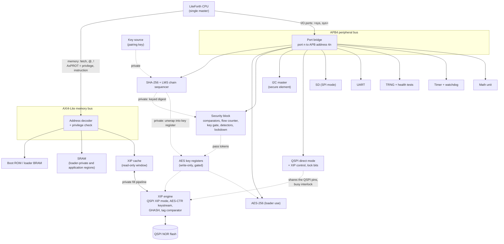

# Hardware Modules and Interconnect

This document lists the hardware modules of the `thriller` FPGA (and later ASIC) design and how they connect.
It follows the Verilog/Forth split in `doc/arch.md` (Implementation partition) and the execute-in-place design in `doc/xip.md`.

## Principles

1. **Two buses, chosen by speed.** An AXI4-Lite memory bus for what the CPU fetches from and loads from every few cycles; APB4 for peripherals.
2. **One bus master in production.** The LiteForth CPU is the only master. With no DMA, no other agent can read or write memory or peripherals.
   Test-only masters exist only in test builds.
3. **Secrets never cross a bus.** Keys, comparator results and the XIP fill pipeline use private, point-to-point connections.
4. **The loader is privileged; the application is not.** Both run on the same CPU, so hardware must keep the application away from keys and from the loader's controls (see Privilege).
5. **Same Forth code everywhere.** Peripherals are reached through LiteForth's I/O ports (`>sys` and `sys>`), which `vm.c` and MCU builds implement in C.

## Block diagram

Dotted lines are private connections, never visible on either bus.

## Bus choice

| Path | Protocol | Why |
|---|---|---|
| CPU memory port (fetch, `@`, `!`) | **AXI4-Lite** | The CPU fetches every instruction pair and loads data through it; it needs single-beat, low-latency access. The CPU never bursts, so the burst features of full AXI4 would go unused. The slaves can be upgraded to full AXI4 later if a burst-capable master is ever added |
| CPU I/O ports (`>sys`, `sys>`) | **Port bridge to APB4** | Peripherals need no speed beyond what the CPU can drive. APB is simple, standard, and has `PPROT` for privilege and `PSLVERR` for errors |
| XIP cache refills | **Private pipeline** | Must keep pace with the flash (about 2 µs per 64-byte line) and keep the device key inside the engine (`doc/xip.md`) |
| Keys, comparator results, pass tokens | **Private wires** | Never on a bus, so no software can read them |

LiteForth's I/O ports have a 9-bit immediate index, so there are 512 ports, and reads and writes are separate spaces (`src/iomap.h` in LiteForth).
The port bridge turns `>sys n` into an APB write and `sys> n` into an APB read at address 4n. Ports 0 to 15 belong to the VM itself and never reach the bridge.
A port that returns `PSLVERR` becomes an ior, which LiteForth already treats like a failed memory access.

Because the port index is compiled into the instruction, every port an image uses can be found by scanning it. That gives a cheap static check (see Privilege).

## Modules

| Module | Connection | Speed need | Loader only | FPGA | ASIC | Notes |
|---|---|---|:-:|---|---|---|
| LiteForth CPU | Master | — | — | RTL | RTL | Drives AxPROT from its privilege state |
| Address decoder | AXI4-Lite interconnect | Every access | — | RTL | RTL | Unmapped or forbidden access returns `SLVERR` or `DECERR`, which becomes a CPU fault |
| Boot ROM / loader memory | AXI4-Lite slave | Every fetch | Yes (instruction fetch allowed from the application only at entry points) | Block RAM, initialized by the bitstream | Mask ROM | Holds the loader's boot code (`doc/ics55.md`, migration hooks) |
| SRAM | AXI4-Lite slave | Every load and store | Loader-private region: yes | Block RAM | SRAM macro | Two regions: loader-private (keys in transit, buffers) and application |
| XIP cache | AXI4-Lite slave (read-only) | Hits every fetch | — | Block RAM + flip-flops | SRAM macro + flip-flops | Writes return an error |
| XIP engine | Private to the cache | About 2 µs per line | — | RTL | RTL | QSPI XIP mode, AES-CTR keystream, GHASH, tag comparator |
| QSPI direct mode, XIP control, lock bits | APB | Slow | Yes | RTL | RTL | Busy interlock: a cache miss in direct mode raises a programming fault (`doc/xip.md`) |
| SHA-256 core + LMS chain sequencer | APB | About 1 word per 4 cycles | Key insertion: yes | RTL | RTL | Private key input and private keyed-digest output (see Key paths) |
| AES-256 core (loader use) | APB | Moderate | Yes | RTL | RTL | Shares the AES datapath with the XIP engine; XIP refills take priority |
| AES key registers and key gate | Private | — | Yes (write-only) | RTL | RTL | Loaded only from the SHA unwrap path or a privileged write; never readable |
| Security block | APB | Slow | Yes | RTL | RTL | Comparators, flow counter, key gate tokens, glitch and clock detectors, lockdown, fault status, secret-clear fan-out |
| Key source (pairing key) | Private to SHA | — | — | Small block RAM, patched per board | PUF + unwrap (`doc/ics55.md`) | Behind the fixed interface from the migration hooks |
| I2C master | APB | 100 to 400 kHz | Yes | RTL | RTL | The secure element's bus |
| SD (SPI mode) | APB | Up to a few MB/s | Shared, see note | RTL | RTL | The loader uses it for logs and offline packages; whether the application may use it is a product decision |
| UART | APB | 115 kbaud to a few Mbaud | Shared | RTL | RTL | The LiteForth terminal (ports 16 to 18) |
| TRNG + health tests | APB | Slow | Raw output: yes | Ring oscillators | Ring oscillators | Conditioned output can be offered to the application |
| Timer + watchdog | APB | Slow | Watchdog control: yes | RTL | RTL | A hung loader resets and fails safe (`doc/test.md`) |
| Math unit | APB | Moderate | No | RTL | RTL | LiteForth's multiply and divide ports (32 to 43); `hardware/verilog/modules` in LiteForth has a divider |
| Clock and reset | Private | — | — | PLL primitive (wrapped) | PLL macro (wrapped) | One core clock domain; the oscillator also feeds the clock checker |
| Test only: fault controller, trigger pin, debug bridge | Test builds only | — | — | RTL | Not on the die | Absent from production builds (`doc/test.md`, campaign C) |

## Memory map

Byte addresses on the AXI4-Lite bus. LiteForth is cell-addressed with 22-bit cell addresses, so the CPU's byte addresses span 16 MB.

| Byte address | Size | Region | Access |
|---|---|---|---|
| `0x000000` | 64 KB | Boot ROM / loader memory | Privileged; the application may fetch only the entry-point table at its start |
| `0x010000` | 16 KB | Loader-private SRAM | Privileged only |
| `0x020000` | up to 192 KB | Application SRAM | Anyone |
| `0x050000` | — | Unmapped | Error |
| `0x400000` | 12 MB | XIP window (active application slot, plaintext view) | Read and fetch; writes return an error |

Sizes are placeholders, to be set from the RAM budget (`doc/xip.md`) and the target's block RAM.

## Port map

Ports 16 to 43 keep LiteForth's existing assignments. The rest are proposals, grouped in blocks of 16 so each module decodes the low 4 bits.

| Ports | Module | Privileged |
|---|---|:-:|
| 0 to 15 | The VM's own (not on APB) | — |
| 16 to 18 | UART (LiteForth terminal) | No |
| 24 | LCD (LiteForth) | No |
| 32 to 43 | Math unit (LiteForth) | No |
| 64 to 79 | SHA-256 core and LMS chain sequencer | Key insertion ports only |
| 80 to 95 | AES-256 (loader use) | Yes |
| 96 to 111 | Security block | Yes |
| 112 to 127 | I2C master | Yes |
| 128 to 143 | QSPI direct mode, XIP control, lock bits | Yes |
| 144 to 159 | SD (SPI mode) | Product decision |
| 160 to 175 | TRNG | Raw output only |
| 176 to 191 | Timer and watchdog | Watchdog only |
| 192 to 511 | Reserved | — |

These would also be added to LiteForth's `iomap.h`, so the desktop and MCU builds implement the same ports in C.

## Privilege

The application runs on the same CPU as the loader. Without hardware separation, application code could read the pairing key,
talk to the secure element, load keys or put the flash in direct mode. That matters most when the application belongs to a customer
(`doc/arch.md`, Open Question 6), but it matters for any application with a bug.

LiteForth has no privilege modes, so privilege comes from where the CPU is executing:

- **The CPU is privileged while its PC is in the loader region** (boot ROM or loader memory). It drives this as `AxPROT[0]` on AXI4-Lite,
  and the port bridge passes it on as `PPROT[0]` on APB4. Both are standard signals.
- **Entry only through entry points.** The first cells of the loader region are a table of entry points. A jump, call or return into the loader region
  anywhere else raises a fault. Leaving the loader region drops privilege at once.
- **Privileged-only resources** return an error to an unprivileged access: loader-private SRAM, and the ports marked privileged above.
- **The loader wipes its secrets** from the data stack and registers before returning to the application, since the stacks are shared.
- **A static check adds depth.** Because port numbers are compiled into instructions, the packaging tool scans an application image and refuses one that
  uses a privileged port. The hardware check is what enforces it; the scan catches mistakes early.

This needs a few gates in the CPU (compare the PC with the loader region, check entry points) and the PROT signals that the buses already carry.

## Key paths

The loader's Forth code never needs to see a key.

**Pairing key into SHA-256.** Every secure element MAC format hashes the pairing key as one 32-byte field of the message (`doc/arch.md`, secure element MAC protocol).
The SHA-256 core has a privileged "insert key here" port: the key source feeds the 32 bytes straight into the message. The CPU supplies everything else.

**Keyed digests stay private.** A digest whose input included an inserted key can't be read back over APB. It can only go to:
- the security block's comparator, to check a MAC from the secure element; or
- the AES key registers, XORed in, to unwrap a key read from the secure element with EncRead (whose keystream is such a digest).

**Result:** the pairing key, the application key, the data key and the distribution key all move from the key source or the secure element
into the AES key registers without passing through the CPU, its stacks, or SRAM. A bug in the loader, or a compromised application, cannot leak them.
Unkeyed digests (LMS verification, image hashes) remain readable, as the loader needs them.

## Clocks, resets and errors

- **One core clock domain** for all security logic, from the oscillator through the PLL. Fault analysis is much simpler without clock-domain crossings.
- **QSPI** is clocked from the core clock (with DDR outputs if a faster flash clock is needed).
- **The TRNG's ring oscillators** are asynchronous by design and pass through a synchronizer into the health tests.
- **Clock checker:** compares the core clock with the oscillator to detect clock glitching (`doc/test.md`, countermeasure 7).
- **Resets:** a power-on reset, the watchdog reset and the lockdown all clear the key registers, pass tokens, cache lock bits and loader-private SRAM through the secret-clear fan-out.
- **Errors:** an AXI error response or `PSLVERR` becomes an ior in the CPU, which goes to the loader's or the application's `yeet` handler. Privilege violations and the XIP tag failure go to lockdown.

## FPGA and ASIC

Every module above is the same RTL on both, except the memories and the clock primitive, which sit behind the wrappers from `doc/ics55.md`, and the key source,
which has the fixed interface from the same document. Test-only modules are compiled in only for test builds, on the FPGA, and never reach the ASIC.

## Open questions

1. **AXI4-Lite latency.** Whether the decoder and slaves can answer in the cycles the CPU's memory state machine expects (LiteForth's `doc/hdl.md` assumes about 5 cycles per read), or whether ROM and SRAM need a tightly coupled path beside the bus.
2. **Privilege details.** How the entry-point table is laid out, how the CPU tracks a return into the loader region, and how the multitasker interacts with privileged code.
3. **SD access for the application.** Whether the application may use the card, and if so whether it gets its own region of it.
4. **Port numbering.** Agree the proposed ports with LiteForth's `iomap.h` before any RTL fixes them.
5. **DMA.** None is planned. If throughput ever needs one, it must be limited to fixed source and destination windows, like LiteForth's Guarded DMA on the CH32H417.
