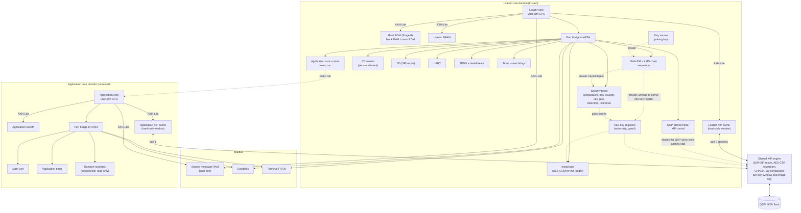

# Hardware Modules and Interconnect

This document lists the hardware modules of the `thriller` FPGA (and later ASIC) design and how they connect.
It follows the Verilog/Forth split in `doc/arch.md` (Implementation partition) and the execute-in-place design in `doc/xip.md`.

## Principles

1. **Two cores.** A loader core runs the loader and owns every secret and every security control. An application core runs the application.
   The loader is a firewall: the application reaches security functions only by sending it messages.
2. **Separation by wiring.** The application core's buses have no connection to keys, the secure element, the security block or flash writing.
   This is checked from the netlist's connectivity, not argued from a privilege state machine.
3. **Both cores execute in place, through one shared XIP engine.** Each core has its own cache, flash window and image key; the QSPI controller,
   AES, GHASH and tag comparator are built once. There is only one flash, so a second engine would add no throughput.
4. **The FPGA mirrors the ASIC's boot chain.** A small boot ROM (block RAM on the FPGA, mask ROM on the ASIC) verifies the loader image in flash,
   and the loader verifies the application, on both. The ASIC's boot chain is tested from the first FPGA build.
5. **Two buses per core, chosen by speed.** AXI4-Lite for memory (fetches and loads every few cycles); APB4 for peripherals.
6. **Each core is the only master on its own buses.** No DMA. Test-only masters exist only in test builds.
7. **Secrets never cross a bus.** Keys, comparator results and the XIP fill pipeline use private, point-to-point connections.
8. **Same Forth code everywhere.** Peripherals are reached through LiteForth's I/O ports (`>sys` and `sys>`), which `vm.c` and MCU builds implement in C.

LiteForth already works this way on the CH32H417: its V3F core runs stage 1, holds the device key and bridges USB to the V5F core,
which runs LiteForth and the application. The two cores talk through rings in shared SRAM (`cdc_shared.h` in LiteForth).

## Block diagram

Dotted lines are private connections, never visible on any bus. Nothing in the application core domain connects to the loader core domain
except through the mailbox and its own port on the XIP engine, which can only fill its own cache, from its own window, with its own key.

## Bus choice

| Path | Protocol | Why |
|---|---|---|
| Each core's memory port (fetch, `@`, `!`) | **AXI4-Lite** | Single-beat, low-latency access for every instruction pair and load. The cores never burst, so the burst features of full AXI4 would go unused. The slaves can be upgraded to full AXI4 if a burst-capable master is ever added |
| Each core's I/O ports (`>sys`, `sys>`) | **Port bridge to APB4** | Peripherals need no speed beyond what a core can drive. APB is simple and standard, and `PSLVERR` carries errors |
| XIP cache refills (both caches) | **Private pipeline, two ports** | Must keep pace with the flash (about 2 µs per 64-byte line) and keep the image keys inside the engine (`doc/xip.md`) |
| Keys, comparator results, pass tokens | **Private wires** | Never on a bus, so no software on either core can read them |

LiteForth's I/O ports have a 9-bit immediate index, so each core has 512 ports, and reads and writes are separate spaces (`src/iomap.h` in LiteForth).
Each core's port bridge turns `>sys n` into an APB write and `sys> n` into an APB read at address 4n. Ports 0 to 15 belong to the VM itself and never reach the bridge.
A port that returns `PSLVERR` becomes an ior, which LiteForth already treats like a failed memory access.

## Shared XIP engine

| Shared (one copy) | Per port (one for each core) |
|---|---|
| QSPI controller and the address mapper (line plus tag stride) | A cache: the loader's 2 KB, the application's 4 KB |
| AES core (keystream and tag mask) and GHASH multiplier | A request port into the fill engine |
| Tag comparator and fill state machine | A flash window (base and limit) and an image key register |
| Busy interlock for flash writes | |
| **Install port** (port 2, loader only, through APB): GCM on lines and records for the loader | |

- **The requesting port selects the key and window in hardware.** Software never chooses them for a fill, so the application core cannot cause a fill
  with the loader's key or from the loader's flash region.
- **Separate caches.** The application can never hit on a loader line.
- **Loader priority.** Port 0 (the loader) wins arbitration, so the application cannot starve the loader by forcing misses. A loader miss waits at most
  for one application fill in progress, about 2 µs.
- **Write-once configuration.** The boot ROM sets port 0's window and key at reset; the loader sets port 1's. Each port's configuration locks until the next reset.
- **Install port.** The loader reaches the engine's AES and GHASH through a third port, which never fills a cache. It encrypts and tags lines under
  install key B for writing to an inactive slot, decrypts and checks lines from any slot for read-back, and runs AES-GCM on user data records and
  session frames. Cache fills take priority over it.
- **Accepted leak.** The application can time its own misses and infer when the loader is fetching. That reveals the loader's activity, not secrets,
  because keys and crypto stay in hardware.

## Mailbox

The mailbox is the only path from the application to the loader, so it is the firewall.

| Part | What it is |
|---|---|
| Message RAM | A small dual-port RAM (2 KB, one 18 Kbit block RAM on the FPGA), with a request ring written by the application core and a response ring written by the loader core. Each core sees it on its AXI4-Lite bus |
| Doorbells | One register in each direction: writing it raises an event the other core can poll or wait on |
| Terminal FIFOs | A byte FIFO each way. On the application core they sit behind ports 16 to 18, so LiteForth's `key`, `emit`, `key?` and `emit?` work unchanged. The loader forwards them to and from the UART |

**Services the loader offers through the mailbox** (a small, fixed set, each with a fixed message format):

- Read and write user data on the MicroSD card (encrypted under the data key, inside the loader)
- Host session status: the host opens and closes sessions over the UART; the application can ask whether a session is open, or ask the loader to prompt the host for one, and learns only success or failure
- Append to the security event log
- Install an application update from the staging area
- Get the device's identity and status

**Rules for the loader's message parser:**
- Copy each request out of the shared RAM before checking it, so the application core cannot change it between check and use.
- Check every length, offset and field against fixed limits; reject anything else.
- Never pass a pointer from a message to anything; the loader works only on its own copy.
- Fuzz the parser on the software platform, like the MicroSD input (`doc/test.md`).

## Modules

### Loader core domain

| Module | Connection | Speed need | FPGA | ASIC | Notes |
|---|---|---|---|---|---|
| Loader core | Master | — | RTL | RTL | Unmodified LiteForth CPU |
| Boot ROM (Stage 0) | AXI4-Lite | Every fetch while it runs | Block RAM, initialized by the bitstream | Mask ROM (`doc/ics55.md`) | See Boot ROM contents |
| Loader XIP cache | AXI4-Lite (read-only) | Hits every loader fetch | Block RAM + distributed RAM | SRAM macro + flip-flops | 2 KB; the rest of the loader runs from flash through it |
| Loader SRAM | AXI4-Lite | Every load and store | Block RAM | SRAM macro | Buffers, stacks, variables; never keys (see Key paths) |
| SHA-256 core + LMS chain sequencer | APB | About 1 word per 4 cycles | RTL | RTL | Private key input and private keyed-digest output (see Key paths) |
| AES-256 for the loader | Install port of the XIP engine | Moderate | RTL | RTL | The engine's masked AES core and GHASH, through port 2; cache fills take priority |
| AES key registers and key gate | Private | — | RTL | RTL | Loaded only from the SHA unwrap or derive path, with pass tokens; never readable (see Key registers) |
| Security block | APB | Slow | RTL | RTL | Comparators, flow counter, key gate tokens, glitch and clock detectors, lockdown, fault status, secret-clear fan-out |
| Key source (pairing key) | Private to SHA | — | Small block RAM, patched per board | PUF + unwrap (`doc/ics55.md`) | Behind the fixed interface from the migration hooks |
| I2C master | APB | 100 to 400 kHz | RTL | RTL | The secure element's bus |
| QSPI direct mode, XIP control | APB | Slow | RTL | RTL | Erase and program, driven by the boot ROM's primitives during updates and development only; both caches stall meanwhile. Port window and key setup, write-once |
| SD (SPI mode) | APB | Up to a few MB/s | RTL | RTL | User data, logs, offline packages |
| UART | APB | 115 kbaud to a few Mbaud | RTL | RTL | Host protocol, and the application's terminal forwarded through the mailbox |
| TRNG + health tests | APB | Slow | Ring oscillators | Ring oscillators | Also feeds conditioned random numbers to the application core |
| Timer + watchdogs | APB | Slow | RTL | RTL | One watchdog for each core; the loader resets the application core on its timeout |
| Application core control | APB | Slow | RTL | RTL | Holds the application core in reset until boot checks pass; lockdown holds it in reset |
| Mailbox (loader side) | AXI4-Lite + APB | Moderate | Dual-port block RAM | Dual-port SRAM | |

### Application core domain

| Module | Connection | Speed need | FPGA | ASIC | Notes |
|---|---|---|---|---|---|
| Application core | Master | — | RTL | RTL | Unmodified LiteForth CPU |
| Application SRAM | AXI4-Lite | Every load and store | Block RAM | SRAM macro | Variables, stacks, buffers |
| Application XIP cache | AXI4-Lite (read-only) | Hits every fetch | Block RAM + flip-flops | SRAM macro + flip-flops | 4 KB; writes return an error |
| Math unit | APB | Moderate | RTL | RTL | LiteForth's multiply and divide ports (32 to 43) |
| Application timer | APB | Slow | RTL | RTL | |
| Random numbers | APB | Slow | RTL | RTL | Conditioned output from the loader's TRNG, read-only |
| Mailbox (application side) | AXI4-Lite + APB | Moderate | Shared with the loader side | Shared | Includes the terminal FIFOs at ports 16 to 18 |
| Optional application peripherals | APB | Product-specific | RTL | RTL | GPIO, LCD (LiteForth's port 24), sensors: anything that holds no secret |

### Shared

| Module | Connection | Notes |
|---|---|---|
| XIP engine | Private to both caches and the key registers | Two ports; QSPI XIP mode, AES-CTR keystream, GHASH, tag comparator (`doc/xip.md`) |
| Clock and reset | Private | One core clock domain for both cores; the oscillator also feeds the clock checker |
| Test only: fault controller, trigger pin, debug bridge | Test builds only | Absent from production builds (`doc/test.md`, campaign C) |

## Memory maps

Byte addresses on each core's AXI4-Lite bus. LiteForth is cell-addressed with 22-bit cell addresses, so each core's byte addresses span 16 MB.
Sizes are placeholders, to be set from the RAM budget (`doc/xip.md`) and the target's block RAM.

**Loader core:**

| Byte address | Size | Region |
|---|---|---|
| `0x000000` | 16 KB | Boot ROM (Stage 0) |
| `0x010000` | 16 KB | Loader SRAM (a placeholder; the loader's own needs are about 3 to 4 KB, `doc/xip.md`) |
| `0x030000` | 2 KB | Mailbox message RAM |
| `0x400000` | about 450 KB | Loader XIP window (active loader slot, plaintext view; `doc/flash.md`); writes return an error |
| other | — | Unmapped: error |

**Application core:**

| Byte address | Size | Region |
|---|---|---|
| `0x030000` | 2 KB | Mailbox message RAM |
| `0x040000` | up to 192 KB | Application SRAM |
| `0x400000` | about 10.5 MB | Application XIP window (active application slot, plaintext view; `doc/flash.md`); writes return an error |
| other | — | Unmapped: error |

The two XIP windows share a CPU address but map to different flash regions, each set by its own port's window register.

## Port maps

Ports 16 to 43 keep LiteForth's existing assignments on the core where they apply. The rest are proposals, in blocks of 16 so each module decodes the low 4 bits.

| Ports | Loader core | Application core |
|---|---|---|
| 0 to 15 | The VM's own (not on APB) | The VM's own (not on APB) |
| 16 to 18 | UART (the real one) | Terminal FIFOs to the loader (LiteForth's `key`, `emit`, `key?`, `emit?`) |
| 24 | — | LCD (LiteForth), if fitted |
| 32 to 43 | Math unit, if fitted | Math unit (LiteForth) |
| 64 to 79 | SHA-256 core and LMS chain sequencer | Mailbox doorbell and status |
| 80 to 95 | Install port of the XIP engine (AES-GCM for the loader) | Application timer |
| 96 to 111 | Security block | Random numbers |
| 112 to 127 | I2C master | Optional application peripherals |
| 128 to 143 | QSPI direct mode, XIP control and port configuration | — |
| 144 to 159 | SD (SPI mode) | — |
| 160 to 175 | TRNG | — |
| 176 to 191 | Timer and watchdogs | — |
| 192 to 207 | Application core control, mailbox doorbell, terminal FIFOs | — |
| 208 to 511 | Reserved | Reserved |

These would also be added to LiteForth's `iomap.h`, so the desktop and MCU builds implement the same ports in C.

## Key paths

All key handling is in the loader core domain, and even the loader's Forth code never sees a key.

### Key registers

| Register | Holds | Loaded from | Used by |
|---|---|---|---|
| SHA-256 key input | The pairing key, or the application, developer or log key | The key source, or an EncRead unwrap | Secure element MACs, header and boot-record HMACs, log MACs, key derivation |
| XIP port 0 key | Loader image key | Derived from the application key | Loader cache fills |
| XIP port 1 key | Application image key | Derived from the application key | Application cache fills |
| Install key A | Distribution key, package content key, or developer package key | EncRead unwrap or derivation | Decrypting a package on the install port |
| Install key B | The new image key for the slot being written | Derived from the application key and a fresh salt | Encrypting and tagging lines on the install port |
| Data key | User data key, or the developer data key | EncRead unwrap after CheckMac, then optional derivation | User data records on the MicroSD card |
| Session key | Host session key (`doc/questions.md`, Arch 13) | Unwrap of the secure element's KDF output | Session frames on the UART |

**Pairing key into SHA-256.** Every secure element MAC format hashes the pairing key as one 32-byte field of the message (`doc/arch.md`, secure element MAC protocol).
The SHA-256 core has an "insert key here" port: the key source, or a key unwrapped from the secure element, feeds the 32 bytes straight into the message.
The loader core supplies everything else.

### Two output modes

Every keyed SHA-256 operation runs in one of two modes, set by a domain byte at the start of the message and enforced in hardware:

- **Derive mode.** The digest is key material: an EncRead keystream, an image key, a working key, a session key. It can never be read over APB.
  It goes only to a key register, XORed in (to unwrap) or loaded directly (for a derivation).
- **MAC mode.** The digest is a MAC, which is not secret. It can be read over APB, or sent to the security block's comparator. The loader uses it to
  write header HMACs, boot-record HMACs and log MACs, and to check the secure element's MACs.

The domain bytes reserved for derivation are refused in MAC mode, so software can never compute a derivation as a MAC and read the key it produces.
Unkeyed digests (LMS verification, image hashes) remain readable.

### Encrypted reads carry no MAC

The secure element's encrypted read (Nonce, GenDig, Read, then XOR with TempKey, as cryptoauthlib implements it) is not authenticated: a key altered
on the I2C bus unwraps to a wrong value without any error. Every unwrapped key is therefore checked before it is trusted:

- the application key, by the header HMAC it must reproduce;
- the developer key, by the developer package HMAC it must reproduce;
- the log key, by the existing log chain it must reproduce;
- the data key and the distribution key, by key check values: a MAC of a fixed string under each key, written at provisioning into the first 32 bytes
  of slot 8 (16 bytes each), which an authenticated read covers (`doc/se.md`).

### Pass tokens

The key gate loads a decryption key into an AES key register only with pass tokens from hardware comparators:

- an image key goes into an XIP port only after the header HMAC comparator passes, and the version comparator (production image) or the epoch
  comparator (developer image) passes, for that image;
- the data key goes into its register only after its key check value passes; the secure element releases it only after a successful CheckMac;
- the install keys load only after the package's LMS root comparator, or the developer package HMAC comparator, passes;
- the session key loads only after the session's key confirmation passes (Arch 13).

**Result:** the pairing key and the application, data, distribution, developer, log and session keys move from the key source or the secure element
into key registers without passing through either CPU, their stacks, or any SRAM. A bug in the loader cannot leak them, and the application core has no path to them at all.

## Boot ROM contents

The boot ROM holds everything that must run before the loader is trusted, or while flash cannot be read:

- Reset, clocking and SRAM test; on the ASIC, the PUF key derivation and the pairing key unwrap (`doc/ics55.md`)
- Drivers for the SHA-256, AES, I2C and QSPI cores, and the TRNG health check
- The secure element pairing exchange, authenticated counter reads, and the EncRead of the application key
- The loader header check: HMAC, version against counter 0, image key derivation, then configuring and locking XIP port 0
- The boot record: choosing the active loader slot, and skipping slots marked bad (`doc/flash.md`)
- LMS verification, used by UART recovery
- Flash primitives (read into SRAM, erase, program, status), since nothing fetched from flash can run while the flash is busy
- The lockdown path, which records the event in the flash boot record; it needs no MicroSD driver and no key
- UART recovery: receiving a signed loader package into a flash staging region, verifying it, and installing it into a loader slot (`doc/flash.md`, Staging)

## Boot and lockdown

The same chain runs on the FPGA and the ASIC. On the FPGA, the configuration engine first loads the bitstream, which contains the boot ROM.

1. **Boot ROM.** Reset holds the application core in reset, and the loader core starts in the boot ROM. It authenticates to the secure element,
   reads counter 0, unwraps the application key, checks the loader image header's HMAC and the loader's version against counter 0, derives the loader
   image key into port 0, and locks port 0's window and key. It then jumps to the loader in its XIP window.
   If no loader slot checks, it stays in UART recovery.
2. **Loader.** The loader moves any lockdown record from the boot record into the security event log on the card. It reads counter 1, checks the application
   image header and its version (production) or epoch (developer), derives the application image key into port 1, and locks port 1's window and key (`doc/xip.md`).
3. **Application.** The loader releases the application core, which starts executing from its XIP window.
4. **Lockdown** (any detection, a tag failure on either port, a fault in the loader) enters the boot ROM through a hardware vector, never through
   loader code, which may be the flash that just failed. In this order, it:
   1. holds the application core in reset;
   2. clears the key registers, pass tokens, both caches and the XIP port configuration through the secret-clear fan-out, and wipes the loader's stacks and registers;
   3. writes a lockdown record into the flash boot record with the boot ROM's flash primitives: the cause, and for a tag failure the slot, which it marks bad.
      The record is not authenticated, because it can only cause logging and a fallback;
   4. halts until the next power-on reset.

On the next boot, the boot ROM and the loader skip slots marked bad and fall back to the other slot, or to recovery or update-only mode if both are bad.
A single flash bit error therefore costs one slot, not a lockdown loop. Lockdowns are counted in the boot record; past a threshold the device stays in update-only mode.

## Clocks, resets and errors

- **One core clock domain** for both cores and all security logic, from the oscillator through the PLL. The mailbox needs no clock-domain crossing.
- **QSPI** is clocked from the core clock (with DDR outputs if a faster flash clock is needed).
- **The TRNG's ring oscillators** are asynchronous by design and pass through a synchronizer into the health tests.
- **Clock checker:** compares the core clock with the oscillator to detect clock glitching (`doc/test.md`, countermeasure 7).
- **Resets:** power-on and the loader watchdog reset both cores and clear the key registers, pass tokens, both caches, the XIP port configuration
  and loader SRAM through the secret-clear fan-out; the boot ROM then starts again. Lockdown halts instead (see Boot and lockdown).
  The application watchdog resets only the application core, and it pauses while the QSPI controller is in direct mode, so a long erase stall cannot trip it.
- **One UART, two channels.** The UART carries the host protocol (updates, sessions) and the application's forwarded terminal. Each frame carries
  a channel number, and the loader handles host protocol frames itself and forwards terminal frames to the application's FIFOs.
- **Errors:** a bus error or `PSLVERR` becomes an ior in the core that caused it and goes to that core's `yeet` handler.
  An XIP tag failure goes to the lockdown, on either port.

## Software platform

`vm.c` keeps its state in one global struct, so the desktop software platform runs the two cores as two processes, joined by a
shared-memory mailbox. LiteForth's `unit_tests/stage1sim` already runs the CH32H417's two cores this way. The shared XIP engine is modeled once,
with a port for each process.

## FPGA and ASIC

Every module above is the same RTL on both, except the memories and the clock primitive, which sit behind the wrappers from `doc/ics55.md`, and the key source,
which has the fixed interface from the same document. Test-only modules are compiled in only for test builds, on the FPGA, and never reach the ASIC.

On the FPGA the boot ROM is block RAM inside the bitstream, so unlike the ASIC's mask ROM it can still be changed by a platform update.
Everything else about the boot chain is the same.

### Resource estimate for the mirrored boot chain

Mirroring the ASIC boot chain, compared with keeping the whole loader in block RAM, adds a second cache and XIP port.
These are estimates, to be replaced by synthesis results:

| Addition | Logic (LUT4) | Flip-flops | Block RAM |
|---|---|---|---|
| Loader cache controller (2-way, 64-byte lines, AXI4-Lite port, LRU) | 300 to 500 | about 100 | — |
| Loader cache tags (32 lines × about 15 bits) | 50 to 100, in distributed RAM | — | — |
| Loader cache data (2 KB) | — | — | 1 block |
| Second request port, priority arbiter, per-port window registers, write-once locks | 50 to 150 | about 70 | — |
| Second image key register and key select into the AES core | 100 to 300 (less with the keys in distributed RAM) | up to 256 | — |
| Install port (port 2) and its arbitration | 100 to 200 | about 50 | — |
| **Total** | **about 0.6K to 1.3K** | **about 0.5K** | **+1 block** |

| Part | Logic available | Added logic | Block RAM available |
|---|---|---|---|
| LFE5U-25 (ECP5) | 24K LUTs | about 2 to 5% | 56 blocks of 18 Kbit (1,008 Kbit) |
| LIFCL-17 (CrossLink-NX) | 17K logic cells | about 3 to 7% | 432 Kbit EBR, plus 2,560 Kbit LRAM |
| Ti60 (Titanium) | 62K logic elements | about 1 to 2% | 256 blocks of 10 Kbit (2.6 Mbit) |

Not included: the masked AES core, which is now part of the base design (`doc/arch.md`, R17). Masking typically costs two to four times the
area of an unmasked core; to be measured (`doc/arch.md`, Open Question 14).

**Block RAM use goes down.** Only the boot ROM (8 to 16 KB) and the 2 KB loader cache stay in block RAM, instead of the whole loader.
If the full loader is 24 to 40 KB, that frees roughly 6 to 22 KB, or 3 to 11 ECP5 blocks.

Other costs: the loader image in flash (a few tens of KB plus 12.5% for tags), one more header check at boot (a few milliseconds),
and loader cache misses at run time (about 2 µs each; the hit rate is to be measured).

## Open questions

1. **AXI4-Lite latency.** Whether the decoder and slaves can answer in the cycles the CPU's memory state machine expects (LiteForth's `doc/hdl.md` assumes about 5 cycles per read), or whether ROM and SRAM need a tightly coupled path beside the bus.
2. **Mailbox message set.** The exact services and their formats, and the message RAM's size.
3. **SD for the application.** Whether the application needs the card for its own files, through mailbox services or a separate region.
4. **Port numbering.** Agree the proposed ports with LiteForth's `iomap.h` before any RTL fixes them.
5. **Loader cache size and boot ROM size,** from measurements of the loader's run-time hit rate and the Stage 0 code size on the FPGA.
