# Hardware Modules and Interconnect

This document lists the hardware modules of the `thriller` FPGA (and later ASIC) design and how they connect. The execute-in-place design is in `doc/xip.md`,
the TPM in `doc/tpm.md`, the flash map in `doc/flash.md`. Everything here is family-neutral RTL; the primitives it needs from a family are in `fpga/README.md`.

## Principles

1. **Three cores, one of them the cryptographic module.** The **loader core** runs the boot ROM and the loader, owns every secret and every security control, and together with the
   security hardware around it *is* the FIPS 140-3 module (`doc/fips.md`). It offers a small, fixed set of services and nothing else. The **supervisor core** runs the manufacturer's
   supervisor image: transports (Ethernet, sensor link, card, stream buffer), scheduling, the CLI, power management, everything that changes from release to release and must not drag the
   module through a CMVP filing. The **application core** runs the application. Neither of the other two cores reaches a security function except by sending the loader a message.
2. **Separation by wiring.** The supervisor and application cores' buses have no connection to keys, the TPM, the security block or flash writing; the application core's have none to the
   network or the card either. This is checked from the netlist's connectivity, not argued from a privilege state machine.
3. **All three cores execute in place, through one shared XIP engine.** Each core has its own cache, flash window and image key; the QSPI controller, the cipher path and the tag comparator are built once.
4. **The FPGA mirrors the ASIC's boot chain.** A small boot ROM (block RAM on the FPGA, mask ROM on the ASIC) verifies the loader image in flash, and the loader verifies the application, on both.
   The ASIC's boot chain is tested from the first FPGA build.
5. **One key-source interface.** The pairing keys reach the SHA-256 core through a module with a fixed interface: patched block RAM constants on the FPGA, a PUF with its characterization logic on the ASIC (`doc/ics55.md`).
6. **Secrets never cross a bus.** Keys, comparator results and the XIP fill pipeline use private, point-to-point connections, and all key-dependent symmetric work runs in one masked Ascon core; the TPM sessions' parameter encryption is an XOR with a KDFa stream from the SHA-256 core.
7. **Two buses per core, chosen by speed.** AXI4-Lite for memory; APB4 for peripherals. Each core is the only master on its own buses. No DMA except the recording path: the recording engine's private sample FIFO in, and the stream buffer's private drain to the card and network controllers out. Both carry ciphertext or samples, never keys, and neither can address memory on either core's bus.
8. **Same Forth code everywhere.** Peripherals are reached through LiteForth's I/O ports (`>sys` and `sys>`), which `vm.c` and MCU builds implement in C.
9. **The module is frozen; change happens outside it.** A change to the bitstream or to the loader image is a change to a validated module and costs a CMVP filing, months of queue and a
   laboratory's time (`doc/fips.md`, Designing for few filings). So the loader is a *crypto kernel* with a fixed service API, not a place for product logic, and the hardware in the loader
   domain is only what the services need. Anything that parses a transport, schedules, formats, displays or decides policy lives in the supervisor or the application.

## Block diagram

```mermaid
flowchart TB
  subgraph LD["Loader core domain (trusted)"]
    LCPU["Loader core<br/>LiteForth CPU"]
    LROM["Boot ROM<br/>block RAM / mask ROM"]
    LRAM["Loader SRAM"]
    LXC["Loader XIP cache"]
    LPB["Port bridge to APB4"]
    SHA["SHA-256 core<br/>+ LMS chain sequencer"]
    SEC["Security block<br/>comparators, flow counter, key gate,<br/>detectors, lockdown, PHY reset, WAKE"]
    TPMI["TPM interface<br/>SPI master, reset"]
    QD["QSPI direct mode,<br/>XIP control"]
    UART["Host UART<br/>(byte pipe; recovery)"]
    TRNG["TRNG + health tests"]
    WDT["Module watchdog"]
    ACC["Core control<br/>(supervisor, application)"]
    KEY["Key source<br/>(pairing keys, version)"]
    KREG["Key registers<br/>(write-only, gated)"]
    ASC["Ascon core<br/>(masked)"]
    INST["Install port"]
    REC["Recording engine"]
    LCPU -->|AXI4-Lite| LROM & LRAM & LXC
    LCPU --> LPB
    LPB --> SHA & SEC & TPMI & QD & UART & TRNG & WDT & ACC & INST & REC
  end
  subgraph SD_["Supervisor core domain (outside the module)"]
    SCPU["Supervisor core<br/>LiteForth CPU"]
    SRAM["Supervisor SRAM"]
    SXC["Supervisor XIP cache"]
    SPB["Port bridge to APB4"]
    SD["SD controller"]
    SUART["Sensor link"]
    ETH["Ethernet transport<br/>RMII MAC, ARP, IPv4, UDP demux"]
    PSR["Stream buffer<br/>QSPI PSRAM controller"]
    RTCI["RTC I2C master"]
    STMR["Timers, scheduling"]
    SCPU -->|AXI4-Lite| SRAM & SXC
    SCPU --> SPB
    SPB --> SD & SUART & ETH & PSR & RTCI & STMR
    PSR -.->|ciphertext| SD & ETH
  end
  subgraph MB["Mailboxes"]
    MRAM["Message RAMs:<br/>loader–supervisor, loader–application,<br/>supervisor–application"]
    DB["Doorbells"]
    TF["Terminal FIFOs"]
    RFIFO["Sample FIFO<br/>(application → recording engine)"]
    UFIFO["UART byte FIFOs<br/>(loader ↔ supervisor)"]
  end
  subgraph AD["Application core domain (untrusted)"]
    ACPU["Application core<br/>LiteForth CPU"]
    ARAM["Application SRAM"]
    XIPC["Application XIP cache"]
    APB2["Port bridge to APB4"]
    I2S["2 x I2S master<br/>+ CODEC I2C + MCLK"]
    LCD["LCD controller<br/>+ loader overlay"]
    MATH["Math unit"]
    ATMR["Application timer"]
    RNG2["Random numbers<br/>(read-only)"]
    ACPU -->|AXI4-Lite| ARAM & XIPC
    ACPU --> APB2
    APB2 --> I2S & LCD & MATH & ATMR & RNG2
  end
  LCPU -->|AXI4-Lite| MRAM
  SCPU -->|AXI4-Lite| MRAM
  ACPU -->|AXI4-Lite| MRAM
  LPB --> DB & TF & UFIFO
  SPB --> DB & TF & UFIFO
  APB2 --> DB & TF & RFIFO
  RFIFO -.-> REC
  REC -.->|"ciphertext, private FIFO"| PSR
  LXC <-->|"port 0 (priority)"| XENG["Shared XIP engine<br/>QSPI XIP mode, decrypt and tag<br/>via the Ascon core,<br/>per-port window and image key"]
  SXC <-->|"port 2"| XENG
  XIPC <-->|"port 1"| XENG
  XENG <--> QSPI[("QSPI NOR flash")]
  QD -.->|"shares the QSPI pins; all caches stall"| XENG
  KEY -.->|private| SHA
  SHA -.->|"private: keyed digest"| SEC
  SHA -.->|"private: unwrap or derive into key register"| KREG
  SEC -.->|pass tokens| KREG
  KREG -.-> ASC & TPMI
  ASC -.-> XENG & INST & REC
  ACC -.->|"reset, run"| ACPU & SCPU
  SEC -.->|"developer mode, alarms"| LCD
  SEC -.->|"PHY reset (network policy)"| ETH
```

Dotted lines are private connections, never visible on any bus. Nothing in the supervisor or application core domain connects to the loader core domain except the mailboxes (messages,
terminal, samples, UART bytes), the recording engine's ciphertext FIFO into the stream buffer, and each core's own port on the XIP engine, which can only fill its own cache, from its own
window, with its own key. The supervisor domain holds every transport and storage controller that carries ciphertext or MAC'd data: it moves bytes, the module checks them.

## Bus choice

| Path | Protocol | Why |
|---|---|---|
| Each core's memory port (fetch, `@`, `!`) | **AXI4-Lite** | Single-beat, low-latency access for every instruction pair and load. The cores never burst |
| Each core's I/O ports (`>sys`, `sys>`) | **Port bridge to APB4** | Peripherals need no speed beyond what a core can drive. APB is simple and standard, and `PSLVERR` carries errors |
| XIP cache refills (all three caches) | **Private pipeline, three ports** | Must keep pace with the flash (about 2 µs per 64-byte line) and keep the image keys inside the engine |
| Samples to the recording engine | **Private FIFO** | Plaintext samples flow one way, from the application to an engine whose key it cannot see |
| Keys, comparator results, pass tokens | **Private wires** | Never on a bus, so no software on any core can read them |

LiteForth's I/O ports have a 9-bit immediate index, so each core has 512 ports, and reads and writes are separate spaces (`src/iomap.h` in LiteForth).
Each core's port bridge turns `>sys n` into an APB write and `sys> n` into an APB read at address 4n. Ports 0 to 15 belong to the VM itself and never reach the bridge.
A port that returns `PSLVERR` becomes an ior, which LiteForth already treats like a failed memory access.

## The Ascon core

Every key-dependent symmetric operation in the FPGA runs in one Ascon permutation core of our own, implementing Ascon-AEAD128 (NIST SP 800-232), shared by three users with a fixed priority:

| User | Priority | Work |
|---|---|---|
| XIP engine | 1 | Decrypting and checking every cache line, both ports |
| Recording engine | 2 | Ascon-AEAD128 over the sample stream, in 4 KB blocks |
| Install port | 3 | Encrypting and tagging lines being written; records, session frames, package payloads |

Keys come from the key registers over private wires; the key select is driven by the requesting port in hardware, so software never chooses which key a job uses.

**Why Ascon, and why our own core.** No candidate family offers a power-analysis-hardened cipher block usable from the fabric (the Logos2's "DPA protection" is authentication before decryption of the
bitstream, not a hardened engine), so the symmetric cipher is soft logic on every family and on the ASIC alike, and must carry its own countermeasures. Ascon was designed for that: its S-box has algebraic
degree 2, so a first-order threshold implementation (three shares) costs a few times the unprotected area rather than the order of magnitude a masked AES costs, and the permutation is small to begin with.
A round-based core runs one round per cycle: a 16-byte block costs 8 cycles, initialization and finalization 12 each, so a 64-byte XIP line is checked about 20 cycles after its last byte arrives and the
recording engine can process about 2 bytes per cycle, far above the 0.6 MB/s it needs. The same RTL goes into the ASIC.

**Masking randomness.** A masked core consumes fresh random bits every round. The TRNG seeds a conditioned PRNG whose output feeds the masks; the PRNG's rate is a design parameter (F4), and a TRNG
health failure stops the core along with the boot chain.

**Key size.** Ascon-AEAD128 takes a 128-bit key, a 128-bit nonce and produces a 128-bit tag (truncated to 64 bits for XIP lines). AEAD keys are derived from 256-bit roots with the HMAC-SHA256 KDF; the
pairing, identity and HSM-derived keys stay 256 bits (`doc/arch.md`, Key sizes).

## Shared XIP engine

| Shared (one copy) | Per port (one for each of the three cores) |
|---|---|
| QSPI controller and the address mapper (line plus tag stride) | A cache: the loader's 2 KB, the application's 4 KB |
| Decrypt and tag path through the Ascon core | A request port into the fill engine |
| Tag comparator and fill state machine | A flash window (base and limit) and an image key register |
| Busy interlock for flash writes | |
| **Install port** (port 3, loader only, through APB) | |

- **The requesting port selects the key and window in hardware.** Neither the application core nor the supervisor core can cause a fill with the loader's key or from the loader's flash region, or with each other's.
- **Separate caches.** The application can never hit on a loader line.
- **Loader priority.** Port 0 wins arbitration, so the application cannot starve the loader by forcing misses.
- **Write-once configuration.** The boot ROM sets port 0's window and key at reset; the loader sets port 2's (supervisor) and port 1's (application). Each port's configuration locks until the next reset.
- **Install port.** The loader reaches the Ascon core through a fourth port, which never fills a cache: encrypting and tagging lines under the install key for an inactive slot, decrypting and checking
  lines on read-back, and Ascon-AEAD128 on user data records, session frames and package payloads.
- **Accepted leak.** The application or the supervisor can time its own misses and infer when the loader is fetching. That reveals the loader's activity, not secrets.

## Mailboxes and the module's service API

The mailboxes are the only paths into the loader domain from the other two cores, so they are the firewall (R45), and the loader's message set is the **service API of the cryptographic
module**: it is what the Security Policy lists as services, and it is frozen with the module. Three mailboxes, all the same hardware:

| Mailbox | Between | Carries |
|---|---|---|
| A | Loader ↔ supervisor | Service requests and responses; session frames in and out (ciphertext); package bytes; segment headers and recording ciphertext control; verified sensor readings; status |
| B | Loader ↔ application | The application's service requests (user data, recordings, readings, log, status, alarms), and the sample FIFO |
| C | Supervisor ↔ application | Terminal, readings pass-through, alarms, scheduling: nothing secret. A plain dual-port RAM, outside the module |

| Part | What it is |
|---|---|
| Message RAM | A dual-port RAM per mailbox (16 KB for mailbox A, whose 4 KB messages carry frames, manifests and certificates; 2 KB each for B and C), with a request ring written by one side and a response ring written by the other (`doc/api.md`) |
| Doorbells | One register in each direction |
| Terminal FIFOs | A byte FIFO each way on mailbox C. On the application core they sit behind ports 16 to 18, so LiteForth's `key`, `emit`, `key?` and `emit?` work unchanged. The supervisor forwards them to the host inside a session |
| UART byte FIFOs | The host UART lives in the module (the boot ROM needs it for recovery) but is a byte pipe: outside recovery, its bytes pass straight through FIFOs to the supervisor, which does the framing |
| Sample FIFO | Samples the application wants recorded, into the recording engine. One way; the engine accepts samples only while a segment key is loaded |

**The module's services** (a small, fixed set, each with a fixed message format; `doc/fips.md`, Roles, services, authentication):

| Service | Caller | What the module does |
|---|---|---|
| Show status | Any | Versions (module, supervisor, application), build mode, approved-mode and self-test state, faults, pairing state, enrollment state |
| Host session | Supervisor | Open: the TPM relay for host *h* (`doc/tpm.md`), session key into its register. Then *decrypt frame* and *encrypt frame*: the supervisor passes ciphertext frames and gets plaintext messages, except key material (the host data secret), which the module consumes itself. Close |
| Server session | Supervisor | Mutual authentication under the symmetric identity key; frames as above; time beacons verified and kept |
| User data | Application (while a host session is open) | Encrypt a record under the derived data key; decrypt one; freshness digest update and check |
| Recording | Application: start, stop. Supervisor: header out, drain control | Draw a segment key, encapsulate it to the recipients, emit the authenticated segment header; encrypt the sample stream into the stream buffer; stop and erase |
| Sensor | Supervisor: frame bytes in. Application: reading out | Pairing (ML-DSA certificate check, ML-KEM), per-frame MAC check and age stamp; the verified reading with its age |
| Install | Supervisor streams the package | Verify (LMS, version against the counter), then install on a second pass into the inactive slot, read back, advance the counter, switch the boot record (`doc/flash.md`); applies to supervisor, application and platform packages |
| Attestation | Supervisor relays the verifier's nonce | PCR extends as the chain runs; `TPM2_Quote` or the identity HMAC over the report |
| Event log | Supervisor, application | MAC each entry into the log chain; the module adds its own entries (installs, lockdowns, ratchets, sessions) itself |
| Lifecycle | Server session only | Ratchet, retire, wipe (zeroization), host slot enrollment and revocation |
| Power | Supervisor | Request power-down: granted only with no segment open and no install in progress; the module drops WAKE |
| Random | Supervisor, application | DRBG output |

The message formats, status codes, events and the session messages the module consumes itself are specified in `doc/api.md`. Everything else, including the transports, DHCP, the CLI's
command set, scheduling, the LCD's contents, the speaker, sensor policy (what to do with a late reading) and the user interface, is the supervisor's or the application's, and changes without touching the module.

**Rules for the loader's message parser:**
- Copy each request out of the shared RAM before checking it, so the requesting core cannot change it between check and use.
- Check every length, offset and field against fixed limits; reject anything else.
- Never pass a pointer from a message to anything; the loader works only on its own copy.
- Fuzz the parser on the software platform (`doc/test.md`).
- The message set is versioned; adding a message is a module firmware change and is done only in a platform release that was going to be filed anyway.

## Modules

### Loader core domain

| Module | Connection | FPGA | ASIC | Notes |
|---|---|---|---|---|
| Loader core | Master | RTL | RTL | Unmodified LiteForth CPU |
| Boot ROM | AXI4-Lite | Block RAM, initialized by the bitstream | Mask ROM (`doc/ics55.md`) | See Boot ROM contents |
| Loader XIP cache | AXI4-Lite (read-only) | Block RAM + distributed RAM | SRAM macro + flip-flops | 2 KB; the loader runs from flash through it |
| Loader SRAM | AXI4-Lite | Block RAM | SRAM macro | Buffers, stacks, variables; never keys |
| SHA-256 core + LMS chain sequencer | APB | RTL | RTL | Private key input (pairing key, unwrapped keys) and private keyed-digest output; with the Ascon core, one of the two masked key-dependent blocks (R33, open question H4) |
| Install port | APB | RTL | RTL | The loader's Ascon-AEAD128 work through the Ascon core |
| Key registers and key gate | Private | RTL | RTL | Loaded only from the SHA unwrap or derive path, with pass tokens; never readable |
| Security block | APB | RTL | RTL | Comparators, flow counter, key gate tokens, glitch and clock detectors, lockdown, fault status, secret-clear fan-out (the zeroization path, with the ratchet-to-random in `doc/fips.md`); drives the LCD overlay's developer-mode and alarm inputs, the Ethernet PHY's reset from the signed network policy, and the WAKE (power-hold) line |
| Key source | Private to SHA | Block RAM patched per device | PUF + helper data + characterization | See The key-source interface |
| TPM interface | APB | RTL | RTL | SPI master in the TCG PTP FIFO protocol (4-byte header, wait states, locality 0) with the TPM's reset line. Session parameter encryption is the TPM's XOR mode: the derive path produces the KDFa stream and XORs it into the encrypted parameter straight into a key register (`doc/tpm.md`, Sessions). Nothing else on the bus |
| QSPI direct mode, XIP control | APB | RTL | RTL | Erase and program during installs; all caches stall meanwhile. Port window and key setup, write-once |
| Host UART | APB, byte FIFOs to the supervisor | RTL | RTL | In recovery, the boot ROM's status and recovery protocol; otherwise a byte pipe to the supervisor, which runs the host protocol over it |
| TRNG + health tests + HMAC_DRBG + mask PRNG | APB | Ring oscillators | Ring oscillators | SP 800-90B source with continuous health tests, conditioned in the SHA-256 core, feeding an SP 800-90A HMAC_DRBG on the same core, with the TPM's `TPM2_GetRandom` output as additional input; every key, nonce and salt comes from the DRBG; the DRBG seeds the Ascon core's mask PRNG and the application's random numbers (`doc/fips.md`) |
| Module watchdog, boot-cause input | APB | RTL | RTL | The loader's own watchdog; the RTC alarm line as an input for the boot cause (Real-time clock). Resets of the other cores on their watchdogs are requested through core control |
| Core control | APB | RTL | RTL | Holds the supervisor and application cores in reset until their images pass; lockdown holds both in reset |
| Recording engine | APB (control), private FIFO in (samples), private FIFO out (ciphertext) | RTL | RTL | Ascon-AEAD128 blocks over the sample stream in the Ascon core; segment key register cleared at segment end; finished blocks go by a private FIFO into the stream buffer in the supervisor domain |

### Supervisor core domain

Outside the module. Manufacturer firmware, LMS-signed, version-counted (counter 2), authenticated line by line like the other images, and replaceable without a CMVP filing.

| Module | Connection | FPGA | ASIC | Notes |
|---|---|---|---|---|
| Supervisor core | Master | RTL | RTL | Unmodified LiteForth CPU |
| Supervisor SRAM | AXI4-Lite | Block RAM | SRAM macro | Buffers, stacks, variables |
| Supervisor XIP cache | AXI4-Lite (read-only) | Block RAM + flip-flops | SRAM macro + flip-flops | 4 KB; XIP port 2 |
| SD controller | APB | RTL | RTL | Recordings (ciphertext), user data records (ciphertext), the log, staged packages. SPI mode at first; 4-bit SD if the recording rate needs it |
| Sensor link | APB | RTL | RTL | UART or the sensor's own physical layer (`doc/sensor.md`), with a capture timer whose stamp travels with the frame to the module |
| Ethernet transport | APB (control, address registers), FIFOs (datagrams) | RTL | RTL | See Ethernet transport below. The PHY's reset is driven by the module's security block from the signed network policy, so the supervisor cannot enable a disabled port |
| Stream buffer | APB (control, levels), private paths (data) | RTL + external PSRAM | RTL + external PSRAM | A ring buffer of encrypted recording blocks in an 8 MB QSPI PSRAM (ESP-PSRAM64H), filled by the recording engine's private FIFO and drained to the SD controller or the Ethernet transport under the supervisor's direction. Ciphertext only; its own QSPI pins, separate from the flash's. See `doc/acquisition.md`, Stream buffer |
| RTC I2C master | APB | RTL | RTL | The real-time clock, on its own I2C bus: alarms, local time, the alarm flag. See Real-time clock |
| Timers, scheduling, supervisor watchdog | APB | RTL | RTL | Recording windows, server contacts, sleep; the watchdog's timeout resets the supervisor core through the module's core control |

### Application core domain

| Module | Connection | FPGA | ASIC | Notes |
|---|---|---|---|---|
| Application core | Master | RTL | RTL | Unmodified LiteForth CPU |
| Application SRAM | AXI4-Lite | Block RAM | SRAM macro | Variables, stacks, sample buffers |
| Application XIP cache | AXI4-Lite (read-only) | Block RAM + flip-flops | SRAM macro + flip-flops | 4 KB |
| 2 × I2S master, MCLK, CODEC I2C | APB | RTL | RTL | Acquisition and the speaker (`doc/acquisition.md`). The RTC's I2C is the supervisor's; the TPM is on SPI in the module |
| LCD controller + overlay | APB | RTL | RTL | The application draws the display; the overlay band for developer mode and alarms is driven by the security block and cannot be drawn over (F8) |
| Math unit | APB | RTL | RTL | LiteForth's multiply and divide ports |
| Application timer | APB | RTL | RTL | |
| Random numbers | APB | RTL | RTL | DRBG output from the module, read-only (the supervisor has the same port) |
| Optional application peripherals | APB | RTL | RTL | GPIO, buttons: anything that holds no secret |

### Shared

| Module | Connection | Notes |
|---|---|---|
| XIP engine | Private to the three caches and the key registers | Three ports plus the install port |
| Ascon core | Private | One masked instance shared as above; a second if throughput ever needs it (F4) |
| Mailboxes | AXI4-Lite + APB on each side | Three message RAMs, doorbells, terminal FIFOs, UART byte FIFOs, sample FIFO |
| Clock and reset | Private | One core clock domain; the oscillator also feeds the clock checker |
| Test only: fault controller, trigger pin, debug bridge | Test builds only | Absent from production builds (`doc/test.md`) |

## Ethernet transport

The network side of the device is hardware in the supervisor domain; there is no network stack on any core.

| Layer | What the RTL does | What it drops |
|---|---|---|
| RMII MAC, 10/100 | Frames to our unicast MAC address and to broadcast; CRC check; minimum and maximum length | Everything else, including multicast |
| ARP | Answers requests for our IPv4 address; keeps one entry for the gateway (or the server, on the same subnet), refreshed by the loader | ARP for other addresses; gratuitous ARP |
| IPv4 | Version 4, header length 5, no fragments, destination is our address (or broadcast, for DHCP before an address is set); header checksum | Options, fragments, other protocols except ICMP echo and UDP |
| ICMP | Echo reply, so the port is pingable for commissioning (disable by policy) | All other ICMP |
| UDP | Destination port equal to our session port, or the DHCP client port while leasing; length and checksum | Everything else |
| Payload | Into the receive FIFO, with the source address and port; the supervisor hands the frame to the module, whose session frame check is the next step | — |

Transmit is the mirror: the supervisor writes a payload (a frame the module encrypted) with a destination, and the RTL wraps it in UDP, IPv4 and Ethernet with the correct checksums.
Our MAC address comes from the manufacturer's OUI block, assigned at enrollment and stored in the records region (it is not secret). Addressing is by DHCP, a short UDP exchange run by supervisor
Forth through the same FIFOs, or by static settings written in a host session. Everything above the UDP payload is the session protocol the UART already carries, so the module has one frame format for two transports, and the supervisor one framing layer.

**Why hardware.** A software stack would have to live on some core: on the loader core it would put a network parser in the module, on the application core it would make a remote
exploit an application compromise (live plaintext samples), and on the supervisor core it would still be a parser reachable from the network (R50). Header parsing in RTL is a few hundred LUTs, cannot be made to execute
anything, and is fuzzed in simulation (`doc/test.md`). TCP, DNS, TLS and HTTP are left to the edge proxy, which is untrusted and sees only ciphertext.

## The key-source interface

The key source is the one module that differs between the FPGA and the ASIC, so its interface is fixed now:

| Signal | Direction | Meaning |
|---|---|---|
| `key_sel[1:0]` | in | 0: inherited pairing key, 1: own pairing key (`doc/tpm.md`, Ratchet) |
| `key_req` / `key_ack` | in / out | Request and handshake; the key is presented only to the SHA-256 core's key port, never on a bus |
| `key_data[255:0]` | out, private | The selected key, to the SHA-256 core only |
| `key_version[31:0]` | out | The pairing key version, in clear, readable by the loader |
| `key_ready` | out | Keys available (immediately on the FPGA; after PUF reconstruction on the ASIC) |
| `key_fault` | out | Reconstruction failed (ASIC); tied low on the FPGA |
| `char_*` | in / out | Characterization and enrollment port: present on both, a stub on the FPGA (`doc/ics55.md`) |
| `clear` | in | Secret-clear fan-out: wipes any reconstructed key material |

On the FPGA the module is a small block RAM whose initialization the bitstream build service patches per device, placed by constraint so the script finds it by name (`fpga/<family>/`).
On the ASIC it is the PUF, its error correction over helper data in flash, and the characterization logic. The RTL on either side of the interface is identical.

## Key paths

All key handling is in the loader core domain, and even the loader's Forth code never sees a key.

### Key registers

| Register | Holds | Loaded from | Used by |
|---|---|---|---|
| SHA-256 key input | A pairing key, a TPM session key, or the application, developer or log key | The key source or the derive path | TPM session KDFa and HMACs, header and boot-record HMACs, log MACs, derivation |
| TPM session key | One TPM session's key | Derive mode: KDFa over the pairing key and both nonces | The SHA-256 core's command and response HMACs, and the KDFa stream that unmasks encrypted parameters |
| XIP port 0 key | Loader image key | Derived from the application key | Loader cache fills |
| XIP port 1 key | Application image key | Derived from the application key | Application cache fills |
| XIP port 2 key | Supervisor image key | Derived from the application key, its own label | Supervisor cache fills |
| Install key A | Distribution key, package content key, or developer package key | Unwrap or derivation | Decrypting a package on the install port |
| Install key B | The new image key for the slot being written | Derived from the application key and a fresh salt | Encrypting and tagging lines on the install port |
| Data key | User data key, or the developer data key | Unsealed by the TPM after the host's proof to it, unmasked by the derive path, then derivation with the host data secret | User data records |
| Session key | Host or CLI session key | Derived from the host session secret, which the TPM unseals with the data key | Session frames |
| Segment key | One recording segment's key | The DRBG, through the derive path | Recording engine; also encapsulated to the host by the loader's ML-KEM code, which receives it wrapped for that purpose only |
| Sensor session keys | One per direction | Derived from the sensor pairing key, unwrapped from flash under the application key | Sensor frames |

**Pairing key into SHA-256.** A TPM session bound to the pairing index derives its session key with KDFa, which is HMAC-SHA256 over the pairing key, and authenticates every command and
response with HMAC-SHA256 under that session key. The SHA-256 core has an "insert key here" port: the key source, or a key register, feeds the 32 bytes straight into the HMAC's key block, and
the derived session key goes to its own register. The loader core supplies everything else (command parameter hashes, nonces) and sees only HMAC values, which are not secret.

### Two output modes

Every keyed SHA-256 operation runs in one of two modes, set by a domain byte at the start of the message and enforced in hardware:

- **Derive mode.** The digest is key material: a TPM session key, an image key, a working key, a session key. It can never be read over APB. It goes only to a key register.
- **MAC mode.** The digest is a MAC, which is not secret. It can be read over APB, or sent to the security block's comparator.

The domain bytes reserved for derivation are refused in MAC mode, so software can never compute a derivation as a MAC and read the key it produces. Unkeyed digests (LMS verification, image hashes) remain readable.

**The segment key is the one exception** to "software never sees key material": ML-KEM encapsulation runs as Forth, and it must wrap the segment key. The loader gets the key once,
wrapped under a one-time mask from the derive path, encapsulates, writes the header, and wipes its copy; the recording engine's register is loaded by hardware. Whether to move that wrap into
hardware is open question H6.

### Pass tokens

The key gate loads a key into a register only with pass tokens from hardware comparators:

- an image key goes into an XIP port only after the header HMAC comparator passes, and the version comparator (production image) or the epoch comparator (developer image) passes;
- the data key goes into its register only after the TPM's response HMAC passes in the comparator; the TPM unseals it only after the host's proof to it;
- the install keys load only after the package's LMS root comparator, or the developer package MAC comparator, passes;
- the session key loads only after the session's key confirmation passes.

**Result:** keys move from the key source or the TPM into key registers without passing through either CPU, their stacks, or any SRAM. A bug in the loader cannot leak them,
and the application core has no path to them at all.

## Boot ROM contents

The boot ROM holds everything that must run before the loader is trusted, or while flash cannot be read:

- Reset, clocking and SRAM test; on the ASIC, the PUF reconstruction (`doc/ics55.md`)
- Pre-operational self-tests: known-answer tests of the Ascon, SHA-256, HMAC, KBKDF, HMAC_DRBG, LMS, ML-KEM and ML-DSA implementations, and a whole-image integrity check of the loader slot before it is used, in addition to the per-line tags (`doc/fips.md`, Self-tests); a failure takes the lockdown path
- Drivers for the SHA-256, TPM, host UART and QSPI cores, and the TRNG health check. The RTC and the card are on the supervisor's bus and the boot ROM never touches them; the boot cause comes from the alarm input pin
- The TPM start-up (`TPM2_Startup`, platform hierarchy disable, self-test check), the pairing session (own key first, inherited key second), the counter 0 read, and the application key's unseal (`doc/tpm.md`)
- The loader header check: HMAC, version against counter 0, image key derivation, then configuring and locking XIP port 0 (the supervisor and application checks are the loader's)
- The boot record: choosing the active loader slot, and skipping slots marked bad (`doc/flash.md`)
- LMS verification, used by UART recovery
- Flash primitives (read into SRAM, erase, program, status), since nothing fetched from flash can run while the flash is busy
- The lockdown path, which records the event in the flash boot record; it needs no card driver and no key
- UART recovery, two package kinds: a **bitstream repair package** (the current or a newer release's bitstream for this device, LMS-signed by the platform key, verified against the platform public key in the boot ROM and written into the bitstream slot the boot ROM is not running from; it needs no TPM exchange, which is what makes it work from a superseded bitstream, R44), and a **loader package** (verified and installed into a loader slot; possible only once the running bitstream pairs, since loader headers need the application key). Both are streamed twice over the UART, hash-then-write, because there is no card in the module to stage them on
- UART status: versions, build mode, faults, pairing state (R30)

The ratchet write, attestation, sessions and everything else is the loader's.

## Boot and lockdown

The same chain runs on the FPGA and the ASIC. On the FPGA, the configuration engine first loads the bitstream, which contains the boot ROM.

1. **Boot ROM.** Reset holds the application core in reset, and the loader core starts in the boot ROM. It releases the TPM's reset, starts it and disables its platform hierarchy, opens
   the pairing session, reads counter 0, has the TPM unseal the application key, checks the loader image header's HMAC and version, derives the loader image key into port 0, and locks port 0.
   It then jumps to the loader in its XIP window. If the TPM accepts neither pairing key, this bitstream has been superseded (R17, R44): the boot ROM reports it on the UART and stays in recovery.
   If no loader slot checks, it stays in recovery.
2. **Loader.** The loader moves any lockdown record into the event log, completes a pending ratchet (`doc/tpm.md`), reads counters 1 and 2, checks the supervisor image header and version
   against counter 2, derives its image key into port 2 and locks it, then does the same for the application image (production: version against counter 1; developer: device and epoch) on port 1.
   It unwraps the sensor pairing and host records, and applies the network policy from the application header to the PHY's reset.
3. **Supervisor.** The loader releases the supervisor core, which brings up the transports (DHCP or the static settings in the records region), the card, the RTC and the schedule, and asks the module to start the sensor session.
4. **Application.** The loader releases the application core, which starts executing from its XIP window.
5. **Lockdown** (any detection, a tag failure on any port, a fault in the loader) enters the boot ROM through a hardware vector, never through loader code, which may be the flash that just failed. In order, it:
   1. holds the supervisor and application cores and the Ethernet PHY in reset;
   2. clears the key registers, pass tokens, all caches, the recording engine and the XIP port configuration through the secret-clear fan-out, and wipes the loader's stacks and registers;
   3. writes a lockdown record into the flash boot record: the cause, and for a tag failure the slot, which it marks bad. The record is not authenticated, because it can only cause logging and a fallback;
   4. halts until the next power-on reset.

On the next boot, the boot ROM and the loader skip slots marked bad and fall back to the other slot, or to recovery if both are bad. A single flash bit error therefore costs one slot,
not a lockdown loop. Lockdowns are counted in the boot record; past a threshold the device stays in update-only mode.

## Real-time clock

The RTC is a **YXC YSN8130E**: a 3225 module with its 32.768 kHz crystal built in, 1.6 to 5.5 V, 0.9 µA timekeeping, ±23 ppm at 25 °C, backup-battery charge control, an /INT alarm output and a
programmable-period FOUT, on I2C. Per its block diagram, /INT is open-drain and is **not reset by a VDD cycle**, which is what lets it hold the regulators' enables asserted from a powered-down
state until the loader clears the flag. Backup is **two SR44 silver-oxide cells in series** (about 3.1 V, primary, not rechargeable), chosen over a single lithium cell for shipping regulations; the
RTC's charge-control function is therefore disabled. It gives the device local time across power cycles and a way to wake from deep sleep on schedule. It is **untrusted**: anyone on the board can set it, so it never
stands in for the server's time beacons (`doc/acquisition.md`, When a recording was made). What it does:

- **Wake from deep sleep.** Deep sleep is a real power-down: the FPGA, flash, PSRAM, CODECs and PHY are off, and only the RTC (on its backup source) stays up; the TPM keeps its state in its own non-volatile memory and powers down with the FPGA.
  The RTC's alarm output, open-drain and latching until cleared over I2C, is wired-OR with the power button into the **voltage regulators' enable** on the FPGA board, and into **RST_N** on the ASIC.
  An alarm therefore brings the device up from nothing: configuration engine, boot ROM, pairing, loader, application, exactly as at power-on. There is no path by which a wake resumes old state, so a
  compromise of running software cannot outlive the next sleep, and a device that sleeps nightly bounds any runtime compromise to one day. The power-up sequence is: the alarm asserts the enables; the
  boot ROM asserts the power-hold line (WAKE, in the security block) so the enables stay asserted; the supervisor clears the alarm flag. To sleep, the supervisor programs the next alarm,
  flushes the stream buffer, closes the card, and asks the module to release power-hold, which it does only with no segment open and no install in progress; that cuts the device's own power.
- **The alarm is also an input pin.** Besides the power path, the alarm line lands on an FPGA (and ASIC) input in the loader domain. At boot it tells the boot ROM the boot cause (power-on, alarm, button,
  watchdog, lockdown) without an I2C transaction, and the cause goes into the boot record and the attestation report. While awake, an alarm is an interrupt to the supervisor (a scheduled event, such as
  a server contact or the start of a recording window) rather than a power event, since power-hold is already asserted. The same pin is what the test build polls in the TRNG restart campaign.
- **TRNG restart testing.** NIST SP 800-90B assesses an entropy source not only on long runs but on **restarts**: the first samples after each of many power-ups must show the same entropy as
  steady state, and the standard's restart tests want on the order of a thousand restarts. The RTC automates that: a test build sleeps and wakes a thousand times on a short alarm, and at each cold start the
  boot ROM logs the first raw noise-source samples to the MicroSD card before anything else runs. The log feeds the SP 800-90B estimators (`doc/test.md`, TRNG characterization). A measured, defensible
  entropy figure is what lets the conditioning component be sized to need rather than to pessimism: a vetted conditioner over a source whose raw entropy is known is lighter than the alternatives
  (`doc/fpga.md`, TRNG).
- **Local time.** For the display, for log entries (marked as local time, distinct from beacon-anchored time), and for interpolating between beacons when the device has been powered down,
  where the sample count cannot run; the host treats that interpolation as an estimate inside the beacon bracket, never as evidence.
- **Scheduling discipline.** The supervisor never sets an alarm inside a recording it has started, and flushes the stream buffer before any planned power-down (the module refuses to drop power-hold while a segment is open); an alarm that arrives anyway
  (a hostile or mis-set RTC) ends the segment the way a power cut does, visibly to the host (R49).

The alarm line is a power control, so an attacker who controls the RTC can wake or, through the supervisor's sleep logic, fail to wake the device. That is denial of service, equivalent to
cycling power, and it is accepted; the device always comes back through the same authenticated chain. Nothing about the chain depends on the RTC being honest. On the FPGA board the RTC does not touch
the configuration engine's program pin: a wake is a power cycle, which is cleaner than a reconfiguration of a powered part and is what the ASIC's RST_N gives.

## Clocks, resets and errors

- **One core clock domain** for all three cores and all security logic, from the oscillator through the PLL. The mailbox needs no clock-domain crossing. The I2S masters derive their clocks from it.
- **QSPI** is clocked from the core clock (with DDR outputs if a faster flash clock is needed).
- **The TRNG's ring oscillators** are asynchronous by design and pass through a synchronizer into the health tests.
- **Clock checker:** compares the core clock with the oscillator to detect clock glitching; **supply monitor:** an external supervisor's output is an input to the security block where the family has no detectors.
- **Resets:** power-on, the RTC alarm (through reconfiguration) and the module watchdog reset all cores and clear everything the secret-clear fan-out reaches; the boot ROM then starts again. Lockdown halts instead.
  The supervisor and application watchdogs reset only their own core, through the module's core control.
- **One UART, two channels.** The host UART carries the host protocol and the application's forwarded terminal, framed by the supervisor. Each frame carries a channel number.
- **Errors:** a bus error or `PSLVERR` becomes an ior in the core that caused it. An XIP tag failure goes to the lockdown, on either port.

## Software platform

`vm.c` keeps its state in one global struct, so the desktop software platform runs the three cores as three processes, joined by shared-memory mailboxes, with the TPM,
the flash, the card and the sensor as models. LiteForth's `unit_tests/stage1sim` already runs two cores this way; a third is the same mechanism again.

## FPGA and ASIC

Every module above is the same RTL on both, except the memories and the clock primitive, which sit behind thin wrappers, and the key source, behind its fixed interface. The Ascon and SHA-256 cores are the same masked RTL on both. Test-only modules are compiled in only for test builds, on the FPGA, and never reach the ASIC.

## Resource estimate

Rough figures in 4-input-LUT equivalents, to be replaced by synthesis results:

| Block | LUTs | Block RAM |
|---|---|---|
| Three LiteForth cores | 4.5K to 9K | Stacks, data RAM |
| Boot ROM | — | 8 to 16 KB |
| XIP engine: three caches, fill controller, install port, flash bridge | 1.2K to 2.4K | 2 KB + 4 KB + 4 KB caches |
| Ascon core, first-order masked, round-based, with mask PRNG | 4K to 7K (1.5K to 2K unprotected) | — |
| SHA-256 core and LMS sequencer | 1K to 2K (more if masked) | — |
| Security block, key registers, key gate | 0.5K to 1K | — |
| Recording engine, sample FIFO | 0.5K to 1K | Block buffer |
| TPM SPI master, host UART, module watchdog | 0.3K to 0.5K | — |
| Supervisor domain: SD, sensor link, RTC I2C, timers, mailbox C | 0.5K to 1K | Message RAM |
| Ethernet transport: RMII MAC, ARP, IPv4, ICMP echo, UDP demux, FIFOs | 0.5K to 1K | Frame buffers |
| Stream buffer: QSPI PSRAM controller, ring pointers, drain paths | 0.3K to 0.6K | Small staging FIFOs |
| Entropy source: ring oscillators, SP 800-90B health tests, conditioner input buffering | 0.2K to 0.5K | — |
| HMAC_DRBG sequencer and state (K, V, reseed counter; the HMACs run on the SHA-256 core) | 0.2K to 0.4K, about 550 flip-flops | — |
| Two I2S masters, CODEC I2C, LCD controller with overlay | 1K to 2K | Line buffer |
| **Total** | **About 16K to 29K with the masked Ascon core** | |

The PG2L50H (about 50K LUT4) leaves room for the application; the Ti60 is tighter and is the reason the supervisor core is listed in H8 as something that could fold into the application core.

**DRBG in hardware or in firmware.** HMAC_DRBG is a handful of HMAC calls over a 512-bit state, so it could run as loader firmware with the SHA-256 core in derive mode, at no LUT cost.
The hardware sequencer is preferred because the DRBG state is a CSP: in hardware it never exists in the loader's SRAM or stacks, so the "software never sees key material" claim holds without exception,
and the boot ROM can run the DRBG's known-answer tests before the loader is trusted. A CTR_DRBG would have needed its own AES core (1.5K to 3K LUTs); HMAC_DRBG on the existing core is why the choice is cheap, and why there is no AES in the fabric at all (F4).

## Open questions

See `doc/questions.md` (Hardware rows).
