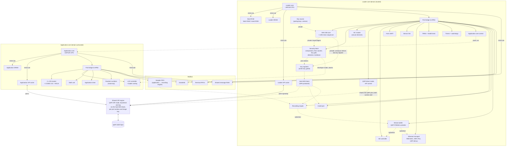

# Hardware Modules and Interconnect

This document lists the hardware modules of the `thriller` FPGA (and later ASIC) design and how they connect. The execute-in-place design is in `doc/xip.md`,
the secure element protocol in `doc/se.md`, the flash map in `doc/flash.md`. Everything here is family-neutral RTL; the primitives it needs from a family are in `fpga/README.md`.

## Principles

1. **Two cores.** A loader core runs the boot ROM and the loader and owns every secret and every security control. An application core runs the application.
   The loader is a firewall: the application reaches security functions only by sending it messages.
2. **Separation by wiring.** The application core's buses have no connection to keys, the secure element, the security block, the sensor, the network, the card or flash writing.
   This is checked from the netlist's connectivity, not argued from a privilege state machine.
3. **Both cores execute in place, through one shared XIP engine.** Each core has its own cache, flash window and image key; the QSPI controller, the AES path and the tag comparator are built once.
4. **The FPGA mirrors the ASIC's boot chain.** A small boot ROM (block RAM on the FPGA, mask ROM on the ASIC) verifies the loader image in flash, and the loader verifies the application, on both.
   The ASIC's boot chain is tested from the first FPGA build.
5. **One key-source interface.** The pairing keys reach the SHA-256 core through a module with a fixed interface: patched block RAM constants on the FPGA, a PUF with its characterization logic on the ASIC (`doc/ics55.md`).
6. **Secrets never cross a bus.** Keys, comparator results and the XIP fill pipeline use private, point-to-point connections, and all AES work runs in the hard AES block.
7. **Two buses per core, chosen by speed.** AXI4-Lite for memory; APB4 for peripherals. Each core is the only master on its own buses. No DMA except the recording path: the recording engine's private sample FIFO in, and the stream buffer's private drain to the card and network controllers out. Both carry ciphertext or samples, never keys, and neither can address memory on either core's bus.
8. **Same Forth code everywhere.** Peripherals are reached through LiteForth's I/O ports (`>sys` and `sys>`), which `vm.c` and MCU builds implement in C.

## Block diagram

Dotted lines are private connections, never visible on any bus. Nothing in the application core domain connects to the loader core domain except the mailbox (messages, terminal, samples)
and its own port on the XIP engine, which can only fill its own cache, from its own window, with its own key.

## Bus choice

| Path | Protocol | Why |
|---|---|---|
| Each core's memory port (fetch, `@`, `!`) | **AXI4-Lite** | Single-beat, low-latency access for every instruction pair and load. The cores never burst |
| Each core's I/O ports (`>sys`, `sys>`) | **Port bridge to APB4** | Peripherals need no speed beyond what a core can drive. APB is simple and standard, and `PSLVERR` carries errors |
| XIP cache refills (both caches) | **Private pipeline, two ports** | Must keep pace with the flash (about 2 µs per 64-byte line) and keep the image keys inside the engine |
| Samples to the recording engine | **Private FIFO** | Plaintext samples flow one way, from the application to an engine whose key it cannot see |
| Keys, comparator results, pass tokens | **Private wires** | Never on a bus, so no software on either core can read them |

LiteForth's I/O ports have a 9-bit immediate index, so each core has 512 ports, and reads and writes are separate spaces (`src/iomap.h` in LiteForth).
Each core's port bridge turns `>sys n` into an APB write and `sys> n` into an APB read at address 4n. Ports 0 to 15 belong to the VM itself and never reach the bridge.
A port that returns `PSLVERR` becomes an ior, which LiteForth already treats like a failed memory access.

## The hard AES block

All AES work in the FPGA runs in the family's hard AES block (on the Logos2, protected against power analysis), shared by three users with a fixed priority:

| User | Priority | Work |
|---|---|---|
| XIP engine | 1 | Keystream and tag for every cache fill, both ports |
| Recording engine | 2 | AES-256-GCM over the sample stream, in 4 KB blocks |
| Install port | 3 | GCM on lines being written, records, session frames, package decryption; AES-256-CMAC derivations |

Keys come from the key registers over private wires; the key select is driven by the requesting port in hardware, so software never chooses which key a job uses.
If the block cannot compute GHASH, the engines use AES-CCM so that no key-dependent step leaves the block (open question F4). The ECP5 fallback has no hard block and uses soft AES-256 cores,
unprotected (R33).

## Shared XIP engine

| Shared (one copy) | Per port (one for each core) |
|---|---|
| QSPI controller and the address mapper (line plus tag stride) | A cache: the loader's 2 KB, the application's 4 KB |
| Keystream and tag path through the hard AES block | A request port into the fill engine |
| Tag comparator and fill state machine | A flash window (base and limit) and an image key register |
| Busy interlock for flash writes | |
| **Install port** (port 2, loader only, through APB) | |

- **The requesting port selects the key and window in hardware.** The application core cannot cause a fill with the loader's key or from the loader's flash region.
- **Separate caches.** The application can never hit on a loader line.
- **Loader priority.** Port 0 wins arbitration, so the application cannot starve the loader by forcing misses.
- **Write-once configuration.** The boot ROM sets port 0's window and key at reset; the loader sets port 1's. Each port's configuration locks until the next reset.
- **Install port.** The loader reaches the AES path through a third port, which never fills a cache: encrypting and tagging lines under the install key for an inactive slot, decrypting and checking
  lines on read-back, and AES-GCM on user data records, session frames and package payloads.
- **Accepted leak.** The application can time its own misses and infer when the loader is fetching. That reveals the loader's activity, not secrets.

## Mailbox

The mailbox is the only path from the application to the loader, so it is the firewall (R45).

| Part | What it is |
|---|---|
| Message RAM | A small dual-port RAM (2 KB), with a request ring written by the application core and a response ring written by the loader core |
| Doorbells | One register in each direction |
| Terminal FIFOs | A byte FIFO each way. On the application core they sit behind ports 16 to 18, so LiteForth's `key`, `emit`, `key?` and `emit?` work unchanged. The loader forwards them to the host over the UART or a session |
| Sample FIFO | Samples the application wants recorded, into the recording engine. One way; the engine accepts samples only while a segment key is loaded |

**Services the loader offers through the mailbox** (a small, fixed set, each with a fixed message format):

- Read and write user data on the MicroSD card (encrypted under the data key, inside the loader; only while a host session is open)
- Host session status, and a request to prompt the host for one; the application learns only success or failure
- Start and end a recording segment; the loader draws the key, writes the segment header (including the latest time beacon) and the ciphertext to the card
- The latest sensor reading with its age and status (`doc/sensor.md`); the application acts only on readings the loader has passed
- Append to the security event log
- Install an application update from the staging area
- Device identity, versions, build mode, network policy, enrollment state
- Alarms to raise on the speaker and the LCD overlay

**Rules for the loader's message parser:**
- Copy each request out of the shared RAM before checking it, so the application core cannot change it between check and use.
- Check every length, offset and field against fixed limits; reject anything else.
- Never pass a pointer from a message to anything; the loader works only on its own copy.
- Fuzz the parser on the software platform (`doc/test.md`).

## Modules

### Loader core domain

| Module | Connection | FPGA | ASIC | Notes |
|---|---|---|---|---|
| Loader core | Master | RTL | RTL | Unmodified LiteForth CPU |
| Boot ROM | AXI4-Lite | Block RAM, initialized by the bitstream | Mask ROM (`doc/ics55.md`) | See Boot ROM contents |
| Loader XIP cache | AXI4-Lite (read-only) | Block RAM + distributed RAM | SRAM macro + flip-flops | 2 KB; the loader runs from flash through it |
| Loader SRAM | AXI4-Lite | Block RAM | SRAM macro | Buffers, stacks, variables; never keys |
| SHA-256 core + LMS chain sequencer | APB | RTL | RTL | Private key input (pairing key, unwrapped keys) and private keyed-digest output; the one key-dependent soft block (R33, open question H4) |
| Install port | APB | RTL | RTL | The loader's AES-GCM and CMAC work through the hard AES block |
| Key registers and key gate | Private | RTL | RTL | Loaded only from the SHA unwrap or derive path, with pass tokens; never readable |
| Security block | APB | RTL | RTL | Comparators, flow counter, key gate tokens, glitch and clock detectors, lockdown, fault status, secret-clear fan-out; drives the LCD overlay's developer-mode and alarm inputs |
| Key source | Private to SHA | Block RAM patched per device | PUF + helper data + characterization | See The key-source interface |
| I2C master | APB | RTL | RTL | The secure element's bus, and nothing else on it |
| QSPI direct mode, XIP control | APB | RTL | RTL | Erase and program during installs; both caches stall meanwhile. Port window and key setup, write-once |
| SD controller | APB | RTL | RTL | Recordings (ciphertext), user data, logs, offline packages. SPI mode at first; 4-bit SD if the recording rate needs it |
| Host UART | APB | RTL | RTL | Status, host protocol, the application's forwarded terminal |
| Sensor link | APB | RTL | RTL | UART or the sensor's own physical layer (`doc/sensor.md`), with a capture timer for reading age |
| Ethernet transport | APB (control, address registers), FIFOs (datagrams) | RTL | RTL | See Ethernet transport below. The PHY's reset is driven from the network policy, so a disabled port cannot be enabled by software |
| TRNG + health tests | APB | Ring oscillators | Ring oscillators | Conditioned with AES-256-CMAC; mixed with the secure element's Random; also feeds the application's random numbers |
| Timers + watchdogs | APB | RTL | RTL | One watchdog per core; the sensor age timer; the loader resets the application core on its timeout |
| Application core control | APB | RTL | RTL | Holds the application core in reset until boot checks pass; lockdown holds it in reset |
| Recording engine | APB (control), private FIFO (data) | RTL | RTL | AES-256-GCM blocks over the sample stream in the hard AES block; segment key register cleared at segment end; output goes to the stream buffer |
| Stream buffer | APB (control, levels), private paths (data) | RTL + external PSRAM | RTL + external PSRAM | A ring buffer of encrypted recording blocks in an 8 MB QSPI PSRAM (ESP-PSRAM64H), written by the recording engine and drained to the SD controller or the Ethernet transport under the loader's direction. Ciphertext only; its own QSPI pins, separate from the flash's. See `doc/acquisition.md`, Stream buffer |

### Application core domain

| Module | Connection | FPGA | ASIC | Notes |
|---|---|---|---|---|
| Application core | Master | RTL | RTL | Unmodified LiteForth CPU |
| Application SRAM | AXI4-Lite | Block RAM | SRAM macro | Variables, stacks, sample buffers |
| Application XIP cache | AXI4-Lite (read-only) | Block RAM + flip-flops | SRAM macro + flip-flops | 4 KB |
| 2 × I2S master, MCLK, CODEC I2C | APB | RTL | RTL | Acquisition and the speaker (`doc/acquisition.md`). A separate I2C bus from the secure element's |
| LCD controller + overlay | APB | RTL | RTL | The application draws the display; the overlay band for developer mode and alarms is driven by the security block and cannot be drawn over (F8) |
| Math unit | APB | RTL | RTL | LiteForth's multiply and divide ports |
| Application timer | APB | RTL | RTL | |
| Random numbers | APB | RTL | RTL | Conditioned output from the loader's TRNG, read-only |
| Optional application peripherals | APB | RTL | RTL | GPIO, buttons: anything that holds no secret |

### Shared

| Module | Connection | Notes |
|---|---|---|
| XIP engine | Private to both caches and the key registers | Two ports plus the install port |
| Hard AES block | Private | One instance shared as above; a second instance if the family offers it and throughput needs it (F4) |
| Mailbox | AXI4-Lite + APB on both sides | Message RAM, doorbells, terminal FIFOs, sample FIFO |
| Clock and reset | Private | One core clock domain; the oscillator also feeds the clock checker |
| Test only: fault controller, trigger pin, debug bridge | Test builds only | Absent from production builds (`doc/test.md`) |

## Ethernet transport

The network side of the device is hardware in the loader domain; there is no network stack on either core.

| Layer | What the RTL does | What it drops |
|---|---|---|
| RMII MAC, 10/100 | Frames to our unicast MAC address and to broadcast; CRC check; minimum and maximum length | Everything else, including multicast |
| ARP | Answers requests for our IPv4 address; keeps one entry for the gateway (or the server, on the same subnet), refreshed by the loader | ARP for other addresses; gratuitous ARP |
| IPv4 | Version 4, header length 5, no fragments, destination is our address (or broadcast, for DHCP before an address is set); header checksum | Options, fragments, other protocols except ICMP echo and UDP |
| ICMP | Echo reply, so the port is pingable for commissioning (disable by policy) | All other ICMP |
| UDP | Destination port equal to our session port, or the DHCP client port while leasing; length and checksum | Everything else |
| Payload | Into the receive FIFO, with the source address and port; the loader's session frame parser is the next step | — |

Transmit is the mirror: the loader writes a payload with a destination, and the RTL wraps it in UDP, IPv4 and Ethernet with the correct checksums.
Our MAC address comes from the manufacturer's OUI block, assigned at enrollment and stored in the records region (it is not secret). Addressing is by DHCP, a short UDP exchange run by loader
Forth through the same FIFOs, or by static settings written in a host session. Everything above the UDP payload is the session protocol the UART already carries, so the loader has one parser for two transports.

**Why hardware.** A software stack would have to live on some core: on the loader core it would put a network parser in the trusted domain, on the application core it would make a remote
exploit an application compromise (live plaintext samples), and a third core would cost logic, RAM and a third image. Header parsing in RTL is a few hundred LUTs, cannot be made to execute
anything, and is fuzzed in simulation (`doc/test.md`). TCP, DNS, TLS and HTTP are left to the edge proxy, which is untrusted and sees only ciphertext.

## The key-source interface

The key source is the one module that differs between the FPGA and the ASIC, so its interface is fixed now:

| Signal | Direction | Meaning |
|---|---|---|
| `key_sel[1:0]` | in | 0: inherited pairing key, 1: own pairing key (`doc/se.md`, Ratchet) |
| `key_req` / `key_ack` | in / out | Request and handshake; the key is presented only to the SHA-256 core's key port, never on a bus |
| `key_data[255:0]` | out, private | The selected key, to the SHA-256 core only |
| `key_version[31:0]` | out | The pairing key version, in clear, readable by the loader |
| `key_ready` | out | Keys available (immediately on the FPGA; after PUF reconstruction on the ASIC) |
| `key_fault` | out | Reconstruction failed (ASIC); tied low on the FPGA |
| `char_*` | in / out | Characterization and enrollment port: present on both, a stub on the FPGA (`doc/ics55.md`) |
| `clear` | in | Secret-clear fan-out: wipes any reconstructed key material |

On the FPGA the module is a small block RAM whose initialization the bitstream build service patches per device, placed by constraint so the script finds it by name (`fpga/<family>/`).
On the ASIC it is the PUF, its error correction over helper data in flash, and the characterization logic. The RTL on either side of the interface is identical.

## Key paths

All key handling is in the loader core domain, and even the loader's Forth code never sees a key.

### Key registers

| Register | Holds | Loaded from | Used by |
|---|---|---|---|
| SHA-256 key input | A pairing key, or the application, developer or log key | The key source, or an encrypted-read unwrap | Secure element MACs, header and boot-record HMACs, log MACs, derivation |
| XIP port 0 key | Loader image key | Derived from the application key | Loader cache fills |
| XIP port 1 key | Application image key | Derived from the application key | Application cache fills |
| Install key A | Distribution key, package content key, or developer package key | Unwrap or derivation | Decrypting a package on the install port |
| Install key B | The new image key for the slot being written | Derived from the application key and a fresh salt | Encrypting and tagging lines on the install port |
| Data key | User data key, or the developer data key | Unwrap after the host's CheckMac, then derivation with the host data secret | User data records |
| Session key | Host or CLI session key | Unwrap of the secure element's KDF output | Session frames |
| Segment key | One recording segment's key | The TRNG, through the derive path | Recording engine; also encapsulated to the host by the loader's ML-KEM code, which receives it wrapped for that purpose only |
| Sensor session keys | One per direction | Derived from the sensor pairing key, unwrapped from flash under the application key | Sensor frames |

**Pairing key into SHA-256.** Every secure element MAC format hashes the pairing key as one 32-byte field of the message. The SHA-256 core has an "insert key here" port: the key source,
or a key unwrapped from the secure element, feeds the 32 bytes straight into the message. The loader core supplies everything else.

### Two output modes

Every keyed SHA-256 operation runs in one of two modes, set by a domain byte at the start of the message and enforced in hardware:

- **Derive mode.** The digest is key material: an encrypted-read mask, an image key, a working key, a session key. It can never be read over APB. It goes only to a key register.
- **MAC mode.** The digest is a MAC, which is not secret. It can be read over APB, or sent to the security block's comparator.

The domain bytes reserved for derivation are refused in MAC mode, so software can never compute a derivation as a MAC and read the key it produces. Unkeyed digests (LMS verification, image hashes) remain readable.

**The segment key is the one exception** to "software never sees key material": ML-KEM encapsulation runs as Forth, and it must wrap the segment key. The loader gets the key once,
wrapped under a one-time mask from the derive path, encapsulates, writes the header, and wipes its copy; the recording engine's register is loaded by hardware. Whether to move that wrap into
hardware is open question H6.

### Pass tokens

The key gate loads a key into a register only with pass tokens from hardware comparators:

- an image key goes into an XIP port only after the header HMAC comparator passes, and the version comparator (production image) or the epoch comparator (developer image) passes;
- the data key goes into its register only after its key check value passes; the secure element releases it only after a successful CheckMac;
- the install keys load only after the package's LMS root comparator, or the developer package MAC comparator, passes;
- the session key loads only after the session's key confirmation passes.

**Result:** keys move from the key source or the secure element into key registers without passing through either CPU, their stacks, or any SRAM. A bug in the loader cannot leak them,
and the application core has no path to them at all.

## Boot ROM contents

The boot ROM holds everything that must run before the loader is trusted, or while flash cannot be read:

- Reset, clocking and SRAM test; on the ASIC, the PUF reconstruction (`doc/ics55.md`)
- Drivers for the SHA-256, I2C and QSPI cores, and the TRNG health check
- The secure element pairing exchange (own key first, inherited key second), authenticated counter reads, and the encrypted read of the application key
- The loader header check: HMAC, version against counter 0, image key derivation, then configuring and locking XIP port 0
- The boot record: choosing the active loader slot, and skipping slots marked bad (`doc/flash.md`)
- LMS verification, used by UART recovery
- Flash primitives (read into SRAM, erase, program, status), since nothing fetched from flash can run while the flash is busy
- The lockdown path, which records the event in the flash boot record; it needs no card driver and no key
- UART recovery: receiving a signed loader package into the staging region, verifying it, and installing it into a loader slot
- UART status: versions, build mode, faults, pairing state (R30)

The ratchet write, attestation, sessions and everything else is the loader's.

## Boot and lockdown

The same chain runs on the FPGA and the ASIC. On the FPGA, the configuration engine first loads the bitstream, which contains the boot ROM.

1. **Boot ROM.** Reset holds the application core in reset, and the loader core starts in the boot ROM. It pairs with the secure element, reads counter 0, unwraps the application key,
   checks the loader image header's HMAC and version, derives the loader image key into port 0, and locks port 0. It then jumps to the loader in its XIP window.
   If the secure element refuses both pairing keys, this bitstream has been superseded (R17, R44): the boot ROM reports it on the UART and stays in recovery.
   If no loader slot checks, it stays in recovery.
2. **Loader.** The loader moves any lockdown record into the event log, completes a pending ratchet (`doc/se.md`), reads counter 1, checks the application image header and its version
   (production) or device and epoch (developer), derives the application image key into port 1, and locks port 1. It unwraps the sensor pairing and host records, starts the sensor session,
   and applies the network policy to the PHY's reset, then obtains an address (DHCP, or the static settings in the records region).
3. **Application.** The loader releases the application core, which starts executing from its XIP window.
4. **Lockdown** (any detection, a tag failure on either port, a fault in the loader) enters the boot ROM through a hardware vector, never through loader code, which may be the flash that just failed. In order, it:
   1. holds the application core and the Ethernet PHY in reset;
   2. clears the key registers, pass tokens, both caches, the recording engine and the XIP port configuration through the secret-clear fan-out, and wipes the loader's stacks and registers;
   3. writes a lockdown record into the flash boot record: the cause, and for a tag failure the slot, which it marks bad. The record is not authenticated, because it can only cause logging and a fallback;
   4. halts until the next power-on reset.

On the next boot, the boot ROM and the loader skip slots marked bad and fall back to the other slot, or to recovery if both are bad. A single flash bit error therefore costs one slot,
not a lockdown loop. Lockdowns are counted in the boot record; past a threshold the device stays in update-only mode.

## Clocks, resets and errors

- **One core clock domain** for both cores and all security logic, from the oscillator through the PLL. The mailbox needs no clock-domain crossing. The I2S masters derive their clocks from it.
- **QSPI** is clocked from the core clock (with DDR outputs if a faster flash clock is needed).
- **The TRNG's ring oscillators** are asynchronous by design and pass through a synchronizer into the health tests.
- **Clock checker:** compares the core clock with the oscillator to detect clock glitching; **supply monitor:** an external supervisor's output is an input to the security block where the family has no detectors.
- **Resets:** power-on and the loader watchdog reset both cores and clear everything the secret-clear fan-out reaches; the boot ROM then starts again. Lockdown halts instead.
  The application watchdog resets only the application core.
- **One UART, two channels.** The host UART carries the host protocol and the application's forwarded terminal. Each frame carries a channel number.
- **Errors:** a bus error or `PSLVERR` becomes an ior in the core that caused it. An XIP tag failure goes to the lockdown, on either port.

## Software platform

`vm.c` keeps its state in one global struct, so the desktop software platform runs the two cores as two processes, joined by a shared-memory mailbox, with the secure element,
the flash, the card and the sensor as models. LiteForth's `unit_tests/stage1sim` already runs two cores this way.

## FPGA and ASIC

Every module above is the same RTL on both, except the memories and the clock primitive, which sit behind thin wrappers, the hard AES block (a vendor primitive on the FPGA, a masked core on the ASIC),
and the key source, behind its fixed interface. Test-only modules are compiled in only for test builds, on the FPGA, and never reach the ASIC.

## Resource estimate

Rough figures in 4-input-LUT equivalents, to be replaced by synthesis results:

| Block | LUTs | Block RAM |
|---|---|---|
| Two LiteForth cores | 3K to 6K | Stacks, data RAM |
| Boot ROM | — | 8 to 16 KB |
| XIP engine: two caches, fill controller, install port, flash bridge; GHASH if the hard block lacks it | 1.5K to 3K | 2 KB + 4 KB caches |
| SHA-256 core and LMS sequencer | 1K to 2K (more if masked) | — |
| Security block, key registers, key gate | 0.5K to 1K | — |
| Recording engine, sample FIFO | 0.5K to 1K | Block buffer |
| I2C master, SD, two UARTs, timers | 0.5K to 1K | — |
| Ethernet transport: RMII MAC, ARP, IPv4, ICMP echo, UDP demux, FIFOs | 0.5K to 1K | Frame buffers |
| Stream buffer: QSPI PSRAM controller, ring pointers, drain paths | 0.3K to 0.6K | Small staging FIFOs |
| TRNG | Under 0.2K | — |
| Two I2S masters, CODEC I2C, LCD controller with overlay | 1K to 2K | Line buffer |
| **Total** | **About 9K to 17K, plus the hard AES block** | |

The PG2L50H leaves ample room for the application. On the ECP5 fallback, soft AES-256 and GHASH add about 6K LUTs, leaving little of the LFE5U-25F's 24K for the application (`fpga/ecp5/`).

## Open questions

See `doc/questions.md` (Hardware rows).
