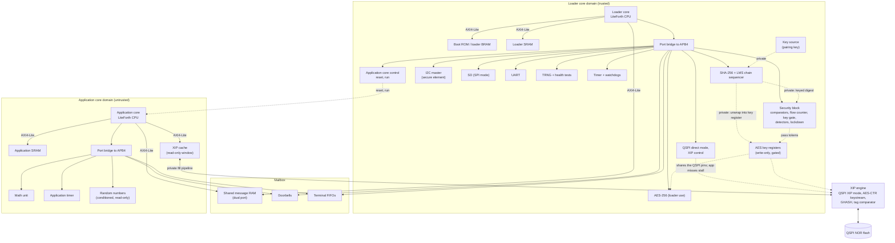

# Hardware Modules and Interconnect

This document lists the hardware modules of the `thriller` FPGA (and later ASIC) design and how they connect.
It follows the Verilog/Forth split in `doc/arch.md` (Implementation partition) and the execute-in-place design in `doc/xip.md`.

## Principles

1. **Two cores.** A loader core runs the loader and owns every secret and every security control. An application core runs the application.
   The loader is a firewall: the application reaches security functions only by sending it messages.
2. **Separation by wiring.** The application core's buses have no connection to keys, the secure element, the security block or flash writing.
   This is checked from the netlist's connectivity, not argued from a privilege state machine.
3. **Two buses per core, chosen by speed.** AXI4-Lite for memory (fetches and loads every few cycles); APB4 for peripherals.
4. **Each core is the only master on its own buses.** No DMA. Test-only masters exist only in test builds.
5. **Secrets never cross a bus.** Keys, comparator results and the XIP fill pipeline use private, point-to-point connections.
6. **Same Forth code everywhere.** Peripherals are reached through LiteForth's I/O ports (`>sys` and `sys>`), which `vm.c` and MCU builds implement in C.

LiteForth already works this way on the CH32H417: its V3F core runs stage 1, holds the device key and bridges USB to the V5F core,
which runs LiteForth and the application. The two cores talk through rings in shared SRAM (`cdc_shared.h` in LiteForth).

## Block diagram

Dotted lines are private connections, never visible on any bus. Nothing in the application core domain connects to the loader core domain
except through the mailbox and the XIP engine, which the application core can only read through its cache.

## Bus choice

| Path | Protocol | Why |
|---|---|---|
| Each core's memory port (fetch, `@`, `!`) | **AXI4-Lite** | Single-beat, low-latency access for every instruction pair and load. The cores never burst, so the burst features of full AXI4 would go unused. The slaves can be upgraded to full AXI4 if a burst-capable master is ever added |
| Each core's I/O ports (`>sys`, `sys>`) | **Port bridge to APB4** | Peripherals need no speed beyond what a core can drive. APB is simple and standard, and `PSLVERR` carries errors |
| XIP cache refills | **Private pipeline** | Must keep pace with the flash (about 2 µs per 64-byte line) and keep the device key inside the engine (`doc/xip.md`) |
| Keys, comparator results, pass tokens | **Private wires** | Never on a bus, so no software on either core can read them |

LiteForth's I/O ports have a 9-bit immediate index, so each core has 512 ports, and reads and writes are separate spaces (`src/iomap.h` in LiteForth).
Each core's port bridge turns `>sys n` into an APB write and `sys> n` into an APB read at address 4n. Ports 0 to 15 belong to the VM itself and never reach the bridge.
A port that returns `PSLVERR` becomes an ior, which LiteForth already treats like a failed memory access.

## Mailbox

The mailbox is the only path from the application to the loader, so it is the firewall.

| Part | What it is |
|---|---|
| Message RAM | A small dual-port RAM (one block RAM on the FPGA), with a request ring written by the application core and a response ring written by the loader core. Each core sees it on its AXI4-Lite bus |
| Doorbells | One register in each direction: writing it raises an event the other core can poll or wait on |
| Terminal FIFOs | A byte FIFO each way. On the application core they sit behind ports 16 to 18, so LiteForth's `key`, `emit`, `key?` and `emit?` work unchanged. The loader forwards them to and from the UART |

**Services the loader offers through the mailbox** (a small, fixed set, each with a fixed message format):

- Read and write user data (encrypted under the data key, inside the loader)
- Open and close a host session (forwarded host authorization; the application learns only success or failure)
- Append to the security event log
- Install an application update from the staging area
- Get the device's identity and status

**Rules for the loader's message parser:**
- Copy each request out of the shared RAM before checking it, so the application core cannot change it between check and use.
- Check every length, offset and field against fixed limits; reject anything else.
- Never pass a pointer from a message to anything; the loader works only on its own copy.
- Fuzz the parser on the software platform, like the MicroSD input (`doc/test.md`).

## Modules

### Loader core domain

| Module | Connection | Speed need | FPGA | ASIC | Notes |
|---|---|---|---|---|---|
| Loader core | Master | — | RTL | RTL | Unmodified LiteForth CPU |
| Boot ROM / loader memory | AXI4-Lite | Every fetch | Block RAM, initialized by the bitstream | Mask ROM (`doc/ics55.md`) | |
| Loader SRAM | AXI4-Lite | Every load and store | Block RAM | SRAM macro | Keys in transit, buffers, stacks |
| SHA-256 core + LMS chain sequencer | APB | About 1 word per 4 cycles | RTL | RTL | Private key input and private keyed-digest output (see Key paths) |
| AES-256 core (loader use) | APB | Moderate | RTL | RTL | Shares the AES datapath with the XIP engine; XIP refills take priority |
| AES key registers and key gate | Private | — | RTL | RTL | Loaded only from the SHA unwrap path; never readable |
| Security block | APB | Slow | RTL | RTL | Comparators, flow counter, key gate tokens, glitch and clock detectors, lockdown, fault status, secret-clear fan-out |
| Key source (pairing key) | Private to SHA | — | Small block RAM, patched per board | PUF + unwrap (`doc/ics55.md`) | Behind the fixed interface from the migration hooks |
| I2C master | APB | 100 to 400 kHz | RTL | RTL | The secure element's bus |
| QSPI direct mode, XIP control | APB | Slow | RTL | RTL | Erase and program; while in direct mode, application cache misses stall |
| SD (SPI mode) | APB | Up to a few MB/s | RTL | RTL | Logs, offline packages, user data |
| UART | APB | 115 kbaud to a few Mbaud | RTL | RTL | Host protocol, and the application's terminal forwarded through the mailbox |
| TRNG + health tests | APB | Slow | Ring oscillators | Ring oscillators | Also feeds conditioned random numbers to the application core |
| Timer + watchdogs | APB | Slow | RTL | RTL | One watchdog for each core; the loader resets the application core on its timeout |
| Application core control | APB | Slow | RTL | RTL | Holds the application core in reset until boot checks pass; lockdown holds it in reset |
| Mailbox (loader side) | AXI4-Lite + APB | Moderate | Dual-port block RAM | Dual-port SRAM | |

### Application core domain

| Module | Connection | Speed need | FPGA | ASIC | Notes |
|---|---|---|---|---|---|
| Application core | Master | — | RTL | RTL | Unmodified LiteForth CPU |
| Application SRAM | AXI4-Lite | Every load and store | Block RAM | SRAM macro | Variables, stacks, buffers |
| XIP cache | AXI4-Lite (read-only) | Hits every fetch | Block RAM + flip-flops | SRAM macro + flip-flops | Writes return an error |
| Math unit | APB | Moderate | RTL | RTL | LiteForth's multiply and divide ports (32 to 43) |
| Application timer | APB | Slow | RTL | RTL | |
| Random numbers | APB | Slow | RTL | RTL | Conditioned output from the loader's TRNG, read-only |
| Mailbox (application side) | AXI4-Lite + APB | Moderate | Shared with the loader side | Shared | Includes the terminal FIFOs at ports 16 to 18 |
| Optional application peripherals | APB | Product-specific | RTL | RTL | GPIO, LCD (LiteForth's port 24), sensors: anything that holds no secret |

### Shared

| Module | Connection | Notes |
|---|---|---|
| XIP engine | Private to the cache and the key registers | QSPI XIP mode, AES-CTR keystream, GHASH, tag comparator (`doc/xip.md`) |
| Clock and reset | Private | One core clock domain for both cores; the oscillator also feeds the clock checker |
| Test only: fault controller, trigger pin, debug bridge | Test builds only | Absent from production builds (`doc/test.md`, campaign C) |

## Memory maps

Byte addresses on each core's AXI4-Lite bus. LiteForth is cell-addressed with 22-bit cell addresses, so each core's byte addresses span 16 MB.
Sizes are placeholders, to be set from the RAM budget (`doc/xip.md`) and the target's block RAM.

**Loader core:**

| Byte address | Size | Region |
|---|---|---|
| `0x000000` | 64 KB | Boot ROM / loader memory |
| `0x010000` | 16 KB | Loader SRAM |
| `0x030000` | 4 KB | Mailbox message RAM |
| other | — | Unmapped: error |

**Application core:**

| Byte address | Size | Region |
|---|---|---|
| `0x020000` | up to 192 KB | Application SRAM |
| `0x030000` | 4 KB | Mailbox message RAM |
| `0x400000` | 12 MB | XIP window (active application slot, plaintext view); writes return an error |
| other | — | Unmapped: error |

The application core starts at the XIP window's entry point when the loader releases it from reset.

## Port maps

Ports 16 to 43 keep LiteForth's existing assignments on the core where they apply. The rest are proposals, in blocks of 16 so each module decodes the low 4 bits.

| Ports | Loader core | Application core |
|---|---|---|
| 0 to 15 | The VM's own (not on APB) | The VM's own (not on APB) |
| 16 to 18 | UART (the real one) | Terminal FIFOs to the loader (LiteForth's `key`, `emit`, `key?`, `emit?`) |
| 24 | — | LCD (LiteForth), if fitted |
| 32 to 43 | Math unit, if fitted | Math unit (LiteForth) |
| 64 to 79 | SHA-256 core and LMS chain sequencer | Mailbox doorbell and status |
| 80 to 95 | AES-256 (loader use) | Application timer |
| 96 to 111 | Security block | Random numbers |
| 112 to 127 | I2C master | Optional application peripherals |
| 128 to 143 | QSPI direct mode, XIP control | — |
| 144 to 159 | SD (SPI mode) | — |
| 160 to 175 | TRNG | — |
| 176 to 191 | Timer and watchdogs | — |
| 192 to 207 | Application core control, mailbox doorbell, terminal FIFOs | — |
| 208 to 511 | Reserved | Reserved |

These would also be added to LiteForth's `iomap.h`, so the desktop and MCU builds implement the same ports in C.

## Key paths

All key handling is in the loader core domain, and even the loader's Forth code never sees a key.

**Pairing key into SHA-256.** Every secure element MAC format hashes the pairing key as one 32-byte field of the message (`doc/arch.md`, secure element MAC protocol).
The SHA-256 core has an "insert key here" port: the key source feeds the 32 bytes straight into the message. The loader core supplies everything else.

**Keyed digests stay private.** A digest whose input included an inserted key can't be read back over APB. It can only go to:
- the security block's comparator, to check a MAC from the secure element; or
- the AES key registers, XORed in, to unwrap a key read from the secure element with EncRead (whose keystream is such a digest).

**Result:** the pairing key, the application key, the data key and the distribution key all move from the key source or the secure element
into the AES key registers without passing through either CPU, their stacks, or any SRAM. A bug in the loader cannot leak them, and the application core has no path to them at all.
Unkeyed digests (LMS verification, image hashes) remain readable, as the loader needs them.

## Boot and lockdown

1. Reset holds the application core in reset. The loader core starts from its boot ROM.
2. The loader authenticates to the secure element, reads counter 1, unwraps the application key into the key registers, and checks the XIP header's version.
3. The loader releases the application core, which starts executing from the XIP window.
4. On lockdown (any detection, a tag failure, a fault in the loader), the loader core's lockdown path holds the application core in reset, clears the secrets and stops.

## Clocks, resets and errors

- **One core clock domain** for both cores and all security logic, from the oscillator through the PLL. The mailbox needs no clock-domain crossing.
- **QSPI** is clocked from the core clock (with DDR outputs if a faster flash clock is needed).
- **The TRNG's ring oscillators** are asynchronous by design and pass through a synchronizer into the health tests.
- **Clock checker:** compares the core clock with the oscillator to detect clock glitching (`doc/test.md`, countermeasure 7).
- **Resets:** power-on, the loader watchdog and lockdown reset both cores and clear the key registers, pass tokens and loader SRAM through the secret-clear fan-out.
  The application watchdog resets only the application core.
- **Errors:** a bus error or `PSLVERR` becomes an ior in the core that caused it and goes to that core's `yeet` handler.
  The XIP tag failure goes to the loader's lockdown, wherever it happened.

## Software platform

`vm.c` keeps its state in one global struct, so the desktop software platform runs the two cores as two processes, joined by a
shared-memory mailbox. LiteForth's `unit_tests/stage1sim` already runs the CH32H417's two cores this way.

## FPGA and ASIC

Every module above is the same RTL on both, except the memories and the clock primitive, which sit behind the wrappers from `doc/ics55.md`, and the key source,
which has the fixed interface from the same document. Test-only modules are compiled in only for test builds, on the FPGA, and never reach the ASIC.
The second core costs little: the LiteForth CPU is a small MISC design, and most of its cost is its two stack memories.

## Open questions

1. **AXI4-Lite latency.** Whether the decoder and slaves can answer in the cycles the CPU's memory state machine expects (LiteForth's `doc/hdl.md` assumes about 5 cycles per read), or whether ROM and SRAM need a tightly coupled path beside the bus.
2. **Mailbox message set.** The exact services and their formats, and the message RAM's size.
3. **Application stalls during flash writes.** A sector erase can take tens to hundreds of milliseconds, during which an application cache miss stalls. Whether to use the flash's erase-suspend, or let the application lock time-critical lines through a mailbox request.
4. **SD for the application.** Whether the application needs the card for its own files, through mailbox services or a separate region.
5. **Port numbering.** Agree the proposed ports with LiteForth's `iomap.h` before any RTL fixes them.
