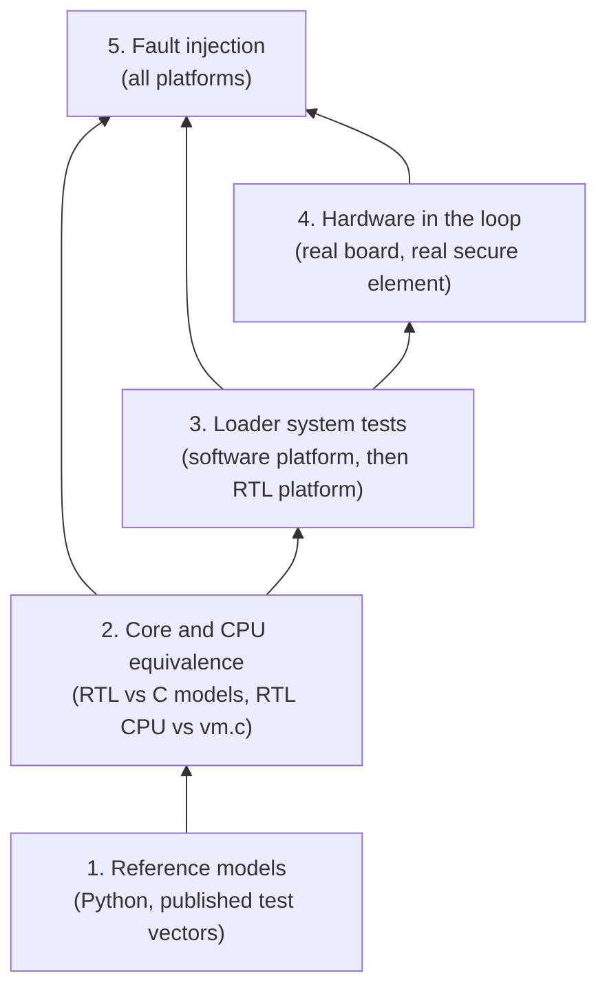

# Test Plan

This document describes how `thriller` is tested, including fault injection. It follows the conventions
already used in [LiteForth](https://github.com/bradleyeckert/LiteForth), the soft CPU the loader runs on:
`vm.c` as the reference model, power cuts at every step, requirements traced to evidence, and a log of
board test runs.

Risk IDs (R1–R24) refer to the Risk Assessment in `doc/arch.md`. FDA control categories and gaps refer to `doc/fda.md`.

## 1. Approach

### One loader, two execution platforms

The loader is LiteForth code running on a LiteForth CPU built in the FPGA fabric. `vm.c` simulates that CPU.
The crypto and peripheral cores (SHA-256, AES, LMS chain hashing, I2C, QSPI, SD, UART) appear to the CPU as
I/O ports through `>sys` and `sys>`, the same way LiteForth's non-blocking math unit does (`src/iomap.c`).

That gives two ways to run the same loader binary:

| Platform | CPU | Cores and peripherals | Speed | Used for |
|---|---|---|---|---|
| **Software** | `vm.c` | C models behind `iomap` ports, plus device models (secure element, flash, SD card, host) | Millions of instructions per second | Protocol tests, attack tests, fuzzing, power-cut sweeps, fault-injection campaigns |
| **RTL** | LiteForth CPU in Verilog | The real RTL cores, plus the same device models through Verilator | Thousands of cycles per second | Checking that the RTL matches the software platform, timing, hardware-level faults |

The software platform runs nearly every test, quickly. The RTL platform's job is to prove that the software platform
is a faithful model of the hardware, so the software results count as evidence for the hardware.

### Layers

Each layer is checked against the one below it:

### Evidence

- Every test names the requirements and risk IDs it verifies, so the test report is the evidence that each
  mitigation was tested (FDA gap 8).
- Requirements follow LiteForth's V-model (`doc/quality/` there): needs, system requirements, architecture, modules,
  each with a **Verified by** line, and a traceability matrix generated and checked by a script like LiteForth's `rtm.py`.
- Board runs are logged like LiteForth's `doc/admin/board-tests.md`: bitstream and loader hashes, package hashes,
  steps, expected results, and the board's output word for word.

## 2. Layer 1: Reference models

Python implementations that everything else is compared against. Each is checked against published vectors before use.

| Model | Implementation | Checked against |
|---|---|---|
| SHA-256 | `hashlib` | NIST CAVP SHA-256 vectors |
| AES-256-GCM | `cryptography` | NIST CAVP GCM vectors |
| LMS verify | A reference verifier, written from RFC 8554 | RFC 8554 Appendix F vectors, and signatures from the signing HSM's software |
| ATECC608 MAC and digest formats | cryptoauthlib's host-side functions (`atcah_nonce`, `atcah_gen_dig`, `atcah_mac`, `atcah_check_mac`, and the encrypted read and write helpers), called from Python | Responses from real ATECC608B parts captured on the bench |
| KDF (HKDF-SHA256) | `cryptography` | RFC 5869 vectors |
| Package builder | The real signing and packaging tool, with the HSM replaced by a test key store | Round trip through the reference verifier |

The cryptoauthlib host functions are the most valuable item here: they are Microchip's own software calculation
of what the chip computes, so the loader's MAC checks can be tested without a chip and without the NDA datasheet.

## 3. Layer 2: Core and CPU equivalence

### Crypto and peripheral cores

Each RTL core is tested with cocotb on Verilator (or Icarus), in two ways:
- **Known-answer tests** from the Layer 1 vectors.
- **Differential tests:** random inputs through the RTL core and through its C model (the one the software platform uses),
  compared bit for bit, including the port protocol: busy status, results read while busy, back-to-back commands.

This is what lets the C models stand in for the cores in Layer 3.

The same differential tests run against the MCU implementations of the ports (C, or the MCU's crypto hardware),
on the board, so LiteForth on an MCU is held to the same port behavior as the fabric.

### No C API calls in the loader

A hardware LiteForth CPU has no C library, so the loader must never use `RFcall` or `AFcall` (imm opcodes 14 and 15).
A static check scans the loader image for those opcodes and fails the build if it finds any. The software platform also
runs the loader with the API tables empty, so a call that slips past the scan fails at once.

### Fault coverage follows the partition

The partition in `doc/arch.md` decides which campaign sees which decision. Decisions made in Forth (MAC message assembly,
version checks, flow counter updates) are covered by campaign A on `vm.c`. Decisions made by Verilog comparators, the key gate
and the TRNG health tests are invisible to `vm.c`, so campaign B must cover them, exhaustively for the comparators' output
registers and the key gate's token, since those are small.

### The LiteForth CPU against `vm.c`

LiteForth already compares two implementations of the VM: `unit_tests/vmasm/difftest.c` runs random states and random code
through `vm.c`'s C `vmExec` and through `vm_rv32.S`, and compares state hashes. The RTL CPU gets the same treatment:

- **Lockstep simulation.** Verilator builds the RTL CPU into a C++ model that links `vm.c` directly. Both run the same
  random code from the same random state, and the full register set (T, N, PC, R, A, B, U, X, Y, prefix, shift_size, sp, rp, cy)
  and the stacks are compared after every instruction group. The first difference stops the run and dumps both states.
- **Same generator.** The random code and state generator comes from `difftest.c`, so all three implementations
  (C, RV32 assembly, RTL) are held to one definition of the ISA.
- **Programs as well as random code.** `scripts/regression.f`'s compiled image runs on the RTL CPU, with its
  assertions checked through the terminal port.
- **I/O ports.** The difftest's stub ports are replaced by the real port map, so the core interfaces are exercised from the CPU side.

## 4. Layer 3: Loader system tests

### Device models

| Model | Behavior | Attack and failure controls |
|---|---|---|
| Secure element (ATECC608B) | Command packets, CRC-16, wake/idle/sleep, counters, Nonce, GenDig, MAC, CheckMac, EncRead, EncWrite, slot policies including authorization requirements | Replay a recorded response, alter any byte, drop or delay a response, report a wrong counter, refuse a command |
| QSPI NOR flash | Erase and program semantics (bits only go from 1 to 0, sector erase) | Power cut at any erase or program, half-done (as LiteForth's `update` test does), bit errors, read disturb |
| MicroSD card | SD (SPI mode) commands, card images built with LiteForth's `mkexfat.py` | Missing card, card removed mid-write, malformed files (from the fuzzer), slow card |
| Host | Update client and session client, scriptable | Wrong key, replayed response, truncated or modified packages, packages for another board, old versions |

The secure element model is trusted only after it is checked against real parts: a bench script runs the same command
sequences on a real ATECC608B and on the model, and compares every response. This runs again whenever the model changes,
and once more on the MOD8ID.

### Test catalogue

| Area | Tests | Risks |
|---|---|---|
| Application updates | Valid package installs. Every byte of a package flipped, one at a time: rejected before decryption. Wrong signing key. Old version (counter 1). Truncated package. (LMS leaf reuse cannot be seen by the device; the signing tools are tested for it separately.) | R4, R3, R20 |
| Platform updates | As above, plus a package built for another board (fails to configure), and pairing key rotation | R3, R4, R14 |
| Power cuts | Every update run is repeated with a cut at each step k, where every flash erase, flash program, secure element write and counter increment is one step, and the cut leaves that step half done. After each cut, the board must boot a valid image, and must never accept an older version | R19, Open Question 1 |
| Boot | Corrupt active slot falls back to the other; both corrupt enters update-only mode; tag failure never runs code | R2, R19 |
| I2C channel | Replayed counter values, altered MACs, a stale nonce, responses from the wrong slot: all rejected | R7, R8 |
| Host sessions | Wrong host key, replayed response, response to a stale challenge: data key never released. Session end and timeout erase the data key (checked by reading the loader's RAM and registers afterward) | R1, R9 |
| MicroSD input | Fuzzing of every file the loader reads (packages, card metadata) with AFL++ or libFuzzer, through the software platform. Malformed inputs must be rejected cleanly: no `vm.c` trap, no out-of-range access, no stack overflow | R23 |
| Security event log | Records appended for each security event; removing, editing, reordering or truncating records is detected at the next boot and reported | R24 |
| Rollback of the platform | An old bitstream boots but cannot read the application or data keys | R3 |

Every test runs on the software platform in continuous integration. A tagged subset runs on the RTL platform nightly,
and its results must match the software platform's exactly.

## 5. Layer 4: Hardware in the loop

The same Python test scripts drive a real board, with the device models replaced by real parts.

| Equipment | Purpose |
|---|---|
| Relay-controlled bench supply | Power cuts during updates, thousands of cycles, at random and at chosen points (triggered from the loader's debug pin in test bitstreams) |
| I2C interposer (a small FPGA or MCU in series with the bus) | Replay, alter, drop and delay secure element traffic, as the model does in Layer 3 |
| USB-UART host | Update client and session client |
| SD card multiplexer | Swaps card images between runs without unplugging |
| JTAG pod | Checks lockout after manufacturing: configuration refused, readback refused |

Hardware-in-the-loop runs are logged in `doc/board-tests.md` (to be created), in LiteForth's format.

## 6. Fault injection

### Threat

An attacker with the device glitches the core supply or the clock, or uses EM pulses, to make the loader skip or corrupt
one or more instructions at the moment it makes a security decision (R16). The decisions that matter:

| Decision | Where | A successful fault would |
|---|---|---|
| LMS root comparison | Package verification | Install an unsigned update |
| Version against counter | Package verification | Install an older, vulnerable version |
| Authentication tag check | Boot | Run modified code from flash |
| Secure element MAC check | Every counter and key read | Accept a forged counter or response |
| CheckMac result | Host session | Release the data key without the host (this one is in the secure element; the loader must still not act on a forged success) |
| Key erasure | Session end | Leave the data key in RAM |

### Fault model

Faults are described at the level of the LiteForth ISA, so the same model applies to `vm.c`, the RTL and the hardware.

| Fault | Effect in the ISA |
|---|---|
| Instruction skip | One 16-bit instruction does not execute (for a micro-op group, all three slots are lost) |
| Slot skip | One micro-op slot in a group does not execute |
| Branch inversion | `if`, `-if` or `next` goes the wrong way |
| Return skip | A `;` (return) in a micro-op group is not taken |
| Register corruption | One bit, or one byte, flipped in T, N, R, A, B, PC, prefix, cy, sp or rp |
| Stack corruption | One cell of the data or return stack corrupted |
| Fetch corruption | Bits flipped in the fetched instruction pair (`inst32`) |
| Core output corruption | A crypto core's result or comparison output flipped (RTL and hardware only) |

### Campaigns

**A. Software platform: exhaustive single faults.** `vm.c` gets a fault hook, compiled in only for this test (in the style of
LiteForth's other build options). The hook runs before each instruction and can apply any fault from the model at
instruction count n. For each security decision, the campaign runs a scenario that should fail (a forged package, an old version,
a modified image, a forged response), and applies every fault type at every instruction in the decision's window, one fault per run.

Each run ends in one of these outcomes:

| Outcome | Meaning | Acceptable |
|---|---|---|
| Rejected | The decision still failed safely | Yes |
| Detected | A countermeasure caught the fault and the loader locked down | Yes |
| Crash | `vm.c` trapped or the loader hung (a watchdog restarts it, failing safe) | Yes, but reviewed |
| **Bypass** | The forged input was accepted | **No** |

`vm.c` runs fast enough that every (instruction, fault type) pair in each window can be tried. Double faults are sampled
randomly, with priority on pairs that each came close to a bypass on their own.

**B. RTL platform: flip-flop faults.** Verilator forces bit flips into any flip-flop of the CPU and the crypto cores at any cycle,
including the comparators and state machines that campaign A cannot see. Too many combinations for an exhaustive run,
so the campaign samples randomly, concentrating on the decision windows found in campaign A. A sample of campaign A's faults is
also repeated here, to check that the ISA-level fault model matches what the hardware does.

**C. On-FPGA emulation.** A test-only bitstream adds a fault controller that flips chosen flip-flops at a programmed cycle,
armed over the UART. This runs at full hardware speed with real timing, so it reaches millions of trials per day.
The fault controller must never ship: the production build is checked for its absence (a build option that cannot be set
in a release build, and a list of approved bitstream hashes).

**D. Physical injection (lab).** Voltage glitches on the FPGA core rail and clock glitches on the oscillator input, using a
ChipWhisperer or similar, with EM fault injection as an option. Each target decision is attacked with a parameter sweep
(glitch width, offset, voltage), using the trigger pin to synchronize. Results feed the risk assessment's exploitability rating.

### Pass criteria

- Campaign A: no bypass from any single fault. Every crash is reviewed.
- Campaigns A and B: every double-fault bypass is analyzed, and either fixed or recorded with its rarity.
- Campaign D: no bypass in an agreed number of attempts per decision (to be set with the integrator). Detection rate recorded.

### Countermeasures to build in

These are design rules for the loader, written so that campaigns A to D have something to measure.

1. **No single-bit decisions.** A security result is a 32-bit constant, such as `0x5A3C96E1` for pass, never 0 or -1, and is tested by
   comparing with the expected constant (`xor` and `if`), not by a sign or zero test of a flag. The initial value of every result
   variable is a fail constant.
2. **Decide in hardware where possible.** The LMS root comparison, the tag comparison and the counter comparison run in RTL
   comparators that output the 32-bit constants directly, so there is no instruction to skip.
3. **Gate keys in hardware.** The AES core will not load the application or data key unless its own hardware pass token is set for
   that boot or session. A skipped software check then still leaves the key unusable.
4. **Check twice, differently.** Each decision is made twice by independent paths, for example the RTL comparator and a Forth comparison,
   or the same comparison in a different order, and both must agree.
5. **Flow counter.** Each step of the boot or update sequence adds a distinct value to a step counter. The final action (starting the
   application, advancing a counter, releasing a key) proceeds only if the counter holds the exact expected sum.
6. **Random delays.** Short random delays from the TRNG before each decision, so a glitch cannot be timed by counting cycles from a trigger.
7. **Detectors.** A delay-line sensor that detects core supply dips, and a frequency check of the core clock against the external oscillator.
8. **Fail closed.** On any detection or inconsistency: erase keys held in the fabric (RAM, stacks, A and B registers), log the event,
   and stop, through the loader's own `yeet` handler. Repeated detections across boots can lock the device into update-only mode.

## 7. Board design for testability

These must be on the board from the first revision:

- Test points on the FPGA core rail, with a series resistor that can be replaced by a glitch injector.
- A way to bypass or replace the oscillator for clock glitching.
- A trigger output driven only by test bitstreams.
- A footprint for the I2C interposer (series resistors in SDA and SCL).
- Current sense on the core rail for power analysis (also useful for R17).

## 8. Tools

All open source, to match the Yosys flow:

| Tool | Use |
|---|---|
| Yosys, nextpnr, Project Trellis | Build the RTL and the bitstreams |
| Verilator | RTL simulation, lockstep with `vm.c`, flip-flop fault forcing |
| cocotb | Python test benches for the RTL cores |
| gcc, LiteForth's makefile and Unity | Software platform, `vm.c` fault hook, C tests |
| AFL++ or libFuzzer | Fuzzing the loader's file and package parsing |
| cryptoauthlib (host functions) | Reference model of the secure element's MAC formats |
| ChipWhisperer (or similar) | Physical voltage and clock glitching |
| GitHub Actions | Layers 1 to 3 on every push; RTL subsets and campaign A nightly |

## 9. Open questions

1. **Physical injection pass threshold.** The number of attempts without a bypass, agreed with the integrator.
2. **Secure element model coverage.** How much of the ATECC608B to model, and whether a second model is needed for the MOD8ID.

Settled: LiteForth moves to `thriller`'s algorithms (LMS, SHA-256, HMAC-SHA256, AES-256), and the split between Verilog
and Forth is in `doc/arch.md`, Implementation partition. The reference models in section 2 serve both projects.
