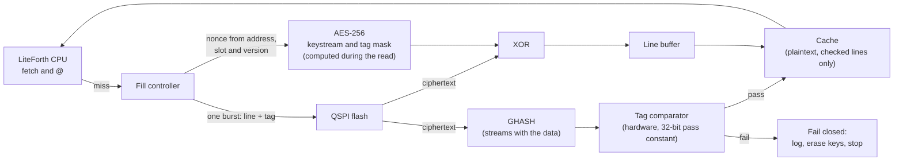

# Execute in Place: Decrypting and Authenticating Flash on the Fly

The application runs directly from external QSPI flash, through a small cache, instead of being copied into RAM.
This keeps on-chip RAM small, which matters most on an ASIC, where SRAM costs 2 to 3 mm2 per Mb (`doc/ics55.md`).
The same design runs on the FPGA, so the RAM budget can be measured there before any silicon.

The flash holds the application encrypted and authenticated under a device-unique key. Nothing is ever decrypted back into
flash. Each cache line is decrypted and checked as it is fetched, and only checked plaintext enters the cache.

## Requirements

| Requirement | Why |
|---|---|
| Decrypt any line independently | The CPU jumps around; a miss can be anywhere |
| Authenticate every line when it is fetched, not only at boot | Checking the image once at boot leaves a time-of-check to time-of-use gap: the flash can be swapped, or replaced by an emulator, afterward |
| Reject a line moved from another address | Otherwise an attacker can rearrange valid code |
| Reject a line from an older version of the image | Otherwise an attacker can mix in old, vulnerable code line by line |
| Add little latency to a miss | The flash read itself is already the dominant cost |
| Use little RAM | The point of the exercise |

## Design summary

- **Encryption and authentication:** AES-256-GCM applied to each cache line separately, with a 64-bit tag stored next to the line.
- **Nonce:** built from the image version, the slot, and the line's address, so it is unique per line and per version.
- **Cache:** a few KB of plaintext lines. A line enters the cache only after its tag checks.

## Flash layout

Each line of ciphertext is followed by its tag, so one burst read fetches both:

| Offset in slot | Contents |
|---|---|
| 0 | Header line: image version, length, slot, and a tag, in the same format as every other line |
| 72 | Line 1 (64 bytes of ciphertext) + tag (8 bytes) |
| 144 | Line 2 + tag |
| ... | ... |

The fill controller maps a CPU address to a flash address with a multiply by 72 (a shift and an add: 64 + 8).
The flash overhead is 8 / 64 = 12.5%.

## Per-line GCM

For line i of the image in slot s, version v:

- **Nonce (96 bits)** = v (32 bits) ‖ s (8 bits) ‖ i (24 bits) ‖ 0 (32 bits).
- **Ciphertext** = plaintext XOR AES-256-CTR keystream from that nonce.
- **Tag** = GCM tag over the ciphertext, truncated to 64 bits.
- **Key** = the device-unique application key, unwrapped at boot from the secure element and loaded into the AES core
  through the key gate (`doc/test.md`, countermeasure rule 3). It never leaves the core.

### Why this needs no Merkle tree

A hash table or Merkle tree is needed when line checks are unkeyed, because then anyone can compute a valid hash.
Here every tag depends on the secret device key and on the line's address, slot and version, through the nonce:

| Attack | Result |
|---|---|
| Modify a line | Tag fails |
| Move a valid line to another address | The nonce differs, so the tag fails |
| Copy a line from the other slot | The slot is in the nonce, so the tag fails |
| Replace a line with the same line from an older version | The version is in the nonce, so the tag fails |
| Replace the whole image with a complete older version | Every line checks, but the header's version is below the secure element's counter 1, so boot refuses it |
| Copy the flash to another board | Different device key, so every tag fails |

The last two rows are why boot still checks one thing: the header line's version against counter 1, read over the authenticated channel.

### Nonce uniqueness

GCM fails badly if a nonce is reused with different plaintext under the same key. The nonce here is unique because a version number
identifies exactly one signed release: the same (version, slot, line) always encrypts the same plaintext. Reinstalling the same release
produces identical ciphertext, which leaks nothing. The installer must refuse to encrypt two different images under one version number,
which the LMS signature already guarantees.

### Tag length

64-bit tags keep the flash overhead at 12.5%. NIST SP 800-38D allows tags this short with limits on how often verification may fail
(its Appendix C). Here an attacker gets very few tries, because the first tag failure locks the device down, and each attempt needs physical
access to the flash.

## Choosing the mode: latency

The miss cost is dominated by the flash read. Using LiteForth's figures for a QPI NOR flash at 80 MHz (`doc/hdl.md` there:
2 clocks per byte plus a 14-clock preamble), and a core clock of 50 MHz with an iterative AES-256 core (about 15 cycles per block):

| Line size | Flash burst (line + tag) | Flash read time |
|---|---|---|
| 32 bytes | 40 bytes | about 1.2 µs |
| 64 bytes | 72 bytes | about 2.0 µs |

What each mode adds after the last byte arrives, for a 64-byte line:

| Mode | How it works on a miss | Added latency | Extra hardware |
|---|---|---|---|
| **AES-GCM per line (recommended)** | All five AES operations (four keystream blocks and the tag mask) depend only on the address, so they run during the flash read. GHASH processes each 16-byte block as it arrives | A few cycles | GHASH multiplier (digit-serial, a few cycles per block) |
| AES-CTR + HMAC-SHA256 | Keystream as above. HMAC needs about three SHA-256 compressions over the line, mostly after it arrives | About 2.5 µs, more than doubling the miss | None |
| AES-CTR + AES-CMAC | CMAC chains AES over the data as it arrives, but one AES core cannot also produce the keystream at that rate | About 0.3 µs, with a second AES core | Second AES core |

GCM's GHASH costs area, but it is the only mode whose authentication keeps pace with the flash. This reverses the earlier recommendation of
CTR with HMAC-SHA256 (`doc/arch.md`, Open Question 3), which was made before XIP was a requirement.

## Cache

| Parameter | Proposal | Notes |
|---|---|---|
| Line size | 64 bytes (16 cells, 32 instructions) | Halves the tag overhead of 32-byte lines; measure both |
| Size | 4 KB (64 lines), 2-way set associative | Forth code is dense; measure the hit rate on real applications on the FPGA |
| Contents | Plaintext, only after the tag passes | Decrypting on every hit would add latency to every fetch |
| Writes | None: the XIP region is read-only | The application's variables live in SRAM; user data in flash goes through the loader's explicit encrypted routines |
| Prefetch | Next line on a sequential miss; LiteForth's proposed `touch` instruction for software prefetch | `touch` is described in LiteForth's `doc/hdl.md` |
| Replacement | Pseudo-LRU | |

The CPU stalls on a miss until the line is checked. It never executes from a line whose tag has not passed, so no speculative execution is needed.

**On a tag failure,** the line never enters the cache. The fill controller raises a fault to the loader's lockdown path: log the event,
clear the secret registers, and stop. Lockdown is the only response, because a failing tag in a running image means the flash has been tampered with.

**The cache must be cleared by the secret-clear input** (`doc/ics55.md`, migration hooks), since it holds plaintext application code.

## Install and boot

**Install.** An application package arrives encrypted under the distribution key and signed with LMS over the whole package.
RAM cannot hold a package, so:

1. The package is written to a staging area in flash as it arrives (as LiteForth does with `lfstage.bin`).
2. The LMS signature is verified by streaming the staged package through the SHA-256 core.
3. The version is checked against counter 1.
4. The package is decrypted with the distribution key and re-encrypted per line, with tags, into the inactive slot, one line at a time.
5. Counter 1 advances, and the slot becomes active.

Each step needs only a line buffer and a flash page buffer.

**Boot.** Boot no longer hashes the whole image. It reads the header line through the cache, which checks its tag, and compares the version with counter 1.
Every other line is checked when it is first used. This removes the 1 to 2 seconds of whole-image hashing estimated in `doc/arch.md` for a Forth implementation,
and most of the work even for a hardware one.

## Flash writes while executing

A NOR flash cannot be read while it is erasing or programming. While the inactive slot is being written, XIP from the same chip stalls. So:

- The code that writes flash (installs, user data, logs) must run from somewhere other than the XIP region: on-chip ROM on the ASIC, block RAM on the FPGA.
- Or the controller can use the flash's erase-suspend and program-suspend commands, which most QSPI NOR parts support, to serve a cache miss mid-write.

The first is simpler and is the recommendation; suspend support can come later.

## RAM budget

Estimates for the loader and the XIP system, to be replaced with measurements:

| Use | Size | Notes |
|---|---|---|
| XIP cache data | 4 KB | 64 lines of 64 bytes |
| XIP cache tags and state | About 0.2 KB | Can be flip-flops |
| CPU stacks | 0.5 to 1 KB | Two stacks of 64 to 128 cells |
| LMS verification | About 0.3 KB | The signature streams from flash; only running hashes are kept |
| Secure element I/O buffer | About 0.2 KB | Largest ATECC command or response |
| UART buffer | 0.25 to 1 KB | |
| Flash page buffer (installs, logs) | 256 bytes | One NOR page |
| MicroSD sector buffer | 512 bytes | |
| Loader variables | About 0.5 KB | |
| **Total** | **About 7 to 8 KB** | About 0.06 Mb, roughly 0.15 mm2 at ICS55's 2 to 3 mm2/Mb |

The application's own data comes on top of this. Its code costs no RAM beyond the shared cache.

## FPGA and ASIC

The XIP controller, cache and GHASH are the same RTL on both. On the FPGA they let the application exceed block RAM and, more importantly,
let the cache size, line size and hit rate be measured on real applications before choosing the ASIC's SRAM size.
The cache memory goes through the memory wrappers (`doc/ics55.md`, migration hooks).

## Fault injection and testing

- The tag comparison is a hardware comparator producing a 32-bit pass constant (countermeasure rules 1 and 2), and is one of the Verilated
  security modules in fault campaign A (`doc/test.md`).
- The fill controller's state machine must not be able to mark a line valid without the comparator's pass constant. Its valid bit is set only
  by that constant, which campaign B checks.
- Test cases for the catalogue in `doc/test.md`: each attack in the table above (modified, moved, other-slot, older-version line; whole older image;
  copied flash), a tag failure mid-execution, and a cache miss during a flash write.

## Open questions

1. **Line and cache size,** from hit-rate measurements of real LiteForth applications on the FPGA.
2. **GHASH multiplier area** for the digit width that keeps pace with the flash, on the smallest target.
3. **Data reads through the cache.** Constant data in flash can share the cache with code; whether it needs its own region or policy.
4. **Erase-suspend support,** if running flash writes from ROM or block RAM proves too restrictive.
